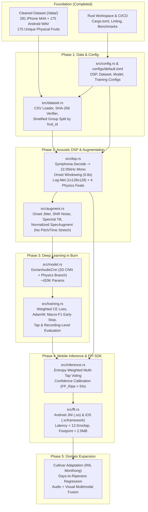

# DurianSonic - Master Engineering Roadmap

**Version:** 2.0
**Last Updated:** November 24, 2026
**Reference Specification:** [docs/TECHNICAL_DESIGN.md](docs/TECHNICAL_DESIGN.md)
**Target Architecture:** Pure-Rust End-to-End Acoustic DSP, Deep Learning (`burn`), and Cross-Platform Mobile SDK

---

## 1. Overview & Vision

**DurianSonic** xây dựng hệ thống phân loại độ chín trái sầu riêng không xâm lấn (`Unripe`, `Ripe`, `Overripe`) dựa trên tín hiệu âm thanh phản hồi khi gõ vào vỏ trái. Toàn bộ pipeline từ giải mã âm thanh, tách xung tiếng gõ (`0.8s`), trích xuất phổ `Log-Mel Spectrogram (1x128x128)` cùng 4 đặc trưng vật lý âm học, đến huấn luyện và suy luận mạng CNN đều được viết bằng **Rust** nhằm loại bỏ hoàn toàn sai lệch giữa môi trường huấn luyện và thiết bị di động (**Zero Training-Serving Skew**).

Tài liệu `RoadMap.md` này chia lộ trình phát triển thành **5 Phases** độc lập, có thứ tự phụ thuộc rõ ràng. **Mỗi Phase đều có một tài liệu hướng dẫn triển khai chi tiết (Implementation Guide) đi kèm trong thư mục [`docs/phases/`](docs/phases/)** để các thành viên trong Team có thể đọc hiểu kiến trúc, nắm rõ cấu trúc code, công thức toán/vật lý, các bước kiểm thử và bắt tay vào code ngay.

---

## 2. Documentation Index (Phase Implementation Guides)

| Phase       | Tên Giai Đoạn                                           | Trạng Thái     | Tài Liệu Hướng Dẫn Chi Tiết Cho Team                                                                 | Trọng Tâm Kỹ Thuật                                                                                                                            |
| ----------- | ------------------------------------------------------- | -------------- | ---------------------------------------------------------------------------------------------------- | --------------------------------------------------------------------------------------------------------------------------------------------- |
| **Phase 1** | **Data Pipeline, Config & Anti-Leakage Split**          | 🟡 In Progress | [`docs/phases/PHASE_1_DATA_AND_CONFIG.md`](docs/phases/PHASE_1_DATA_AND_CONFIG.md)                   | Mở rộng `src/config.rs`, viết `src/dataset.rs`, kiểm tra SHA-256 và chia Stratified Group Split theo `fruit_id (1..175)`                      |
| **Phase 2** | **Acoustic DSP, Onset Detection & Augmentation**        | ⚪ Planned     | [`docs/phases/PHASE_2_DSP_AND_AUGMENTATION.md`](docs/phases/PHASE_2_DSP_AND_AUGMENTATION.md)         | Viết `src/dsp.rs` & `src/augment.rs`: Giải mã WAV/M4A, Resample `22.05kHz`, cắt xung `0.8s`, tính Log-Mel `1x128x128` + 4 đặc trưng vật lý    |
| **Phase 3** | **Hybrid CNN Architecture & Burn Training Pipeline**    | ⚪ Planned     | [`docs/phases/PHASE_3_MODEL_AND_TRAINING.md`](docs/phases/PHASE_3_MODEL_AND_TRAINING.md)             | Viết `src/model.rs` & nâng cấp `src/training.rs`: Kiến trúc `DurianAudioCnn`, Weighted Cross-Entropy, Early Stopping theo Macro F1            |
| **Phase 4** | **Inference Engine, Multi-Tap Voting & Mobile FFI SDK** | ⚪ Planned     | [`docs/phases/PHASE_4_INFERENCE_AND_MOBILE_SDK.md`](docs/phases/PHASE_4_INFERENCE_AND_MOBILE_SDK.md) | Viết `src/inference.rs` & `src/ffi.rs`: Gộp nhiều cú gõ theo Entropy, hiệu chỉnh ngưỡng $\tau_{\text{ripe}}$, đóng gói `.so` / `.xcframework` |
| **Phase 5** | **Domain Expansion, Cultivar Adaptation & Multimodal**  | ⚪ Future R&D  | [`docs/phases/PHASE_5_DOMAIN_EXPANSION.md`](docs/phases/PHASE_5_DOMAIN_EXPANSION.md)                 | Mở rộng > 1,000 trái theo giống (Ri6, Monthong), dự đoán số ngày chín (Regression) và kết hợp ảnh chụp vỏ/cuống                               |

---

## 3. Master Architecture & Phase Dependency Graph



---

## 4. Current Baseline (Foundation Completed)

Trước khi bắt đầu Phase 1, dự án đã hoàn tất các hạng mục nền tảng sau:

- [x] **Chuẩn hóa Dataset (`/data/`):**
    - Tách biệt rõ `metadata_iphone.csv` (`281` bản thu `.m4a` duy nhất, đánh số liên tục `001–281`) và `metadata_android.csv` (`175` bản thu `.wav` duy nhất, đánh số liên tục `001–175`).
    - Loại bỏ toàn bộ `106` file `.wav` bị trùng mã băm nhị phân trên Android và khôi phục nhãn độ chín gốc (`IM_CA_UN_*`, `IM_CA_RI_*`, `IM_CC_OR_*`).
    - Chuẩn hóa cột khóa nhóm vật lý `fruit_id` (`1..175`) đồng nhất giữa hai nền tảng và xếp các bản thu đa giai đoạn (`Unripe -> Ripe -> Overripe`) của cùng một trái đứng liền kề nhau.
- [x] **Khởi tạo Rust Toolchain & Dependencies (`Cargo.toml`):**
    - Tích hợp đầy đủ các crate cốt lõi: `symphonia` (`0.6.1`), `rubato` (`5.1.0`), `realfft` (`3.5.1`), `ndarray` (`0.17.2`), `burn` (`0.22.1`), `clap` (`4.6.9`), `serde`, `toml`, `csv`, `sha2`.
    - Thiết lập sẵn hệ thống CI/CD, Git Hooks, `rustfmt`, `clippy`, `markdownlint` và Criterion benchmarks.

---

## 5. Detailed Phase Breakdown & Milestones

### Phase 1: Data Pipeline, Config Expansion & Anti-Leakage Dataset Splitter

- **Tài liệu hướng dẫn triển khai:** [`docs/phases/PHASE_1_DATA_AND_CONFIG.md`](docs/phases/PHASE_1_DATA_AND_CONFIG.md)
- **Mục tiêu cốt lõi:** Xây dựng nền tảng cấu hình và bộ nạp dữ liệu an toàn tuyệt đối, đảm bảo không có file âm thanh lỗi/trùng lặp và không có bất kỳ trái sầu riêng (`fruit_id`) nào xuất hiện đồng thời ở cả tập Train và Val/Test.
- **Modules chịu trách nhiệm:** `src/config.rs`, `configs/default.toml`, `src/dataset.rs`, `src/main.rs`
- **Deliverables & Checklist:**
    - [ ] Mở rộng `src/config.rs` và `configs/default.toml` bao gồm 4 khối cấu hình: `[dsp]`, `[dataset]`, `[training]`, `[model]` kèm bộ kiểm tra hợp lệ (`validate()`).
    - [ ] Xây dựng `src/dataset.rs` để đọc `metadata_iphone.csv` (`281` dòng) và `metadata_android.csv` (`175` dòng).
    - [ ] Triển khai trình kiểm tra toàn vẹn dữ liệu (`verify_dataset_integrity`): đối chiếu sự tồn tại của file, khớp `file_size_bytes`, kiểm tra tính liên tục của `sample_num` và kiểm tra trùng lặp mã băm `SHA-256`.
    - [ ] Triển khai thuật toán **Stratified Group Split theo `fruit_id` (`1..175`)** theo tỷ lệ `70% Train (123 trái) / 15% Val (26 trái) / 15% Test (26 trái)`, giữ nguyên tỷ lệ phân bố 3 lớp (`Unripe`, `Ripe`, `Overripe`).
    - [ ] Cung cấp lệnh CLI `cargo run -- verify-dataset --data-dir data/` để kiểm tra tự động trong CI.
- **Tiêu chí nghiệm thu (Exit Criteria):**
    - 100% file âm thanh (`456` files) vượt qua bài kiểm tra kích thước byte và SHA-256.
    - Giao tập hợp `fruit_id` giữa Train, Val và Test bằng rỗng ($\text{Train} \cap \text{Val} = \emptyset$, $\text{Train} \cap \text{Test} = \emptyset$, $\text{Val} \cap \text{Test} = \emptyset$).

---

### Phase 2: Acoustic DSP, Impulse Onset Detection & Feature Extraction

- **Tài liệu hướng dẫn triển khai:** [`docs/phases/PHASE_2_DSP_AND_AUGMENTATION.md`](docs/phases/PHASE_2_DSP_AND_AUGMENTATION.md)
- **Mục tiêu cốt lõi:** Biến đổi bản thu thô dài ~30–50 giây thành danh sách các cửa sổ xung gõ chuẩn hóa dài `0.8s` (`17,640` mẫu tại `22,050 Hz`), trích xuất tensor `Log-Mel Spectrogram (1, 128, 128)` cùng vector `4 đặc trưng vật lý` và bộ tăng cường dữ liệu tuân thủ nguyên lý âm học.
- **Modules chịu trách nhiệm:** `src/dsp.rs`, `src/augment.rs`
- **Deliverables & Checklist:**
    - [ ] **Audio Decoder & Resampler (`src/dsp.rs`):** Giải mã cả `.wav` (PCM 16-bit Stereo 48kHz) và `.m4a` (AAC-LC) bằng `symphonia`, trộn kênh xuống Mono (trung bình cộng các kênh) và resample chất lượng cao về `22,050 Hz` bằng `rubato`.
    - [ ] **Impulse Onset Detector (`extract_tap_impulses`):** Tính đường bao năng lượng ngắn hạn RMS (cửa sổ `256` mẫu $\approx 11.6\text{ ms}$), phát hiện đỉnh cục bộ vượt ngưỡng `0.25 * max_rms` với khoảng cách tối thiểu `0.4s` giữa hai cú gõ, cắt cửa sổ `0.8s` (`-100ms` trước đỉnh đến `+700ms` sau đỉnh) và chuẩn hóa biên độ đỉnh `normalize_peak` về `[-1.0, 1.0]`.
    - [ ] **Log-Mel Spectrogram Generator (`compute_log_mel_spectrogram`):** Thực hiện STFT với cửa sổ Hann (`n_fft = 1024`, `hop_length = 128`), nhân ma trận Mel Filterbank (`128` dải tần từ `50 Hz` đến `8,000 Hz`), chuyển sang thang đo Log-dB (`top_db = 80.0`) và chuẩn hóa tuyến tính về `[0.0, 1.0]` với kích thước đúng `(128, 128)`.
    - [ ] **Acoustic Physics Features (`extract_physics_features`):** Trích xuất 4 chỉ số vật lý trên mỗi xung gõ: Peak Resonance Frequency ($f_{\text{peak}} \in [80, 1200]\text{ Hz}$), Spectral Centroid ($C_s$), Spectral Roll-off ($R_{85}$), và Temporal Decay Slope ($\beta_{\text{decay}}$ trong khoảng `50–400 ms` sau đỉnh).
    - [ ] **Physically Valid Data Augmentation (`src/augment.rs`):** Triển khai Onset Jitter ($\pm 40\text{ ms}$), Additive Noise ($\text{SNR} \in [15, 35]\text{ dB}$), Spectral Tilt ($\pm 3\text{ dB}$), và Normalized SpecAugment (gán giá trị nền `0.0`). Tuyệt đối không dùng Pitch Shift hay Time Stretch.
- **Tiêu chí nghiệm thu (Exit Criteria):**
    - Tách thành công trung bình `10–20` xung gõ hợp lệ từ mỗi file âm thanh ~31 giây (tạo ra ~3,370 xung từ tập iPhone và ~2,100 xung từ tập Android).
    - Mỗi xung gõ xuất ra tensor `Log-Mel` kích thước `(1, 128, 128)` có miền giá trị nằm hoàn toàn trong `[0.0, 1.0]` (không chứa `NaN` hay `Inf`) và vector vật lý `4` chiều đã chuẩn hóa.
    - Thời gian xử lý DSP cho 1 cú gõ `0.8s` đạt `< 4.0 ms` trên CPU đơn luồng.

---

### Phase 3: Hybrid CNN Architecture & Training Pipeline in Burn

- **Tài liệu hướng dẫn triển khai:** [`docs/phases/PHASE_3_MODEL_AND_TRAINING.md`](docs/phases/PHASE_3_MODEL_AND_TRAINING.md)
- **Mục tiêu cốt lõi:** Xây dựng và huấn luyện mô hình lai `DurianAudioCnn` kết hợp nhánh tích chập 2D trên phổ Log-Mel và nhánh tuyến tính trên 4 đặc trưng vật lý bằng framework `burn`, giải quyết triệt để bài toán mất cân bằng lớp.
- **Modules chịu trách nhiệm:** `src/model.rs`, `src/training.rs`, `src/main.rs`
- **Deliverables & Checklist:**
    - [ ] **Model Implementation (`src/model.rs`):** Hiện thực hóa kiến trúc `DurianAudioCnn<B: Backend>` (~420K tham số) gồm 4 khối tích chập (`1 -> 32 -> 64 -> 128 -> 256`) + `AdaptiveAvgPool2d([1, 1])` ghép nối (`Tensor::cat`) với nhánh `phys_proj` (`Linear 4 -> 16`), qua tầng `Dropout(0.3)` + `Linear(272 -> 64)` + `Linear(64 -> 3)`.
    - [ ] **Imbalance-Aware Loss & Sampler (`src/training.rs`):** Tích hợp hàm mất mát **Weighted Cross-Entropy** với trọng số nghịch đảo tần suất lớp ($w_{\text{Unripe}} \approx 0.548, w_{\text{Ripe}} \approx 1.419, w_{\text{Overripe}} \approx 2.129$) kèm Label Smoothing (`0.05`) và Onset-Jitter Oversampling cho hai lớp thiểu số `Ripe` và `Overripe`.
    - [ ] **Training Loop & Checkpointing:** Huấn luyện với bộ tối ưu `AdamW` (`lr = 3e-4`, `weight_decay = 1e-4`, `batch_size = 32`, `epochs = 80`), lưu checkpoint tốt nhất dựa trên **Validation Macro F1-Score** và dừng sớm (`early_stopping_patience = 12`).
    - [ ] **Tap-Level & Recording-Level Evaluator:** Đánh giá mô hình ở cả cấp độ từng cú gõ đơn lẻ và cấp độ cả trái sầu riêng (gộp tất cả các cú gõ trong cùng một file), xuất bảng Confusion Matrix và thống kê tỷ lệ lỗi nghiêm trọng `FP_R(1)` (`Unripe -> Ripe`) và `FP_R(2)` (`Overripe -> Ripe`).
    - [ ] **Dual-Model Platform Training (`iPhone` & `Android` Separate Models):** Huấn luyện **2 mô hình hoàn toàn độc lập** tương ứng với 2 tập dữ liệu riêng biệt:
        - `durian_iphone.mpk`: Huấn luyện độc quyền trên `metadata_iphone.csv` (`281` files `.m4a`, ~3,370 xung gõ) với bộ trọng số cân bằng lớp riêng của iPhone ($w = [0.548, 1.419, 2.129]$).
        - `durian_android.mpk`: Huấn luyện độc quyền trên `metadata_android.csv` (`175` files `.wav`, ~2,100 xung gõ) với bộ trọng số cân bằng lớp riêng của Android ($w = [0.614, 1.535, 1.389]$).
- **Tiêu chí nghiệm thu (Exit Criteria):**
    - **Recording-Level Macro F1-Score** trên tập Test độc lập của **cả 2 model (`durian_iphone.mpk` và `durian_android.mpk`)** đều đạt $\ge 0.85$.
    - **Balanced Accuracy** trên cả 2 tập Test iPhone và Android đạt $\ge 0.85$.
    - Kích thước mỗi file trọng số mô hình xuất ra đạt `< 2.0 MB` (FP32).

---

### Phase 4: Inference Engine, Multi-Tap Voting & Cross-Platform Mobile SDK

- **Tài liệu hướng dẫn triển khai:** [`docs/phases/PHASE_4_INFERENCE_AND_MOBILE_SDK.md`](docs/phases/PHASE_4_INFERENCE_AND_MOBILE_SDK.md)
- **Mục tiêu cốt lõi:** Đóng gói toàn bộ luồng DSP và suy luận CNN thành một hàm API duy nhất có khả năng nạp đúng trọng số mô hình của từng hệ điều hành (`durian_iphone.mpk` cho iOS, `durian_android.mpk` cho Android), gộp nhiều cú gõ theo trọng số Entropy, hiệu chỉnh ngưỡng an toàn kinh doanh và biên dịch chéo sang thư viện gốc.
- **Modules chịu trách nhiệm:** `src/inference.rs`, `src/ffi.rs`, `Makefile`
- **Deliverables & Checklist:**
    - [ ] **Platform-Specific Inference Engine (`src/inference.rs`):** Triển khai bộ nạp model theo nền tảng (`durian_iphone.mpk` hoặc `durian_android.mpk`) và hàm `classify_recorded_pcm(pcm_samples: &[f32], input_sample_rate: u32) -> Result<RipenessPrediction>`.
    - [ ] **Entropy-Weighted Multi-Tap Aggregation:** Tính trọng số tin cậy $\alpha_k = 1 - H(P_k)/\ln 3$ cho từng cú gõ thứ $k \in \{1, \dots, M\}$ để tự động loại bỏ ảnh hưởng của các cú gõ bị trượt tay hoặc dính tạp âm nền.
    - [ ] **Platform-Calibrated Decision Threshold:** Áp dụng ngưỡng quyết định an toàn được tinh chỉnh riêng cho từng model ($\tau_{\text{ripe}}^{\text{iOS}}$ và $\tau_{\text{ripe}}^{\text{Android}}$, mặc định `0.60`) cho lớp `Ripe`.
    - [ ] **Cross-Platform FFI Binding (`src/ffi.rs`):** Xuất giao diện C-ABI / `UniFFI` an toàn bộ nhớ, không rò rỉ con trỏ qua biên FFI.
    - [ ] **Dedicated Mobile Packaging Scripts:**
        - **Android SDK:** Biên dịch `libdurian_sonic.so` (`aarch64-linux-android`, `armv7-linux-androideabi`) đóng gói kèm **duy nhất** model `durian_android.mpk`.
        - **iOS SDK:** Biên dịch `DurianSonic.xcframework` (`aarch64-apple-ios`, `aarch64-apple-ios-sim`) đóng gói kèm **duy nhất** model `durian_iphone.mpk`.
- **Tiêu chí nghiệm thu (Exit Criteria):**
    - **Precision trên lớp `Ripe` đạt `> 90%`** và **False Positive Rate cho lớp `Ripe` đạt `< 5%`** sau khi hiệu chỉnh ngưỡng.
    - Tổng thời gian suy luận end-to-end cho 1 lần kiểm tra (5 cú gõ) đạt `< 100 ms` trên thiết bị di động (`< 12.5 ms / tap`).
    - Tổng dung lượng SDK biên dịch (DSP + Model Weights) đạt `< 2.5 MB` (FP32) hoặc `< 1.2 MB` (INT8/FP16).

---

### Phase 5: Domain Expansion, Cultivar Generalization & Multimodal Fusion

- **Tài liệu hướng dẫn triển khai:** [`docs/phases/PHASE_5_DOMAIN_EXPANSION.md`](docs/phases/PHASE_5_DOMAIN_EXPANSION.md)
- **Mục tiêu cốt lõi:** Mở rộng khả năng tổng quát hóa của hệ thống sang nhiều giống sầu riêng thương mại khác nhau, bổ sung đầu ra dự đoán số ngày chín còn lại và kết hợp đa phương thức (Âm thanh + Hình ảnh).
- **Modules dự kiến:** `src/cultivar.rs`, `src/multimodal.rs`
- **Deliverables & Checklist:**
    - [ ] Mở rộng dataset lên `> 1,000` trái sầu riêng vật lý, gắn nhãn chi tiết theo giống (`Ri6`, `Monthong`, `Musang King`, `Chuồng Bò`) và độ dày vỏ.
    - [ ] Bổ sung nhánh **Cultivar Embedding** vào `DurianAudioCnn` để điều chỉnh tần số cộng hưởng chuẩn theo từng giống sầu riêng.
    - [ ] Nâng cấp mô hình sang kiến trúc **Multi-Task Learning**: dự đoán đồng thời phân lớp độ chín (3 classes) và hồi quy số ngày còn lại cho đến khi chín hoàn toàn (`Days-to-Ripeness Regression Head`).
    - [ ] Nghiên cứu tích hợp **Multimodal Fusion**: kết hợp vector đặc trưng âm thanh tiếng gõ (`272-d`) với đặc trưng hình ảnh chụp gai/cuống sầu riêng từ camera điện thoại.

---

## 6. Target Repository Structure Across Phases

Khi hoàn thành toàn bộ các Phases trong Roadmap, cấu trúc thư mục của repository `DurianSonic` sẽ như sau:

```txt
DurianSonic/
├── Cargo.toml                                    # Rust dependencies (Symphonia, Rubato, RealFFT, Burn, etc.)
├── Makefile                                      # Lệnh build, test, train và cross-compile mobile SDK
├── RoadMap.md                                    # Tài liệu lộ trình tổng thể (file hiện tại)
├── configs/
│   ├── default.toml                              # Cấu hình chuẩn cho DSP, Dataset, Model, Training (Phase 1)
│   └── custom_experiment.toml                    # Cấu hình thử nghiệm hyperparameter (Phase 3)
├── data/
│   ├── README.md                                 # Quy chuẩn đánh số tuần tự và cấu trúc dataset
│   ├── metadata_android.csv                      # Metadata cho 175 bản thu Android (fruit_id 1..175)
│   ├── metadata_iphone.csv                       # Metadata cho 281 bản thu iPhone (fruit_id 1..175)
│   ├── sound_android/                            # 175 files WAV PCM 16-bit 48kHz
│   └── sound_iphone/                             # 281 files M4A AAC-LC
├── docs/
│   ├── TECHNICAL_DESIGN.md                       # Tài liệu thiết kế kỹ thuật gốc (Version 2.0)
│   └── phases/                                   # Hướng dẫn triển khai chi tiết từng Phase cho Team
│       ├── PHASE_1_DATA_AND_CONFIG.md            # Hướng dẫn triển khai Phase 1
│       ├── PHASE_2_DSP_AND_AUGMENTATION.md       # Hướng dẫn triển khai Phase 2
│       ├── PHASE_3_MODEL_AND_TRAINING.md         # Hướng dẫn triển khai Phase 3
│       ├── PHASE_4_INFERENCE_AND_MOBILE_SDK.md   # Hướng dẫn triển khai Phase 4
│       └── PHASE_5_DOMAIN_EXPANSION.md           # Hướng dẫn triển khai Phase 5
├── src/
│   ├── lib.rs                                    # Khai báo và kết nối toàn bộ modules của crate durian_sonic
│   ├── main.rs                                   # CLI entry point (verify-dataset, train, evaluate, predict)
│   ├── config.rs                                 # [Phase 1] Quản lý cấu hình TOML & Validation
│   ├── dataset.rs                                # [Phase 1] CSV Loader, SHA-256 Check, Stratified Group Split
│   ├── dsp.rs                                    # [Phase 2] Audio Decode, Resample, Onset Detection, Log-Mel, Physics
│   ├── augment.rs                                # [Phase 2] Onset Jitter, Noise Mix, Spectral Tilt, SpecAugment
│   ├── model.rs                                  # [Phase 3] Kiến trúc DurianAudioCnn trong Burn
│   ├── training.rs                               # [Phase 3] Training Loop, Weighted CE, Metrics, Checkpointing
│   ├── inference.rs                              # [Phase 4] On-device Pipeline, Multi-Tap Voting, Calibration
│   └── ffi.rs                                    # [Phase 4] Giao diện FFI / JNI / Swift cho iOS & Android
├── tests/                                        # Integration tests cho từng Phase
└── benches/
    └── training_benchmarks.rs                    # Criterion benchmarks cho DSP latency & CNN inference
```

---

## 7. Team Workflow & Quality Gates

Để đảm bảo chất lượng code và tính đồng nhất giữa các thành viên khi triển khai từng Phase:

1. **Đọc tài liệu Phase trước khi code:** Mỗi thành viên khi nhận task ở Phase nào cần đọc kỹ file `docs/phases/PHASE_X_*.md` tương ứng để nắm rõ signature hàm, kiểu dữ liệu, các hằng số vật lý và ràng buộc kỹ thuật.
2. **Tuân thủ nghiêm ngặt quy tắc Vật lý & Dữ liệu:**
    - Không bao giờ chia Train/Val/Test ngẫu nhiên ở cấp độ file hoặc cấp độ xung gõ; **bắt buộc chia theo `fruit_id` (`1..175`)**.
    - Không bao giờ sử dụng **Pitch Shifting** hoặc **Time Stretching** trong quá trình tăng cường dữ liệu.
3. **Kiểm tra tự động trước khi tạo Pull Request:**

    ```bash
    # 1. Định dạng code và kiểm tra linter
    cargo fmt --all -- --check
    cargo clippy --all-targets -- -D warnings

    # 2. Chạy toàn bộ unit tests & integration tests
    cargo test

    # 3. Xác thực tính toàn vẹn của dataset
    cargo run -- verify-dataset --data-dir data/
    ```
