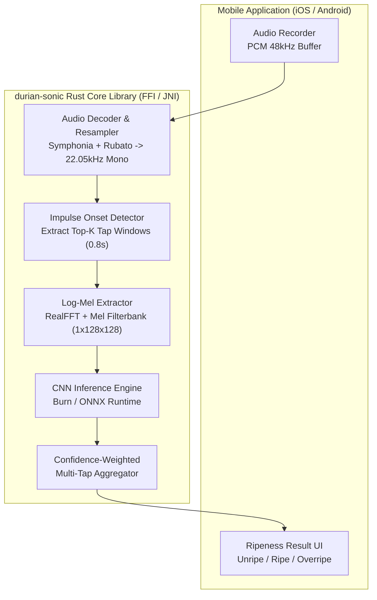
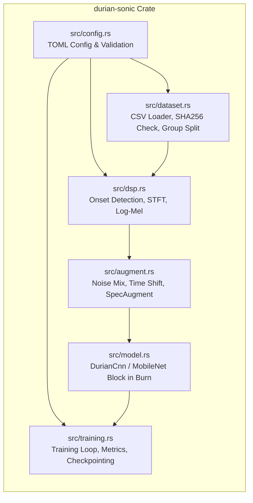
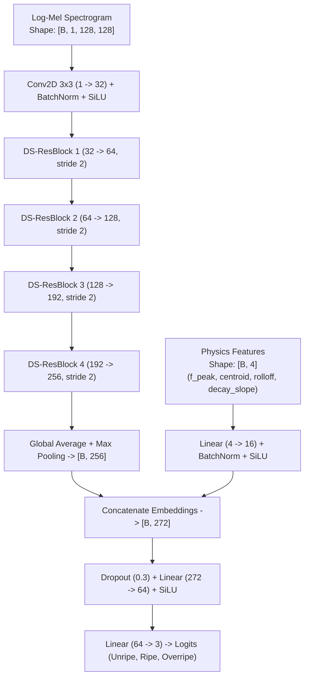

# DurianSonic - Technical Design Document

**Version:** 2.0
**Date:** November 24, 2026
**Author:** NQHxDev
**Status:** Active Development (Rust ML & DSP Pipeline)

---

## Table of Contents

1. [Executive Summary](#executive-summary)
2. [Problem Statement](#problem-statement)
3. [Dataset Description](#dataset-description)
4. [Technical Approach](#technical-approach)
5. [System Architecture](#system-architecture)
6. [Implementation Details](#implementation-details)
7. [Model Selection & Justification](#model-selection--justification)
8. [Training Pipeline](#training-pipeline)
9. [Deployment Strategy](#deployment-strategy)
10. [Performance Metrics](#performance-metrics)
11. [Challenges & Solutions](#challenges--solutions)
12. [Future Improvements](#future-improvements)
13. [References](#references)
14. [Appendix](#appendix)

---

## Executive Summary

**DurianSonic** là hệ thống phân loại độ chín của trái sầu riêng dựa trên âm thanh phản hồi khi gõ vào vỏ trái.
Hệ thống được xây dựng hoàn toàn bằng **Rust** từ khâu xử lý tín hiệu số (DSP), tách xung gõ (Onset Detection),
trích xuất phổ Log-Mel Spectrogram cho đến huấn luyện và suy luận mạng nơ-ron tích chập (CNN), giúp đảm bảo hiệu
năng cao, an toàn bộ nhớ và đồng nhất 100% logic giữa môi trường huấn luyện và thiết bị di động (iOS/Android).

### Key Features

- **Non-destructive testing:** Đánh giá độ chín không cần bổ trái.
- **Unified Rust Core (Zero Training-Serving Skew):** Cùng một thư viện Rust (`durian-sonic`) đảm nhiệm cả tiền xử
  lý âm thanh và suy luận trên Server/Desktop lẫn Mobile (qua C-FFI/UniFFI/JNI).
- **Impulse-Aware DSP Pipeline:** Tự động phát hiện và cắt từng cú gõ (transient impulses) từ bản thu dài 30–50 giây
  thay vì cắt cứng toàn bộ file.
- **Real-time On-Device Classification:** Tốc độ xử lý mỗi cú gõ dưới 30ms trên thiết bị di động, hỗ trợ tổng hợp
  nhiều cú gõ (Multi-tap Aggregation) để tăng độ tin cậy.

### Technology Stack

- **Core Language:** Rust (Edition 2021)
- **Deep Learning Framework (Rust):** `burn` (với backend `burn-wgpu` / `burn-tch` / `burn-ndarray`) & `ort` (ONNX)
- **Audio Decoding & Resampling:** `symphonia` (WAV PCM & M4A AAC decoding), `rubato` (high-quality resampling)
- **Audio DSP & Spectral Analysis:** `realfft` / `rustfft`, `ndarray`
- **Configuration & Serialization:** `serde`, `toml`, `csv`, `clap`
- **Mobile Integration:** Rust Cross-Compilation (`cargo-ndk` cho Android JNI, `cargo-swift` / `uniffi` cho iOS) và
  xuất mô hình chuẩn ONNX / CoreML / TFLite

---

## Problem Statement

### 1. Business Context

Việc xác định độ chín của sầu riêng truyền thống phụ thuộc vào:

- **Kinh nghiệm chủ quan** của thương lái hoặc người bán thông qua tiếng bộp khi gõ dao.
- **Phương pháp xâm lấn** (khui mổ thử tam giác trên vỏ), làm giảm giá trị thương phẩm nếu trái chưa chín.
- **Rủi ro sai sót cao** đối với người tiêu dùng cuối và chuỗi cung ứng xuất khẩu số lượng lớn.

### 2. Technical Problem

Phân loại tín hiệu âm thanh xung gõ (acoustic impulse response) trên vỏ sầu riêng thành 3 lớp độ chín:

| Class                   | Description                                         | Acoustic Characteristics                                              |
| ----------------------- | --------------------------------------------------- | --------------------------------------------------------------------- |
| **Unripe** (Chưa chín)  | Thịt quả cứng, vỏ căng, chưa ăn được                | Tần số cộng hưởng cao, âm đanh, thời gian ngân dài (low damping)      |
| **Ripe** (Chín vừa)     | Thịt mềm dẻo, có khoảng rỗng khí nhỏ giữa múi và vỏ | Tần số trung bình, phổ năng lượng cân bằng, tắt âm vừa phải           |
| **Overripe** (Quá chín) | Thịt nhũn, tách vỏ mạnh, có thể lên men             | Tần số cộng hưởng thấp (âm bộp trầm), tắt âm rất nhanh (high damping) |

### 3. Physical Principle

```txt
Độ cứng & cấu trúc khoang quả (Stiffness & Air Cavity) <-> Tần số cộng hưởng (f_r) & Hệ số tắt dần (ζ)

Chưa chín (Cứng)  -> Độ cứng đàn hồi cao, ít giảm chấn -> High f_r (400-900 Hz), Decay kéo dài
Chín vừa          -> Độ cứng giảm, xuất hiện đệm khí   -> Mid f_r (250-500 Hz), Decay trung bình
Quá chín (Mềm)    -> Mô thịt nhũn, hấp thụ sóng âm     -> Low f_r (100-300 Hz), Decay tắt nhanh (damped)
```

> **Hệ quả kỹ thuật quan trọng:** Vì cả **tần số cộng hưởng** lẫn **tốc độ tắt âm theo thời gian** đều là dấu hiệu vật
> lý trực tiếp quyết định nhãn độ chín, pipeline tiền xử lý và tăng cường dữ liệu (Data Augmentation) **tuyệt đối
> không được làm biến dạng trục tần số (không Pitch Shift) hoặc kéo giãn trục thời gian (không Time Stretch)**.

---

## Dataset Description

### 1. Data Organization

Dữ liệu được lưu trữ tại thư mục `/data/` với hai tập metadata độc lập đã được khử trùng lặp hoàn toàn, hiệu chỉnh nhãn
gốc và đánh số thứ tự liên tục:

```txt
data/
├── README.md                # Tài liệu mô tả quy chuẩn đánh số tuần tự và cấu trúc dataset
├── metadata_android.csv     # Metadata cho 175 bản thu Android duy nhất (001-175)
├── metadata_iphone.csv      # Metadata cho 281 bản thu iPhone duy nhất (001-281)
├── sound_android/           # 175 files định dạng WAV (PCM 16-bit, 48kHz, Stereo, 0 duplicates)
│   └── durian_{id}_{ripeness}_android.wav
└── sound_iphone/            # 281 files định dạng M4A (AAC compressed, 0 duplicates)
    └── durian_{id}_{ripeness}_iphone.m4a
```

### 2. Dataset Statistics

| Metric                     | iPhone Dataset                             | Android Dataset                            |
| -------------------------- | ------------------------------------------ | ------------------------------------------ |
| **Unique Physical Fruits** | 175 (`fruit_id`: `1` – `175`)              | 175 (`fruit_id`: `1` – `175`)              |
| **Total Unique Files**     | 281 (0 duplicate hashes)                   | 175 (0 duplicate hashes, deduplicated)     |
| **Sequential ID Range**    | `001` – `281` (liên tục, không ngắt quãng) | `001` – `175` (liên tục, không ngắt quãng) |
| **Format**                 | M4A (AAC-LC)                               | WAV (Uncompressed PCM 16-bit)              |
| **Total Size**             | ~342 MB                                    | ~1.02 GB                                   |
| **Avg File Size**          | ~1.2 MB                                    | ~5.8 MB                                    |
| **Raw Recording Duration** | ~28 – 51 seconds (median ~31s)             | ~28 – 51 seconds (median ~31s)             |
| **Content per File**       | Chuỗi 10–25 cú gõ liên tiếp quanh vỏ trái  | Chuỗi 10–25 cú gõ liên tiếp quanh vỏ trái  |
| **Native Sample Rate**     | 44.1 kHz / 48 kHz                          | 48.0 kHz (2 channels)                      |

### 3. Exact Class Distribution

Phân bố chính xác theo `metadata_iphone.csv` (281 bản thu) và `metadata_android.csv` (175 bản thu sau khi loại bỏ 106
bản sao bị ghi đè và khôi phục nhãn gốc từ `android_original`):

| Ripeness Class | iPhone Files (`001–281`) | iPhone %    | Est. iPhone Taps | Android Files (`001–175`) | Android %   | Est. Android Taps |
| -------------- | ------------------------ | ----------- | ---------------- | ------------------------- | ----------- | ----------------- |
| **Unripe**     | 171                      | 60.85%      | ~2,050 impulses  | 95                        | 54.29%      | ~1,140 impulses   |
| **Ripe**       | 66                       | 23.49%      | ~790 impulses    | 38                        | 21.71%      | ~455 impulses     |
| **Overripe**   | 44                       | 15.66%      | ~530 impulses    | 42                        | 24.00%      | ~505 impulses     |
| **Total**      | **281**                  | **100.00%** | **~3,370 taps**  | **175**                   | **100.00%** | **~2,100 taps**   |

### 4. Data Integrity & Sequential Fruit Grouping Rules

1. **Tách nhiều cú gõ từ bản thu dài:** Mỗi file âm thanh dài trung bình ~31 giây chứa nhiều cú gõ. Ba giây đầu tiên
   của file thường chỉ chứa ~11% tổng năng lượng (tiếng cầm thiết bị hoặc khoảng lặng). Do đó, không được cắt cứng 3
   giây đầu mà phải quét toàn bộ file để tách từng cú gõ đơn lẻ (`0.8s`/xung).
2. **Đánh số tuần tự liền kề & Quản lý `fruit_id` (`1..175`):** Thay vì nhảy số rời rạc (như từ `008` nhảy lên `190`),
   các bản thu ở nhiều giai đoạn chín của cùng một trái sầu riêng vật lý trên iPhone được xếp **liền kề nhau theo đúng
   trình tự thời gian chín (`Unripe -> Ripe -> Overripe`)** và dịch tuần tự các mã phía sau lên (ví dụ: trái `fruit_id=7`
   gồm `durian_007_unripe_iphone.m4a` và `durian_008_ripe_iphone.m4a`; trái `fruit_id=8` gồm `009` và `010`). Cột
   `fruit_id` (`1..175`) trong cả 2 file CSV dùng làm khóa nhóm để chia tập Train/Val/Test không bị rò rỉ dữ liệu.
3. **Khử trùng lặp và khôi phục nhãn gốc trên Android:** Toàn bộ 106 file `.wav` bị trùng mã băm nhị phân trong gói dữ
   liệu thô đã được loại bỏ, giữ lại đúng **175 bản thu `.wav` duy nhất** và khôi phục chính xác nhãn độ chín thực tế từ
   tên file gốc (`IM_CA_UN_*`, `IM_CA_RI_*`, `IM_CC_OR_*`).

---

## Technical Approach

### 1. Processing Pipeline Overview


### 2. Why Onset Windowing + Log-Mel Spectrogram + CNN

1. **Onset-Centered Impulse Extraction:**
    - Tập trung hoàn toàn vào vùng tín hiệu mang thông tin vật lý (`-100ms` trước đỉnh gõ đến `+700ms` sau đỉnh gõ).
    - Loại bỏ tới > 80% khoảng lặng và tạp âm môi trường giữa các lần gõ trong bản thu 30 giây.
    - Nhân số lượng mẫu huấn luyện thực tế lên gấp ~12 lần một cách tự nhiên mà không cần biến đổi nhân tạo.
2. **High Time-Resolution Log-Mel Spectrogram:**
    - Với tín hiệu xung tắt nhanh, độ phân giải thời gian (time resolution) quan trọng không kém độ phân giải tần số.
    - Sử dụng cửa sổ STFT ngắn (`n_fft = 1024`, `hop_length = 128` tại `22,050 Hz`, tương đương bước nhảy `5.8 ms`) giúp
      bảo toàn đường cong tắt âm (decay envelope) trên từng dải tần Mel.
3. **Single-Channel Spectrogram Tensor `(1, 128, 128)`:**
    - Không nhân bản 3 kênh màu RGB `(224, 224, 3)` hay dùng phép nội suy ảnh `cv2.resize` gây biến dạng tỷ lệ
      thời gian – tần số.
    - Mạng CNN trong Rust nhận trực tiếp tensor 1 kênh `(1, 128, 128)` (128 dải tần Mel $\times$ 128 khung thời gian),
      giảm 67% băng thông bộ nhớ ở tầng tích chập đầu tiên.

### 3. Acoustic Representation Comparison

| Representation           | Dimension per Tap | Pros                                                        | Cons                                                |
| ------------------------ | ----------------- | ----------------------------------------------------------- | --------------------------------------------------- |
| **Raw Waveform (1D)**    | `1 x 17,640`      | Không mất thông tin pha                                     | Cần nhiều dữ liệu, nhạy cảm với lệch pha            |
| **Linear STFT**          | `1 x 513 x 128`   | Chi tiết đều mọi tần số                                     | Dư thừa ở dải tần cao (> 4 kHz)                     |
| **Log-Mel Spectrogram**  | `1 x 128 x 128`   | Tập trung tốt ở dải cộng hưởng 50–4000 Hz, tương phản dB rõ | Mất thông tin pha chi tiết                          |
| **Handcrafted Features** | `1 x 32`          | Nhẹ, giải thích vật lý trực tiếp                            | Khó nắm bắt cấu trúc 2D thời gian - tần số phức tạp |

**Thiết kế lựa chọn:** Sử dụng **Log-Mel Spectrogram `(1, 128, 128)`** làm đầu vào chính cho nhánh 2D CNN, kết hợp
tùy chọn với vector **4 đặc trưng vật lý tường minh** (Peak Resonance Frequency, Spectral Centroid, Spectral Roll-off,
Temporal Decay Slope) ở tầng phân loại cuối.

---

## System Architecture

### 1. High-Level On-Device & Training Architecture



### 2. Rust Workspace Module Architecture



---

## Implementation Details

### 1. Dependencies in `Cargo.toml`

Để triển khai trọn vẹn pipeline âm thanh và huấn luyện học sâu bằng Rust, cấu hình `Cargo.toml` được mở rộng như sau:

```toml
[dependencies]
# CLI & Config
clap = { version = "4.6.9", features = ["derive"] }
toml = "1.2.2"

# Data Handling & Serialization
serde = { version = "1.0.229", features = ["derive"] }
serde_json = "1.0.154"
csv = "1.4.0"

# Audio Decoding & DSP
symphonia = { version = "0.6.1", features = ["aac", "isomp4", "pcm", "wav"] }
rubato = "5.1.0"
realfft = "3.5.1"
ndarray = "0.17.2"
sha2 = "0.11.1"

# Deep Learning in Rust (Burn Framework)
burn = { version = "0.22.1", features = ["train", "wgpu", "ndarray", "autodiff", "metrics"] }

# Logging & Error Handling
tracing = "0.1.44"
tracing-subscriber = "0.3.23"
anyhow = "1.0.105"
thiserror = "2.0.21"
rand = "0.10.4"
```

### 2. Audio Decoding, Resampling & Onset Windowing (Rust)

Thay vì cắt 3 giây đầu tiên, module DSP giải mã toàn bộ file `.wav` hoặc `.m4a`, đưa về kênh đơn (mono) ở tần số lấy
mẫu `22,050 Hz`, sau đó tìm các đỉnh năng lượng xung gõ (onsets) để tách các cửa sổ `0.8 giây` (`17,640` mẫu):

```rust
use anyhow::{Context, Result};
use std::path::Path;

/// Cấu hình trích xuất xung tiếng gõ
#[derive(Debug, Clone)]
pub struct ImpulseConfig {
    pub target_sr: u32,        // 22_050 Hz
    pub window_sec: f32,       // 0.8 seconds (17,640 samples)
    pub pre_onset_sec: f32,    // 0.1 seconds before peak
    pub min_interval_sec: f32, // 0.4 seconds minimum gap between taps
    pub threshold_ratio: f32,  // Energy threshold relative to global peak
}

impl Default for ImpulseConfig {
    fn default() -> Self {
        Self {
            target_sr: 22_050,
            window_sec: 0.8,
            pre_onset_sec: 0.1,
            min_interval_sec: 0.4,
            threshold_ratio: 0.25,
        }
    }
}

/// Tách các cửa sổ tiếng gõ (0.8s) từ mảng âm thanh mono dài ~30s
pub fn extract_tap_impulses(samples: &[f32], cfg: &ImpulseConfig) -> Vec<Vec<f32>> {
    let win_len = (cfg.window_sec * cfg.target_sr as f32) as usize;
    let pre_len = (cfg.pre_onset_sec * cfg.target_sr as f32) as usize;
    let min_gap = (cfg.min_interval_sec * cfg.target_sr as f32) as usize;
    let env_frame = 256usize; // ~11.6ms RMS envelope window

    if samples.len() < win_len {
        let mut padded = samples.to_vec();
        padded.resize(win_len, 0.0);
        return vec![normalize_peak(&padded)];
    }

    // 1. Tính đường bao năng lượng ngắn hạn (Short-time RMS energy)
    let mut rms_env = Vec::with_capacity(samples.len() / env_frame);
    for chunk in samples.chunks(env_frame) {
        let mean_sq = chunk.iter().map(|&x| x * x).sum::<f32>() / chunk.len() as f32;
        rms_env.push(mean_sq.sqrt());
    }

    let max_rms = rms_env.iter().cloned().fold(0.0_f32, f32::max);
    let threshold = (max_rms * cfg.threshold_ratio).max(1e-4);

    // 2. Tìm các đỉnh cục bộ (Local peaks) vượt ngưỡng với khoảng cách tối thiểu min_gap
    let mut tap_windows = Vec::new();
    let mut last_onset_sample: Option<usize> = None;

    for i in 1..rms_env.len().saturating_sub(1) {
        let is_local_peak = rms_env[i] >= threshold
            && rms_env[i] >= rms_env[i - 1]
            && rms_env[i] > rms_env[i + 1];

        if is_local_peak {
            let center_sample = i * env_frame;
            if let Some(prev) = last_onset_sample {
                if center_sample.saturating_sub(prev) < min_gap {
                    continue;
                }
            }

            let start = center_sample.saturating_sub(pre_len);
            if start + win_len <= samples.len() {
                let slice = &samples[start..start + win_len];
                tap_windows.push(normalize_peak(slice));
                last_onset_sample = Some(center_sample);
            }
        }
    }

    tap_windows
}

/// Chuẩn hóa biên độ đỉnh về [-1.0, 1.0] với epsilon an toàn chống chia cho 0
pub fn normalize_peak(window: &[f32]) -> Vec<f32> {
    let peak = window
        .iter()
        .map(|&x| x.abs())
        .fold(0.0_f32, f32::max)
        .max(1e-8);
    window.iter().map(|&x| x / peak).collect()
}
```

### 3. Log-Mel Spectrogram Generation (Rust)

Hàm tính Log-Mel Spectrogram sử dụng thang đo dB chuẩn hóa trong dải động cố định `[-80.0 dB, 0.0 dB]`, sau đó ánh xạ
tuyến tính về `[0.0, 1.0]` với kích thước đầu ra `(128, 128)`:

```rust
use ndarray::Array2;
use realfft::RealFftPlanner;
use std::f32::consts::PI;

#[derive(Debug, Clone)]
pub struct SpectrogramConfig {
    pub sample_rate: u32, // 22_050 Hz
    pub n_fft: usize,     // 1024 samples (~46.4 ms)
    pub hop_length: usize,// 128 samples (~5.8 ms) -> ~128 frames for 0.8s window
    pub n_mels: usize,    // 128 bands
    pub fmin: f32,        // 50.0 Hz
    pub fmax: f32,        // 8000.0 Hz
    pub top_db: f32,      // 80.0 dB dynamic range
}

impl Default for SpectrogramConfig {
    fn default() -> Self {
        Self {
            sample_rate: 22_050,
            n_fft: 1024,
            hop_length: 128,
            n_mels: 128,
            fmin: 50.0,
            fmax: 8_000.0,
            top_db: 80.0,
        }
    }
}

/// Tính Log-Mel Spectrogram chuẩn hóa về miền [0.0, 1.0] kích thước (n_mels, n_frames)
pub fn compute_log_mel_spectrogram(
    audio: &[f32],
    cfg: &SpectrogramConfig,
    mel_basis: &Array2<f32>, // Shape: (n_mels, n_fft / 2 + 1)
) -> Array2<f32> {
    let mut planner = RealFftPlanner::<f32>::new();
    let r2c = planner.plan_fft_forward(cfg.n_fft);

    // Tạo cửa sổ Hann
    let hann: Vec<f32> = (0..cfg.n_fft)
        .map(|n| 0.5 * (1.0 - (2.0 * PI * n as f32 / cfg.n_fft as f32).cos()))
        .collect();

    let n_freqs = cfg.n_fft / 2 + 1;
    let target_frames = 128usize;
    let mut power_spec = Array2::<f32>::zeros((n_freqs, target_frames));

    let mut in_buf = r2c.make_input_vec();
    let mut out_buf = r2c.make_output_vec();

    for frame_idx in 0..target_frames {
        let start = frame_idx * cfg.hop_length;
        for i in 0..cfg.n_fft {
            let sample = audio.get(start + i).copied().unwrap_or(0.0);
            in_buf[i] = sample * hann[i];
        }

        let _ = r2c.process(&mut in_buf, &mut out_buf);
        for (freq_idx, c) in out_buf.iter().enumerate() {
            power_spec[[freq_idx, frame_idx]] = c.norm_sqr();
        }
    }

    // Nhân ma trận Mel filterbank: (n_mels, n_freqs) x (n_freqs, target_frames)
    let mel_spec = mel_basis.dot(&power_spec);

    // Chuyển sang thang đo Log-dB so với đỉnh cực đại (ref = max)
    let max_power = mel_spec.iter().cloned().fold(1e-10_f32, f32::max);
    let min_db = -cfg.top_db;

    mel_spec.mapv(|p| {
        let db = 10.0 * (p.max(1e-10) / max_power).log10();
        let clamped_db = db.clamp(min_db, 0.0);
        // Ánh xạ từ [-top_db, 0.0] về [0.0, 1.0]
        (clamped_db - min_db) / cfg.top_db
    })
}
```

### 4. Hyperparameters (`configs/default.toml`)

Cấu hình huấn luyện và DSP được quản lý tập trung qua file TOML, tương thích trực tiếp với module `src/config.rs`:

```toml
[dsp]
sample_rate = 22050
window_sec = 0.8
pre_onset_sec = 0.1
n_fft = 1024
hop_length = 128
n_mels = 128
fmin = 50.0
fmax = 8000.0
top_db = 80.0

[training]
epochs = 80
batch_size = 32
learning_rate = 0.0003
weight_decay = 0.0001
label_smoothing = 0.05
early_stopping_patience = 12
train_ratio = 0.70
val_ratio = 0.15
test_ratio = 0.15

[model]
architecture = "durian_resnet_small"
input_channels = 1
input_height = 128
input_width = 128
num_classes = 3
dropout = 0.3
hidden_layers = [128, 64]
activation = "relu"
```

---

## Model Selection & Justification

### 1. Why a Dedicated Lightweight Audio CNN in Rust

Với tập dữ liệu gốc gồm **281 bản thu (~3,370 xung gõ sau khi tách onset)**, việc sử dụng một mô hình thị giác
5–25 triệu tham số (như ResNet50 hoặc MobileNetV4 bản lớn nhận ảnh RGB `224x224x3`) vừa dư thừa tài nguyên tính toán,
vừa dễ dẫn tới hiện tượng học vẹt (overfitting) vào nhiễu nền của phòng thu.

Chúng ta thiết kế kiến trúc 2 tầng trong Rust với framework **Burn**:

| Architecture                       | Input Shape     | Parameters | Model Size (FP32 / INT8) | Mobile Latency (per tap) | Overfitting Risk on ~3.3k Taps |
| ---------------------------------- | --------------- | ---------- | ------------------------ | ------------------------ | ------------------------------ |
| **DurianAudioCNN-Small (Primary)** | `1 x 128 x 128` | ~420K      | ~1.7 MB / ~450 KB        | < 8 ms                   | Low                            |
| **MobileNetV3/V4-Small (1-Ch)**    | `1 x 128 x 128` | ~1.5M      | ~6.0 MB / ~1.6 MB        | ~15 ms                   | Moderate                       |
| **ResNet50 (ImageNet 3-Ch)**       | `3 x 224 x 224` | ~25.6M     | ~98 MB / ~25 MB          | > 180 ms                 | Very High                      |

**Khuyến nghị lựa chọn:** Sử dụng **DurianAudioCNN-Small** (kiến trúc Depthwise Separable Residual Blocks kết hợp với
4 đặc trưng vật lý âm học) làm mô hình chủ lực được huấn luyện từ đầu (hoặc pretrain trên ESC-50) trong Rust, và
**MobileNetV4-Conv-Small** (xuất qua ONNX) làm mô hình đối chiếu.

### 2. Hybrid Architecture (Spectrogram CNN + Acoustic Physics Features)



### 3. Model Definition in Rust (`burn`)

```rust
use burn::{
    nn::{
        conv::{Conv2d, Conv2dConfig},
        pool::{AdaptiveAvgPool2d, AdaptiveAvgPool2dConfig},
        BatchNorm, BatchNormConfig, Dropout, DropoutConfig, Linear, LinearConfig, Relu,
    },
    prelude::*,
};

#[derive(Module, Debug)]
pub struct ConvBlock<B: Backend> {
    conv: Conv2d<B>,
    norm: BatchNorm<B, 2>,
    activation: Relu,
}

impl<B: Backend> ConvBlock<B> {
    pub fn new(in_ch: usize, out_ch: usize, stride: usize, device: &B::Device) -> Self {
        let conv = Conv2dConfig::new([in_ch, out_ch], [3, 3])
            .with_stride([stride, stride])
            .with_padding(nn::PaddingConfig2d::Same)
            .init(device);
        let norm = BatchNormConfig::new(out_ch).init(device);
        Self {
            conv,
            norm,
            activation: Relu::new(),
        }
    }

    pub fn forward(&self, x: Tensor<B, 4>) -> Tensor<B, 4> {
        let x = self.conv.forward(x);
        let x = self.norm.forward(x);
        self.activation.forward(x)
    }
}

#[derive(Module, Debug)]
pub struct DurianAudioCnn<B: Backend> {
    block1: ConvBlock<B>,
    block2: ConvBlock<B>,
    block3: ConvBlock<B>,
    block4: ConvBlock<B>,
    pool: AdaptiveAvgPool2d,
    phys_proj: Linear<B>,
    dropout: Dropout,
    fc1: Linear<B>,
    fc_out: Linear<B>,
    activation: Relu,
}

impl<B: Backend> DurianAudioCnn<B> {
    pub fn new(num_classes: usize, dropout_rate: f64, device: &B::Device) -> Self {
        Self {
            block1: ConvBlock::new(1, 32, 2, device),
            block2: ConvBlock::new(32, 64, 2, device),
            block3: ConvBlock::new(64, 128, 2, device),
            block4: ConvBlock::new(128, 256, 2, device),
            pool: AdaptiveAvgPool2dConfig::new([1, 1]).init(),
            phys_proj: LinearConfig::new(4, 16).init(device),
            dropout: DropoutConfig::new(dropout_rate).init(),
            fc1: LinearConfig::new(256 + 16, 64).init(device),
            fc_out: LinearConfig::new(64, num_classes).init(device),
            activation: Relu::new(),
        }
    }

    /// Forward pass kết hợp tensor Log-Mel [B, 1, 128, 128] và đặc trưng vật lý [B, 4]
    pub fn forward(&self, mel_spec: Tensor<B, 4>, phys_feats: Tensor<B, 2>) -> Tensor<B, 2> {
        let [batch_size, _, _, _] = mel_spec.dims();
        let x = self.block1.forward(mel_spec);
        let x = self.block2.forward(x);
        let x = self.block3.forward(x);
        let x = self.block4.forward(x);
        let spec_emb = self.pool.forward(x).reshape([batch_size, 256]);

        let phys_emb = self.activation.forward(self.phys_proj.forward(phys_feats));
        let combined = Tensor::cat(vec![spec_emb, phys_emb], 1);

        let hidden = self.activation.forward(self.fc1.forward(self.dropout.forward(combined)));
        self.fc_out.forward(hidden)
    }
}
```

---

## Training Pipeline

### 1. Stratified Group Split Strategy (Anti-Leakage)

Mỗi bản thu gốc (`001–281` trên iPhone và `001–175` trên Android) sinh ra từ 10 đến 25 cửa sổ xung gõ (`0.8s`). Để ngăn
chặn rò rỉ dữ liệu (Data Leakage):

1. **Nguyên tắc Group Split theo `fruit_id` (`1..175`):** Việc chia Train (70%) / Validation (15%) / Test (15%) **bắt
   buộc thực hiện ở cấp độ trái sầu riêng (`fruit_id` từ `1` đến `175`) TRƯỚC KHI tách các xung gõ và TRƯỚC KHI chạy
   Data Augmentation**. Vì các file của cùng một trái đã được sắp xếp đứng liền kề nhau theo thứ tự tuần tự, việc chia
   theo `fruit_id` đảm bảo không có hai bản thu của cùng một trái sầu riêng nằm ở hai tập Train và Test khác nhau.

1. **Phân bổ mẫu theo từng lớp (iPhone 281 files / Android 175 files):**

    | Class        | iPhone Total | iPhone Train / Val / Test | Android Total | Android Train / Val / Test |
    | ------------ | ------------ | ------------------------- | ------------- | -------------------------- |
    | **Unripe**   | 171          | 120 / 25 / 26             | 95            | 67 / 14 / 14               |
    | **Ripe**     | 66           | 46 / 10 / 10              | 38            | 26 / 6 / 6                 |
    | **Overripe** | 44           | 31 / 6 / 7                | 42            | 30 / 6 / 6                 |
    | **Total**    | **281**      | **197 / 41 / 43**         | **175**       | **123 / 26 / 26**          |

1. **Dual-Model Platform Strategy (2 Mô Hình Độc Lập Cho iPhone và Android):**
    - Vì dữ liệu đã được tách thành 2 tập hoàn toàn riêng biệt (`sound_iphone/` với `281` file M4A và `sound_android/`
      với `175` file WAV), hệ thống **không gộp chung 2 tập để train 1 model**, mà huấn luyện **2 mô hình độc lập hoàn toàn**:
        - **`durian_iphone.mpk`:** Huấn luyện và đánh giá độc quyền trên `metadata_iphone.csv` (`197 Train / 41 Val / 43 Test`),
          tối ưu hóa sâu cho đáp tuyến tần số micro của iPhone và đặc tính giải mã AAC-LC (`.m4a`).
        - **`durian_android.mpk`:** Huấn luyện và đánh giá độc quyền trên `metadata_android.csv` (`123 Train / 26 Val / 26 Test`),
          tối ưu hóa sâu cho đáp tuyến tần số micro Android và định dạng PCM 16-bit không nén (`.wav`).

### 2. Physically Valid Data Augmentation (Rust)

Chỉ áp dụng các phép biến đổi **bảo toàn tần số cộng hưởng và hệ số tắt âm** và **chỉ chạy trên tập Train**:

- **ALLOWED Augmentations:**
    1. **Onset Jitter (Time Shifting):** Dịch ngẫu nhiên điểm bắt đầu cửa sổ cắt xung trong khoảng $\pm 40\text{ ms}$
       ($\pm 880$ mẫu).
    2. **Additive Background Noise:** Cộng nhiễu trắng hoặc nhiễu môi trường thực tế với tỷ số tín hiệu trên nhiễu
       $\text{SNR} \in [15, 35]\text{ dB}$ trước khi tính STFT.
    3. **Spectral Tilt / Microphone EQ Perturbation:** Nhân phổ tần số với độ dốc tuyến tính nhẹ ($\pm 3\text{ dB}$ trên
       toàn dải) để mô phỏng sự khác biệt giữa các micro điện thoại.
    4. **Normalized SpecAugment:** Che ngẫu nhiên 1 dải tần số (tối đa 12 bins) và 1 dải thời gian (tối đa 16 frames)
       trên ma trận Log-Mel đã chuẩn hóa `[0.0, 1.0]` bằng cách gán giá trị **mức nền `0.0`** (tương ứng với `-80 dB`,
       tuyệt đối không gán `0 dB` khi chưa chuẩn hóa).
- **FORBIDDEN Augmentations:**
    - **Không dùng Pitch Shifting:** Làm lệch tần số cộng hưởng $f_r$, gây sai lệch biên giới giữa _Unripe_, _Ripe_ và
      _Overripe_.
    - **Không dùng Time Stretching:** Làm sai lệch tốc độ suy giảm biên độ (damping decay).

```rust
use ndarray::Array2;
use rand::Rng;

/// SpecAugment an toàn trên ma trận Log-Mel đã chuẩn hóa về [0.0, 1.0]
/// Trong đó 0.0 tương ứng với mức sàn nhiễu (-80 dB) và 1.0 là đỉnh năng lượng (0 dB).
pub fn apply_spec_augment(
    mel_spec: &mut Array2<f32>,
    max_freq_mask: usize,
    max_time_mask: usize,
    noise_floor_val: f32, // 0.0 trên thang đã chuẩn hóa [0.0, 1.0]
) {
    let mut rng = rand::thread_rng();
    let (n_mels, n_frames) = mel_spec.dim();

    // 1. Frequency Masking
    let f_mask = rng.gen_range(0..=max_freq_mask.min(n_mels / 4));
    if f_mask > 0 {
        let f0 = rng.gen_range(0..(n_mels - f_mask));
        for f in f0..(f0 + f_mask) {
            for t in 0..n_frames {
                mel_spec[[f, t]] = noise_floor_val;
            }
        }
    }

    // 2. Time Masking
    let t_mask = rng.gen_range(0..=max_time_mask.min(n_frames / 4));
    if t_mask > 0 {
        let t0 = rng.gen_range(0..(n_frames - t_mask));
        for f in 0..n_mels {
            for t in t0..(t0 + t_mask) {
                mel_spec[[f, t]] = noise_floor_val;
            }
        }
    }
}
```

### 3. Class Imbalance Handling (Platform-Specific Weighted Cross-Entropy)

Do hai tập dữ liệu iPhone và Android được huấn luyện thành 2 mô hình riêng biệt và có phân bố lớp khác nhau, hàm mất
mát sử dụng trọng số lớp nghịch đảo tần suất xuất hiện được tính **riêng cho từng Model**:

$$
w_c = \frac{N_{\text{total}}}{K \cdot N_c}
$$

- **Model 1 — iPhone (`durian_iphone.mpk`, 281 files: `171 Unripe : 66 Ripe : 44 Overripe`):**
    - $w_{\text{Unripe}}^{\text{iPhone}} = \frac{281}{3 \times 171} \approx 0.548$
    - $w_{\text{Ripe}}^{\text{iPhone}} = \frac{281}{3 \times 66} \approx 1.419$
    - $w_{\text{Overripe}}^{\text{iPhone}} = \frac{281}{3 \times 44} \approx 2.129$
- **Model 2 — Android (`durian_android.mpk`, 175 files: `95 Unripe : 38 Ripe : 42 Overripe`):**
    - $w_{\text{Unripe}}^{\text{Android}} = \frac{175}{3 \times 95} \approx 0.614$
    - $w_{\text{Ripe}}^{\text{Android}} = \frac{175}{3 \times 38} \approx 1.535$
    - $w_{\text{Overripe}}^{\text{Android}} = \frac{175}{3 \times 42} \approx 1.389$

```rust
/// Tính trọng số cân bằng lớp (Inverse Class Frequency Weights)
pub fn compute_class_weights(class_counts: &[usize; 3]) -> [f32; 3] {
    let total: f32 = class_counts.iter().sum::<usize>() as f32;
    let num_classes = class_counts.len() as f32;

    [
        total / (num_classes * class_counts[0].max(1) as f32),
        total / (num_classes * class_counts[1].max(1) as f32),
        total / (num_classes * class_counts[2].max(1) as f32),
    ]
}
```

Kết hợp thêm **Oversampling ở mức Onset Window** đối với lớp `Ripe` và `Overripe` (cho phép lấy thêm các cửa sổ dịch
thời gian $\pm 25\text{ ms}$ quanh mỗi đỉnh gõ của lớp thiểu số trong tập Train) để cân bằng số lượng mẫu trong mỗi
mini-batch.

## Deployment Strategy

### 1. Native Rust Mobile Core (Recommended Architecture)

Ưu điểm lớn nhất của việc viết toàn bộ pipeline bằng Rust là **không cần viết lại code DSP trên Swift hay Kotlin**:

1. **Cross-Compile trực tiếp thư viện Rust (`durian-sonic`):**
    - **Android:** Biên dịch sang `libdurian_sonic.so` (`aarch64-linux-android`, `armv7-linux-androideabi`) thông qua
      `cargo-ndk`, giao tiếp với Kotlin qua JNI hoặc Mozilla `UniFFI`.
    - **iOS:** Biên dịch sang `DurianSonic.xcframework` (`aarch64-apple-ios`, `aarch64-apple-ios-sim`) thông qua
      `cargo-swift` / `UniFFI`.
2. **Giao diện hàm FFI duy nhất cho Mobile App:**

```rust
#[derive(Debug, Clone, serde::Serialize)]
pub struct RipenessPrediction {
    pub predicted_class: String,      // "Unripe" | "Ripe" | "Overripe"
    pub probabilities: [f32; 3],      // [P(Unripe), P(Ripe), P(Overripe)]
    pub detected_taps_count: usize,   // Số cú gõ hợp lệ phát hiện được
    pub confidence_score: f32,        // Độ tự tin tổng hợp [0.0, 1.0]
}

/// Điểm vào duy nhất gọi từ iOS (Swift) hoặc Android (Kotlin)
pub fn classify_recorded_pcm(
    pcm_samples: &[f32],
    input_sample_rate: u32,
) -> anyhow::Result<RipenessPrediction> {
    // 1. Resample về 22,050 Hz nếu cần
    // 2. Chạy extract_tap_impulses() để lấy danh sách N cú gõ (0.8s/cú)
    // 3. Với mỗi cú gõ, tính Log-Mel (1x128x128) + 4 đặc trưng vật lý
    // 4. Suy luận qua DurianAudioCnn và lấy trung bình có trọng số theo năng lượng xung
    todo!("Implemented in src/inference.rs")
}
```

### 2. Multi-Tap Aggregation Logic

Khi người dùng gõ 3–5 lần vào vỏ trái sầu riêng trong một lần kiểm tra (kéo dài 3–5 giây), hệ thống sẽ tính xác suất
cho từng cú gõ thứ $k \in \{1, \dots, M\}$ và tổng hợp theo độ tự tin (entropy-weighted voting):

$$
P_{\text{final}}(c) = \frac{\sum_{k=1}^{M} \alpha_k \cdot P_k(c)}{\sum_{k=1}^{M} \alpha_k}, \quad
\alpha_k = 1 - \frac{H(P_k)}{\ln 3}
$$

Trong đó $H(P_k) = -\sum_{c} P_k(c) \ln P_k(c)$ là entropy của dự đoán ở cú gõ thứ $k$. Những cú gõ bị lẫn tạp âm có
phân phối xác suất phẳng (entropy cao) sẽ tự động được giảm trọng số $\alpha_k$.

### 3. Expected Artifact Sizes & Latencies

| Artifact Component         | FP32 Size   | INT8 / FP16 Size | Latency per Tap (iPhone 14) | Latency per Tap (Mid-range Android) |
| -------------------------- | ----------- | ---------------- | --------------------------- | ----------------------------------- |
| **Rust DSP + FFT Engine**  | ~650 KB     | ~650 KB          | ~2.5 ms                     | ~4.0 ms                             |
| **DurianAudioCNN Weights** | ~1.7 MB     | ~450 KB          | ~5.0 ms                     | ~8.5 ms                             |
| **Total SDK Footprint**    | **~2.4 MB** | **~1.1 MB**      | **~7.5 ms**                 | **~12.5 ms**                        |

---

## Performance Metrics

### 1. Model Evaluation Metrics

Vì tập dữ liệu mất cân bằng lớp, chỉ số **Overall Accuracy** không phản ánh đầy đủ chất lượng mô hình (một mô hình đoán
toàn bộ là _Unripe_ đã đạt 60.9% accuracy). Hệ thống sử dụng các chỉ số đánh giá chính ở cả **cấp độ từng cú gõ
(Tap-level)** và **cấp độ cả trái/bản thu (Recording-level sau khi gộp nhiều cú gõ)**:

- **Macro F1-Score (Primary Metric):** Trung bình điều hòa F1 của cả 3 lớp với trọng số ngang nhau (Target: $\ge 0.85$
  ở Recording-level).
- **Per-Class Recall & Precision:** Đặc biệt theo dõi Precision của lớp `Ripe` và Recall của lớp `Overripe`.
- **Balanced Accuracy:** Trung bình cộng Recall của 3 lớp (Target: $\ge 0.85$).

### 2. Business & Safety Metrics

| Metric                                 | Target   | Business Justification                                  |
| -------------------------------------- | -------- | ------------------------------------------------------- |
| **End-to-End Inference Time (5 taps)** | < 100 ms | Phản hồi tức thì ngay sau khi người dùng ngừng gõ       |
| **Compiled Mobile SDK Size**           | < 5 MB   | Nhẹ, không làm phình kích thước ứng dụng di động        |
| **Precision on `Ripe` Class**          | > 90%    | Đảm bảo khi báo "Chín vừa" thì trái thực sự ăn ngon     |
| **False Positive Rate for `Ripe`**     | < 5%     | Tối thiểu hóa rủi ro báo trái sống/hỏng thành trái chín |

### 3. Confusion Matrix & Error Criticality Analysis

```txt
                      Predicted Class
                 Unripe      Ripe       Overripe
Actual Class  +----------+-----------+-----------+
Unripe        |   TP_U   |  FP_R (1) |   E_UO    |
Ripe          |  FN_R(a) |   TP_R    |  FN_R (b) |
Overripe      |   E_OU   |  FP_R (2) |   TP_O    |
              +----------+-----------+-----------+
```

#### Các lỗi nghiêm trọng nhất cần triệt tiêu (Critical Errors - Cột `Predicted = Ripe`)

- **`FP_R (1)` (`Actual = Unripe` -> `Predicted = Ripe`):** Người mua bổ trái sầu riêng khi còn sống cứng, gây thiệt
  hại kinh tế hoàn toàn cho trái đó.
- **`FP_R (2)` (`Actual = Overripe` -> `Predicted = Ripe`):** Người dùng mua phải trái đã nhũn hoặc lên men.

#### Các lỗi ít nghiêm trọng hơn (Conservative Errors - Hàng `Actual = Ripe`)

- **`FN_R (a)` (`Actual = Ripe` -> `Predicted = Unripe`):** Người dùng để chờ thêm nửa ngày đến 1 ngày rồi kiểm tra lại.
- **`FN_R (b)` (`Actual = Ripe` -> `Predicted = Overripe`):** Người bán ưu tiên tiêu thụ ngay hoặc làm bánh/kem.

> **Decision Threshold Calibration:** Trong bước hậu xử lý (`Confidence Thresholding`), mô hình chỉ kết luận là `Ripe`
> khi $P(\text{Ripe}) \ge \tau_{\text{ripe}}$ (ví dụ $\tau_{\text{ripe}} = 0.60$). Nếu xác suất thấp hơn ngưỡng này,
> ứng dụng yêu cầu người dùng gõ lại thêm 3 nhịp ở vị trí múi khác.

---

## Challenges & Solutions

### 1. Long Multi-Tap Recordings vs Short Transient Impulses

- **Thách thức:** File gốc dài 28–51 giây, chứa nhiều khoảng lặng và tạp âm cầm nắm ở đầu/cuối file.
- **Giải pháp:** Áp dụng bộ phát hiện đỉnh năng lượng `extract_tap_impulses()` để tự động cắt từng cú gõ `0.8s`, vừa
  loại bỏ nhiễu khoảng lặng vừa tăng số mẫu từ 281 files lên ~3,370 xung gõ.

### 2. Class Imbalance (60.9% Unripe vs 15.7% Overripe)

- **Thách thức:** Mô hình dễ thiên lệch về lớp `Unripe`.
- **Giải pháp:** Kết hợp Weighted Cross-Entropy Loss ($w_{\text{Overripe}} \approx 2.13$), Onset-jitter Oversampling cho
  lớp thiểu số trong tập Train, và chọn **Macro F1-Score** làm tiêu chí lưu checkpoint tốt nhất (`EarlyStopping`).

### 3. Device & Format Heterogeneity (iPhone M4A vs Android WAV)

- **Thách thức:** Micro iPhone và các dòng máy Android có đáp tuyến tần số (frequency response) và bộ nén AAC/PCM khác
  nhau.
- **Giải pháp:** Chuẩn hóa về `22,050 Hz` mono, giới hạn băng thông phân tích trong vùng cộng hưởng vật lý
  `50 Hz – 8,000 Hz`, áp dụng **Spectral Tilt Augmentation** khi huấn luyện, và hỗ trợ nạp trọng số theo từng nền tảng.

### 4. Data Integrity & Potential Duplicate Recordings

- **Thách thức:** Quá trình thu thập và đổi tên file thủ công dễ dẫn đến việc hai file mang nhãn khác nhau nhưng chứa
  cùng nội dung âm thanh nhị phân, hoặc cùng một trái sầu riêng xuất hiện ở cả tập Train và Test.
- **Giải pháp:** Tích hợp bộ kiểm tra băm SHA-256 trong `src/dataset.rs` để loại bỏ các bản ghi trùng lặp nội dung
  trước khi chia tập dữ liệu, đồng thời chia split theo nhóm `sample_num` / `original_fruit_id`.

---

## Future Improvements

### Phase 1: Core Rust DSP & Training Pipeline (Current MVP)

- [x] Chuẩn hóa cấu trúc thư mục `/data/` và tách `metadata_android.csv`, `metadata_iphone.csv`
- [x] Khử 106 file `.wav` trùng trên Android, khôi phục nhãn gốc và đánh số tuần tự (`001–281` & `001–175`)
- [x] Khởi tạo khung dự án Rust (`Cargo.toml`, `src/config.rs`, `src/training.rs`, CI/CD & Benchmarks)
- [ ] Triển khai module `src/dsp.rs` (Symphonia decoding, Onset detection `0.8s`, STFT & Log-Mel `1x128x128`)
- [ ] Triển khai `DurianAudioCnn` bằng framework `burn` và huấn luyện với Stratified Group Split theo `fruit_id`

### Phase 2: Mobile SDK & Cross-Platform FFI

- [ ] Đóng gói thư viện FFI (`UniFFI` / `cargo-ndk` / `cargo-swift`) cho iOS và Android
- [ ] Tích hợp thuật toán **Multi-Tap Aggregation** (gộp 3–5 cú gõ theo trọng số entropy)
- [ ] Hiệu chỉnh ngưỡng quyết định (Confidence Calibration) để giảm `FP_Ripe < 5%`
- [ ] Xây dựng giao diện mobile hiển thị dạng sóng và phản hồi chất lượng cú gõ theo thời gian thực

### Phase 3: Domain Expansion

- [ ] Mở rộng tập dữ liệu lên > 1,000 trái sầu riêng với thông tin giống cụ thể (Ri6, Monthong, Musang King)
- [ ] Dự đoán số ngày còn lại cho đến khi chín hoàn toàn (Regression head)
- [ ] Kết hợp hình ảnh gai/cuống sầu riêng với âm thanh gõ (Multimodal Fusion)

---

## References

1. Hershey et al. (2017) - _"CNN Architectures for Large-Scale Audio Classification"_, IEEE ICASSP.
2. Park et al. (2019) - _"SpecAugment: A Simple Data Augmentation Method for Automatic Speech Recognition"_,
   Interspeech.
3. Qin et al. (2024) - _"MobileNetV4: Universal Models for the Mobile Ecosystem"_, ECCV 2024.
4. Burn Deep Learning Framework in Rust - [burn.dev](https://burn.dev/)
5. Symphonia Pure-Rust Audio Decoding Library - [Symphonia GitHub](https://github.com/pdeljanov/Symphonia)

---

## Appendix

### A. Dataset Integrity Verification Command (Rust CLI)

Trước mỗi lần huấn luyện, chạy lệnh kiểm tra tính toàn vẹn của `metadata_android.csv` và `metadata_iphone.csv` để đảm
bảo không có file bị thiếu, lệch kích thước byte hoặc trùng mã băm SHA-256 giữa các nhãn khác nhau:

```bash
# Kiểm tra cấu hình, chạy unit tests và xác thực dataset
cargo test
cargo run -- --verify-dataset data/
```

### B. Physical Feature Extraction Formulas

Ngoài ma trận Log-Mel Spectrogram `(128, 128)`, 4 đặc trưng vật lý âm học được trích xuất từ mỗi cú gõ `0.8s`:

1. **Peak Resonance Frequency ($f_{\text{peak}}$):** Tần số có năng lượng trung bình lớn nhất trong vùng `80–1200 Hz`.
2. **Spectral Centroid ($C_s$):** Trọng tâm phổ năng lượng, đặc trưng cho độ đanh/sáng của tiếng gõ:

    $$
    C_s = \frac{\sum_{k} f_k \cdot |X(k)|}{\sum_{k} |X(k)|}
    $$

3. **Spectral Roll-off ($R_{85}$):** Tần số ngưỡng mà dưới đó tập trung 85% tổng năng lượng phổ.
4. **Temporal Decay Slope ($\beta_{\text{decay}}$):** Hệ số góc của đường hồi quy tuyến tính năng lượng theo thang dB
   trong khoảng `50 ms` đến `400 ms` sau đỉnh xung gõ (đặc trưng trực tiếp cho hệ số tắt dần $\zeta$).
