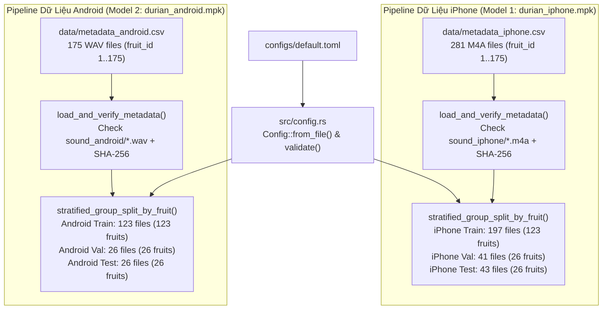

# Phase 1: Data Pipeline, Config Expansion & Anti-Leakage Dataset Splitter

**Phase ID:** Phase 1
**Status:** In Progress
**Prerequisites:** Cleaned `/data/` directory (`281` iPhone `.m4a` + `175` Android `.wav`) & Base `Cargo.toml`
**Target Files:** `configs/default.toml`, `src/config.rs`, `src/dataset.rs`, `src/lib.rs`, `src/main.rs`
**Parent Roadmap:** [`RoadMap.md`](../../RoadMap.md) | **Tech Spec:** [`docs/TECHNICAL_DESIGN.md`](../TECHNICAL_DESIGN.md)

---

## 1. Mục Tiêu Của Phase 1 (Objectives)

Phase 1 đặt nền móng dữ liệu và cấu hình cho toàn bộ hệ thống **DurianSonic**. Team cần hoàn thành 3 nhiệm vụ chính trong Phase này:

1. **Chuẩn hóa hệ thống cấu hình (`src/config.rs` & `configs/default.toml`):** Mở rộng cấu trúc `Config` hiện tại để quản lý tập trung toàn bộ tham số DSP (`sample_rate`, `window_sec`, `n_fft`, `hop_length`, `n_mels`, ...), tham số chia tập dữ liệu (`train_ratio`, `val_ratio`, `test_ratio`, `seed`), tham số kiến trúc mô hình và tham số huấn luyện.
2. **Xây dựng bộ nạp và kiểm định toàn vẹn dữ liệu (`src/dataset.rs`):** Đọc hai tệp `data/metadata_iphone.csv` (`281` bản ghi) và `data/metadata_android.csv` (`175` bản ghi), kiểm tra sự tồn tại của từng file âm thanh, đối chiếu dung lượng `file_size_bytes`, kiểm tra thứ tự `sample_num` liên tục không đứt quãng và băm `SHA-256` để đảm bảo **0% dữ liệu trùng lặp hoặc hư hỏng**.
3. **Triển khai thuật toán Stratified Group Split độc lập cho từng nền tảng (iPhone riêng, Android riêng) theo `fruit_id` (`1..175`):** Vì hệ thống huấn luyện **2 Model riêng biệt** (`durian_iphone.mpk` cho iOS và `durian_android.mpk` cho Android), bộ chia dữ liệu sẽ chia độc lập từng tập `metadata_iphone.csv` và `metadata_android.csv` thành `Train (70%) / Validation (15%) / Test (15%)` theo khóa nhóm `fruit_id` (`1..175`) trước khi tách xung gõ. Tuyệt đối ngăn chặn hiện tượng rò rỉ dữ liệu (Data Leakage) khi một trái sầu riêng được thu âm ở nhiều giai đoạn chín (`Unripe -> Ripe -> Overripe`).

---

## 2. Kiến Trúc Luồng Dữ Liệu Tách Biệt 2 Nền Tảng Trong Phase 1



---

## 3. Hướng Dẫn Triển Khai Chi Tiết Từng Module

### Bước 1: Cập nhật `configs/default.toml`

Hiện tại `configs/default.toml` mới chỉ có vài trường cơ bản. Team cần cập nhật file này lên cấu trúc đầy đủ như trong Thiết kế Kỹ thuật:

```toml
[dsp]
sample_rate = 22050
window_sec = 0.8
pre_onset_sec = 0.1
min_interval_sec = 0.4
threshold_ratio = 0.25
n_fft = 1024
hop_length = 128
n_mels = 128
fmin = 50.0
fmax = 8000.0
top_db = 80.0

[dataset]
data_dir = "data"
iphone_metadata = "data/metadata_iphone.csv"
android_metadata = "data/metadata_android.csv"
train_ratio = 0.70
val_ratio = 0.15
test_ratio = 0.15
split_seed = 42

[training]
epochs = 80
batch_size = 32
learning_rate = 0.0003
weight_decay = 0.0001
label_smoothing = 0.05
early_stopping_patience = 12

[model]
architecture = "durian_audio_cnn_small"
input_channels = 1
input_height = 128
input_width = 128
physics_features_dim = 4
num_classes = 3
dropout = 0.3
hidden_layers = [128, 64]
activation = "relu"
```

---

### Bước 2: Mở rộng `src/config.rs`

Mở rộng các struct trong `src/config.rs` (sử dụng `#[serde(default)]` để giữ tương thích ngược với các unit test cũ nếu file TOML rút gọn chỉ truyền `[training]` và `[model]`):

```rust
use serde::{Deserialize, Serialize};

#[derive(Debug, Clone, Serialize, Deserialize)]
pub struct Config {
    #[serde(default)]
    pub dsp: DspConfig,
    #[serde(default)]
    pub dataset: DatasetConfig,
    pub training: TrainingConfig,
    pub model: ModelConfig,
}

#[derive(Debug, Clone, Serialize, Deserialize)]
pub struct DspConfig {
    pub sample_rate: u32,
    pub window_sec: f32,
    pub pre_onset_sec: f32,
    pub min_interval_sec: f32,
    pub threshold_ratio: f32,
    pub n_fft: usize,
    pub hop_length: usize,
    pub n_mels: usize,
    pub fmin: f32,
    pub fmax: f32,
    pub top_db: f32,
}

impl Default for DspConfig {
    fn default() -> Self {
        Self {
            sample_rate: 22_050,
            window_sec: 0.8,
            pre_onset_sec: 0.1,
            min_interval_sec: 0.4,
            threshold_ratio: 0.25,
            n_fft: 1024,
            hop_length: 128,
            n_mels: 128,
            fmin: 50.0,
            fmax: 8_000.0,
            top_db: 80.0,
        }
    }
}

#[derive(Debug, Clone, Serialize, Deserialize)]
pub struct DatasetConfig {
    pub data_dir: String,
    pub iphone_metadata: String,
    pub android_metadata: String,
    pub train_ratio: f32,
    pub val_ratio: f32,
    pub test_ratio: f32,
    pub split_seed: u64,
}

impl Default for DatasetConfig {
    fn default() -> Self {
        Self {
            data_dir: "data".to_string(),
            iphone_metadata: "data/metadata_iphone.csv".to_string(),
            android_metadata: "data/metadata_android.csv".to_string(),
            train_ratio: 0.70,
            val_ratio: 0.15,
            test_ratio: 0.15,
            split_seed: 42,
        }
    }
}
```

**Các quy tắc kiểm tra cần bổ sung trong `Config::validate()`:**

- `dsp.sample_rate > 0`, `dsp.n_fft` là lũy thừa của 2 (ví dụ `512`, `1024`, `2048`), `dsp.hop_length > 0`.
- `dsp.fmin >= 0.0` và `dsp.fmax > dsp.fmin` và `dsp.fmax <= (dsp.sample_rate as f32) / 2.0` (định lý Nyquist).
- `(dataset.train_ratio + dataset.val_ratio + dataset.test_ratio - 1.0).abs() < 1e-4`.

---

### Bước 3: Xây dựng `src/dataset.rs` (Metadata Loader, Integrity Verifier & Anti-Leakage Splitter)

Tạo file mới `src/dataset.rs` và khai báo `pub mod dataset;` trong `src/lib.rs`.

#### 3.1. Định nghĩa kiểu dữ liệu và Nhãn độ chín (`RipenessLabel`)

```rust
use anyhow::{bail, Context, Result};
use csv::Reader;
use rand::{seq::SliceRandom, SeedableRng};
use rand::rngs::StdRng;
use serde::{Deserialize, Serialize};
use sha2::{Digest, Sha256};
use std::collections::{BTreeMap, HashMap, HashSet};
use std::fs::{self, File};
use std::io::Read;
use std::path::{Path, PathBuf};

/// Hai nền tảng mục tiêu độc lập (mỗi nền tảng huấn luyện ra 1 model riêng biệt)
#[derive(Debug, Clone, Copy, PartialEq, Eq, Serialize, Deserialize)]
pub enum PlatformTarget {
    Iphone,
    Android,
}

impl PlatformTarget {
    pub fn metadata_csv_path(self, data_dir: &Path) -> PathBuf {
        match self {
            Self::Iphone => data_dir.join("metadata_iphone.csv"),
            Self::Android => data_dir.join("metadata_android.csv"),
        }
    }

    pub fn audio_subdir(self, data_dir: &Path) -> PathBuf {
        match self {
            Self::Iphone => data_dir.join("sound_iphone"),
            Self::Android => data_dir.join("sound_android"),
        }
    }

    pub fn default_model_artifact_name(self) -> &'static str {
        match self {
            Self::Iphone => "durian_iphone",
            Self::Android => "durian_android",
        }
    }
}

/// 3 lớp độ chín chuẩn của hệ thống
#[derive(Debug, Clone, Copy, PartialEq, Eq, Hash, Serialize, Deserialize)]
pub enum RipenessLabel {
    Unripe = 0,
    Ripe = 1,
    Overripe = 2,
}

impl RipenessLabel {
    pub fn from_str_label(s: &str) -> Result<Self> {
        match s.trim().to_lowercase().as_str() {
            "unripe" => Ok(Self::Unripe),
            "ripe" => Ok(Self::Ripe),
            "overripe" => Ok(Self::Overripe),
            other => bail!("Unknown ripeness label: '{}'", other),
        }
    }

    pub fn as_index(self) -> usize {
        self as usize
    }

    pub fn as_str(self) -> &'static str {
        match self {
            Self::Unripe => "Unripe",
            Self::Ripe => "Ripe",
            Self::Overripe => "Overripe",
        }
    }
}

/// Cấu trúc ánh xạ 1-1 với từng dòng trong metadata_iphone.csv và metadata_android.csv
#[derive(Debug, Clone, Deserialize, Serialize)]
pub struct AudioMetadataRecord {
    pub sample_num: u32,
    pub fruit_id: u32,
    pub ripeness: String,
    pub filename: String,
    pub original_filename: String,
    pub file_size_bytes: u64,
    pub file_date: String,
}

impl AudioMetadataRecord {
    pub fn label(&self) -> Result<RipenessLabel> {
        RipenessLabel::from_str_label(&self.ripeness)
    }

    pub fn audio_path(&self, data_dir: &Path, audio_subdir: &str) -> PathBuf {
        data_dir.join(audio_subdir).join(&self.filename)
    }
}
```

#### 3.2. Kiểm tra tính toàn vẹn của Dataset (`verify_dataset_integrity`)

Hàm này được gọi trước mỗi lần huấn luyện hoặc qua CLI để đảm bảo:

1. Thứ tự `sample_num` liên tục từ `1..=N` không bị nhảy số.
2. `fruit_id` nằm trong miền `1..=175`.
3. File âm thanh thực tế tồn tại trong `data/sound_iphone/` hoặc `data/sound_android/`.
4. Kích thước byte thực tế trên ổ đĩa khớp tuyệt đối với cột `file_size_bytes`.
5. Không có bất kỳ 2 file nào trong cùng tập dữ liệu bị trùng mã băm `SHA-256`.

```rust
#[derive(Debug, Clone)]
pub struct IntegrityReport {
    pub total_files: usize,
    pub unique_fruits: usize,
    pub class_counts: [usize; 3], // [Unripe, Ripe, Overripe]
    pub total_bytes: u64,
}

pub fn load_and_verify_metadata(
    csv_path: &Path,
    audio_dir: &Path,
    verify_sha256: bool,
) -> Result<(Vec<AudioMetadataRecord>, IntegrityReport)> {
    let mut rdr = Reader::from_path(csv_path)
        .with_context(|| format!("Failed to open CSV: {}", csv_path.display()))?;

    let mut records = Vec::new();
    let mut seen_hashes: HashMap<String, String> = HashMap::new();
    let mut unique_fruits = HashSet::new();
    let mut class_counts = [0usize; 3];
    let mut total_bytes = 0u64;

    for (idx, result) in rdr.deserialize().enumerate() {
        let record: AudioMetadataRecord = result
            .with_context(|| format!("Invalid CSV row {} in {}", idx + 1, csv_path.display()))?;

        let expected_num = (idx + 1) as u32;
        if record.sample_num != expected_num {
            bail!(
                "Sequential numbering gap in {}: expected sample_num {}, got {}",
                csv_path.display(),
                expected_num,
                record.sample_num
            );
        }

        if !(1..=175).contains(&record.fruit_id) {
            bail!("Invalid fruit_id {} in {}", record.fruit_id, record.filename);
        }

        let label = record.label()?;
        class_counts[label.as_index()] += 1;
        unique_fruits.insert(record.fruit_id);

        let file_path = audio_dir.join(&record.filename);
        let meta = fs::metadata(&file_path)
            .with_context(|| format!("Missing audio file: {}", file_path.display()))?;

        if meta.len() != record.file_size_bytes {
            bail!(
                "Size mismatch for {}: CSV says {} bytes, disk has {} bytes",
                record.filename,
                record.file_size_bytes,
                meta.len()
            );
        }
        total_bytes += meta.len();

        if verify_sha256 {
            let hash = compute_file_sha256(&file_path)?;
            if let Some(existing_file) = seen_hashes.insert(hash, record.filename.clone()) {
                bail!(
                    "Duplicate SHA-256 binary content detected between {} and {}",
                    existing_file,
                    record.filename
                );
            }
        }

        records.push(record);
    }

    let report = IntegrityReport {
        total_files: records.len(),
        unique_fruits: unique_fruits.len(),
        class_counts,
        total_bytes,
    };

    Ok((records, report))
}

fn compute_file_sha256(path: &Path) -> Result<String> {
    let mut file = File::open(path)?;
    let mut hasher = Sha256::new();
    let mut buf = [0u8; 65536];
    loop {
        let n = file.read(&mut buf)?;
        if n == 0 {
            break;
        }
        hasher.update(&buf[..n]);
    }
    Ok(format!("{:x}", hasher.finalize()))
}
```

#### 3.3. Thuật toán Chia Tập Dữ Liệu Chống Rò Rỉ (`stratified_group_split_by_fruit`)

> [!IMPORTANT]
> **Quy tắc bất di bất dịch:** Trên tập iPhone (`281` bản thu từ `175` trái `fruit_id`), có nhiều trái được thu âm ở 2 hoặc 3 giai đoạn chín (ví dụ `fruit_id = 7` có `durian_007_unripe_iphone.m4a` và `durian_008_ripe_iphone.m4a`). Toàn bộ các bản thu có cùng `fruit_id` **phải được gom vào cùng một giỏ (Train, hoặc Val, hoặc Test)**.

Cách thực hiện Stratified Group Split chuẩn xác:

1. Gom nhóm tất cả các bản ghi theo `fruit_id` (`BTreeMap<u32, Vec<AudioMetadataRecord>>`).
2. Gán cho mỗi `fruit_id` một nhãn phân tầng đại diện (`stratum_label` - ưu tiên lớp hiếm nhất xuất hiện ở trái đó: `Overripe > Ripe > Unripe` để đảm bảo lớp thiểu số được phân bổ đều vào cả Train, Val và Test).
3. Trong từng nhóm `stratum_label`, xáo trộn danh sách `fruit_id` với `StdRng::seed_from_u64(seed)` cố định (`seed = 42`) để kết quả chia tập luôn tái lập được 100% (deterministic).
4. Chia danh sách `fruit_id` của từng tầng theo tỷ lệ `70% Train / 15% Val / 15% Test`, sau đó bung (`flatten`) các bản ghi âm thanh thuộc về mỗi `fruit_id` ra 3 tập tương ứng.

```rust
#[derive(Debug, Clone)]
pub struct DatasetSplits {
    pub train: Vec<AudioMetadataRecord>,
    pub val: Vec<AudioMetadataRecord>,
    pub test: Vec<AudioMetadataRecord>,
}

pub fn stratified_group_split_by_fruit(
    records: &[AudioMetadataRecord],
    train_ratio: f32,
    val_ratio: f32,
    seed: u64,
) -> Result<DatasetSplits> {
    // 1. Gom nhóm bản ghi theo fruit_id
    let mut fruit_groups: BTreeMap<u32, Vec<AudioMetadataRecord>> = BTreeMap::new();
    for rec in records {
        fruit_groups.entry(rec.fruit_id).or_default().push(rec.clone());
    }

    // 2. Phân tầng các fruit_id theo lớp hiếm nhất mà trái đó sở hữu (Overripe > Ripe > Unripe)
    let mut strata: [Vec<u32>; 3] = [Vec::new(), Vec::new(), Vec::new()];
    for (&fruit_id, group) in &fruit_groups {
        let mut priority_class = RipenessLabel::Unripe;
        for rec in group {
            let lbl = rec.label()?;
            if lbl as usize > priority_class as usize {
                priority_class = lbl;
            }
        }
        strata[priority_class.as_index()].push(fruit_id);
    }

    // 3. Chia từng tầng theo seed cố định
    let mut rng = StdRng::seed_from_u64(seed);
    let mut train_fruits = HashSet::new();
    let mut val_fruits = HashSet::new();
    let mut test_fruits = HashSet::new();

    for fruit_list in &mut strata {
        fruit_list.shuffle(&mut rng);
        let n = fruit_list.len();
        let n_train = ((n as f32) * train_ratio).round() as usize;
        let n_val = ((n as f32) * val_ratio).round() as usize;

        for (i, &fid) in fruit_list.iter().enumerate() {
            if i < n_train {
                train_fruits.insert(fid);
            } else if i < n_train + n_val {
                val_fruits.insert(fid);
            } else {
                test_fruits.insert(fid);
            }
        }
    }

    // 4. Đưa toàn bộ bản thu của mỗi fruit_id vào đúng tập
    let mut train = Vec::new();
    let mut val = Vec::new();
    let mut test = Vec::new();

    for rec in records {
        if train_fruits.contains(&rec.fruit_id) {
            train.push(rec.clone());
        } else if val_fruits.contains(&rec.fruit_id) {
            val.push(rec.clone());
        } else if test_fruits.contains(&rec.fruit_id) {
            test.push(rec.clone());
        }
    }

    Ok(DatasetSplits { train, val, test })
}
```

---

### Bước 4: Tích hợp CLI Command vào `src/main.rs`

Sử dụng `clap` (đã có trong `Cargo.toml`) để tạo lệnh kiểm tra dataset:

```bash
# Kiểm tra toàn bộ dataset (tồn tại file, kích thước byte, SHA-256 và thử chia Group Split)
cargo run -- verify-dataset --data-dir data/
```

Khi chạy lệnh trên, chương trình sẽ in ra bảng tóm tắt:

- **iPhone Dataset:** `281` files, `175` unique fruits, Class distribution (`171 Unripe, 66 Ripe, 44 Overripe`), `0` duplicate hashes.
- **Android Dataset:** `175` files, `175` unique fruits, Class distribution (`95 Unripe, 38 Ripe, 42 Overripe`), `0` duplicate hashes.
- **Group Split Check:** In số lượng `fruit_id` và số lượng files trong Train / Val / Test, đồng thời khẳng định `Overlap fruit_ids = 0`.

---

## 4. Kế Hoạch Kiểm Thử (Unit & Integration Tests)

Team cần bổ sung các unit tests sau vào `src/dataset.rs`:

1. `test_ripeness_label_parsing`: Kiểm tra chuyển đổi `"Unripe"`, `"Ripe"`, `"Overripe"` sang chỉ số `0, 1, 2` và tính trọng số lớp `compute_class_weights(&[171, 66, 44])`.
2. `test_zero_fruit_id_leakage_across_splits`: Tạo dữ liệu giả lập gồm nhiều bản thu có cùng `fruit_id`, chạy `stratified_group_split_by_fruit` và `assert!` rằng tập `fruit_id` của Train, Val, Test đôi một rời nhau hoàn toàn.
3. `test_deterministic_split_with_same_seed`: Chạy `stratified_group_split_by_fruit` 2 lần với cùng `seed = 42` phải cho ra danh sách file giống hệt nhau 100%.
4. `test_real_metadata_csv_loading`: Kiểm tra đọc trực tiếp `data/metadata_iphone.csv` (`281` dòng) và `data/metadata_android.csv` (`175` dòng).

---

## 5. Definition of Done (Tiêu Chí Hoàn Thành Phase 1)

- [ ] `configs/default.toml` và `src/config.rs` hỗ trợ đầy đủ `[dsp]`, `[dataset]`, `[training]`, `[model]` và pass toàn bộ unit tests.
- [ ] `src/dataset.rs` được triển khai hoàn chỉnh với `load_and_verify_metadata`, `stratified_group_split_by_fruit`, và `compute_class_weights`.
- [ ] Lệnh `cargo run -- verify-dataset --data-dir data/` chạy thành công với `0` lỗi trên cả tập iPhone (`281` files) và Android (`175` files).
- [ ] `cargo test` và `cargo clippy --all-targets -- -D warnings` pass 100%.
