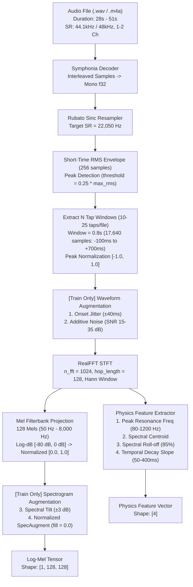

# Phase 2: Acoustic DSP, Impulse Onset Detection & Feature Extraction

**Phase ID:** Phase 2
**Status:** Planned
**Prerequisites:** [Phase 1 (`src/config.rs` & `src/dataset.rs`)](PHASE_1_DATA_AND_CONFIG.md)
**Target Files:** `src/dsp.rs`, `src/augment.rs`, `src/lib.rs`
**Parent Roadmap:** [`RoadMap.md`](../../RoadMap.md) | **Tech Spec:** [`docs/TECHNICAL_DESIGN.md`](../TECHNICAL_DESIGN.md)

---

## 1. Mục Tiêu Của Phase 2 (Objectives)

Trong Phase 2, Team sẽ hiện thực hóa trái tim xử lý tín hiệu số (DSP) của **DurianSonic** hoàn toàn bằng Rust. Mục tiêu là chuyển đổi một file ghi âm dài ~30–50 giây (định dạng `.m4a` của iPhone hoặc `.wav` của Android) thành tập hợp các mẫu đặc trưng chuẩn hóa sẵn sàng đưa vào mạng CNN:

1. **Giải mã & Chuẩn hóa tần số lấy mẫu (`decode_and_resample_mono`):** Giải mã `.wav` (PCM 16-bit, 48kHz Stereo) và `.m4a` (AAC-LC, 44.1/48kHz) bằng `symphonia`, trộn xuống kênh đơn (Mono) và lấy mẫu lại (resample) về đúng **`22,050 Hz`** bằng `rubato`.
2. **Tách xung tiếng gõ tự động (`extract_tap_impulses`):** Quét toàn bộ bản thu dài để tìm các đỉnh xung gõ (transient onsets) dựa trên đường bao năng lượng ngắn hạn RMS, cắt từng cửa sổ **`0.8 giây` (`17,640` mẫu: `-100ms` trước đỉnh đến `+700ms` sau đỉnh)** và chuẩn hóa biên độ đỉnh về `[-1.0, 1.0]`.
3. **Trích xuất phổ `Log-Mel Spectrogram (1, 128, 128)` (`compute_log_mel_spectrogram`):** Biến đổi STFT với độ phân giải thời gian cao (`n_fft = 1024`, `hop_length = 128` $\approx 5.8\text{ ms}$), chiếu qua bộ lọc `128` dải tần Mel (`50 Hz – 8,000 Hz`), chuyển sang thang Log-dB (`top_db = 80.0`) và ánh xạ tuyến tính về `[0.0, 1.0]`.
4. **Trích xuất 4 Đặc trưng Vật lý Âm học (`extract_physics_features`):** Tính trực tiếp Tần số cộng hưởng đỉnh ($f_{\text{peak}}$), Trọng tâm phổ ($C_s$), Tần số cắt năng lượng ($R_{85}$) và Độ dốc tắt âm theo thời gian ($\beta_{\text{decay}}$).
5. **Tăng cường dữ liệu bảo toàn vật lý (`src/augment.rs`):** Triển khai 4 phép biến đổi hợp lệ (Onset Jitter, Additive Noise, Spectral Tilt, Normalized SpecAugment) và **nghiêm cấm tuyệt đối Pitch Shift / Time Stretch**.

---

## 2. Sơ Đồ Luồng Xử Lý Tín Hiệu (DSP Pipeline Diagram)



---

## 3. Hướng Dẫn Triển Khai Chi Tiết (`src/dsp.rs`)

### Bước 1: Giải mã `.wav` / `.m4a` và Resample về `22,050 Hz` Mono

Sử dụng `symphonia` để đọc mọi container âm thanh (`.wav`, `.m4a`) và `rubato` để lấy mẫu lại về `22,050 Hz`:

```rust
use anyhow::{bail, Context, Result};
use rubato::{FftFixedIn, Resampler};
use std::fs::File;
use std::path::Path;
use symphonia::core::audio::SampleBuffer;
use symphonia::core::codecs::DecoderOptions;
use symphonia::core::formats::FormatOptions;
use symphonia::core::io::MediaSourceStream;
use symphonia::core::meta::MetadataOptions;
use symphonia::core::probe::Hint;

/// Giải mã file âm thanh (.wav hoặc .m4a), gộp về 1 kênh Mono và resample về target_sr (22,050 Hz)
pub fn decode_audio_to_mono(path: &Path, target_sr: u32) -> Result<Vec<f32>> {
    let file = File::open(path)
        .with_context(|| format!("Failed to open audio file: {}", path.display()))?;
    let mss = MediaSourceStream::new(Box::new(file), Default::default());

    let mut hint = Hint::new();
    if let Some(ext) = path.extension().and_then(|e| e.to_str()) {
        hint.with_extension(ext);
    }

    let probed = symphonia::default::get_probe()
        .format(&hint, mss, &FormatOptions::default(), &MetadataOptions::default())
        .with_context(|| format!("Unsupported audio format: {}", path.display()))?;

    let mut format = probed.format;
    let track = format
        .default_track()
        .context("No default audio track found")?;
    let track_id = track.id;
    let codec_params = track.codec_params.clone();

    let src_sr = codec_params
        .sample_rate
        .context("Missing sample rate in audio track")?;
    let channels = codec_params.channels.map(|c| c.count()).unwrap_or(1);

    let mut decoder = symphonia::default::get_codecs()
        .make(&codec_params, &DecoderOptions::default())
        .context("Failed to initialize audio codec decoder")?;

    let mut mono_samples: Vec<f32> = Vec::new();

    while let Ok(packet) = format.next_packet() {
        if packet.track_id() != track_id {
            continue;
        }
        let decoded = decoder.decode(&packet)?;
        let spec = *decoded.spec();
        let duration = decoded.capacity() as u64;

        let mut sample_buf = SampleBuffer::<f32>::new(duration, spec);
        sample_buf.copy_interleaved_ref(decoded);

        let samples = sample_buf.samples();
        if channels == 1 {
            mono_samples.extend_from_slice(samples);
        } else {
            for frame in samples.chunks_exact(channels) {
                let sum: f32 = frame.iter().sum();
                mono_samples.push(sum / (channels as f32));
            }
        }
    }

    if mono_samples.is_empty() {
        bail!("Decoded audio is empty: {}", path.display());
    }

    if src_sr == target_sr {
        return Ok(mono_samples);
    }

    resample_mono(&mono_samples, src_sr, target_sr)
}

/// Resample mảng âm thanh Mono từ src_sr về target_sr bằng Rubato
pub fn resample_mono(samples: &[f32], src_sr: u32, target_sr: u32) -> Result<Vec<f32>> {
    let chunk_size = 1024usize;
    let mut resampler = FftFixedIn::<f32>::new(
        src_sr as usize,
        target_sr as usize,
        chunk_size,
        2,
        1,
    )?;

    let mut output = Vec::with_capacity(
        ((samples.len() as f64) * (target_sr as f64 / src_sr as f64)) as usize + chunk_size,
    );

    for chunk in samples.chunks(chunk_size) {
        let mut input_block = chunk.to_vec();
        if input_block.len() < chunk_size {
            input_block.resize(chunk_size, 0.0);
        }
        let waves_out = resampler.process(&[input_block], None)?;
        output.extend_from_slice(&waves_out[0]);
    }

    let expected_len = ((samples.len() as f64) * (target_sr as f64) / (src_sr as f64)).round() as usize;
    output.truncate(expected_len);
    Ok(output)
}
```

---

### Bước 2: Phát hiện đỉnh xung gõ và cắt cửa sổ `0.8s` (`extract_tap_impulses`)

Triển khai đúng thuật toán trong Mục `Implementation Details -> 2. Audio Decoding, Resampling & Onset Windowing` của [`docs/TECHNICAL_DESIGN.md`](../TECHNICAL_DESIGN.md):

- **Tham số chuẩn (`ImpulseConfig`):**
    - `target_sr = 22_050` Hz
    - `window_sec = 0.8` giây $\rightarrow$ `win_len = 17_640` mẫu
    - `pre_onset_sec = 0.1` giây $\rightarrow$ `pre_len = 2_205` mẫu trước đỉnh xung để giữ trọn sườn lên (attack transient)
    - `min_interval_sec = 0.4` giây $\rightarrow$ `min_gap = 8_820` mẫu (chống bắt trùng sóng phản xạ của cùng 1 cú gõ)
    - `threshold_ratio = 0.25` (chỉ nhận các đỉnh có năng lượng RMS $\ge 25\%$ đỉnh lớn nhất toàn file và $\ge 10^{-4}$)
- **Lưu ý khi huấn luyện có Onset Jitter Augmentation:**
    - Ngoài hàm `extract_tap_impulses(samples, cfg) -> Vec<Vec<f32>>`, hãy viết thêm hàm trả về danh sách vị trí mẫu đỉnh `detect_onset_centers(samples, cfg) -> Vec<usize>` để ở tập Train ta có thể dịch điểm cắt ngẫu nhiên $\pm 40\text{ ms}$ ($\pm 880$ mẫu) quanh `center_sample` trước khi cắt cửa sổ `17,640` mẫu.

---

### Bước 3: Khởi tạo Ma trận Mel Filterbank & Tính `Log-Mel Spectrogram (128, 128)`

#### 3.1. Công thức tạo ma trận Mel Filterbank (`build_mel_filterbank`)

Sử dụng thang tần số Mel chuẩn Slaney / HTK từ `fmin = 50.0 Hz` đến `fmax = 8000.0 Hz` với `n_mels = 128` và `n_freqs = n_fft / 2 + 1 = 513`:

$$
m(f) = 2595 \cdot \log_{10}\left(1 + \frac{f}{700}\right), \quad f(m) = 700 \cdot \left(10^{m / 2595} - 1\right)
$$

```rust
use ndarray::Array2;

pub fn hz_to_mel(hz: f32) -> f32 {
    2595.0 * (1.0 + hz / 700.0).log10()
}

pub fn mel_to_hz(mel: f32) -> f32 {
    700.0 * (10.0_f32.powf(mel / 2595.0) - 1.0)
}

/// Tạo ma trận Mel Filterbank kích thước (n_mels, n_fft / 2 + 1)
pub fn build_mel_filterbank(
    sample_rate: u32,
    n_fft: usize,
    n_mels: usize,
    fmin: f32,
    fmax: f32,
) -> Array2<f32> {
    let n_freqs = n_fft / 2 + 1;
    let mel_min = hz_to_mel(fmin);
    let mel_max = hz_to_mel(fmax);

    // n_mels + 2 điểm chia đều trên trục Mel
    let mel_points: Vec<f32> = (0..(n_mels + 2))
        .map(|i| mel_min + (mel_max - mel_min) * (i as f32) / ((n_mels + 1) as f32))
        .collect();
    let hz_points: Vec<f32> = mel_points.iter().map(|&m| mel_to_hz(m)).collect();

    let fft_freqs: Vec<f32> = (0..n_freqs)
        .map(|i| (i as f32) * (sample_rate as f32) / (n_fft as f32))
        .collect();

    let mut weights = Array2::<f32>::zeros((n_mels, n_freqs));

    for m in 0..n_mels {
        let f_left = hz_points[m];
        let f_center = hz_points[m + 1];
        let f_right = hz_points[m + 2];

        for (k, &f) in fft_freqs.iter().enumerate() {
            if f >= f_left && f <= f_center && f_center > f_left {
                weights[[m, k]] = (f - f_left) / (f_center - f_left);
            } else if f > f_center && f <= f_right && f_right > f_center {
                weights[[m, k]] = (f_right - f) / (f_right - f_center);
            }
        }

        // Chuẩn hóa diện tích từng bộ lọc (Slaney area normalization)
        let enorm = 2.0 / (f_right - f_left).max(1e-8);
        for k in 0..n_freqs {
            weights[[m, k]] *= enorm;
        }
    }

    weights
}
```

#### 3.2. Tính `compute_log_mel_spectrogram`

Sử dụng hàm `compute_log_mel_spectrogram` đã định nghĩa trong [`docs/TECHNICAL_DESIGN.md`](../TECHNICAL_DESIGN.md#3-log-mel-spectrogram-generation-rust) (dòng `384–460`). Lưu ý khởi tạo `mel_basis` **một lần duy nhất** trong bộ trích xuất đặc trưng và tái sử dụng cho mọi xung gõ để tối ưu tốc độ.

---

### Bước 4: Trích xuất 4 Đặc trưng Vật lý Âm học (`extract_physics_features`)

Dựa theo Phụ lục B của `docs/TECHNICAL_DESIGN.md`, từ mỗi cửa sổ xung gõ `0.8s` (và ma trận phổ công suất STFT `power_spec` kích thước `(513, 128)`), trích xuất vector 4 chiều đã chuẩn hóa về thang `[0.0, 1.0]` để ghép vào nhánh tuyến tính của mạng `DurianAudioCnn`:

1. **Peak Resonance Frequency ($f_{\text{peak}}$):**
    - Tìm chỉ số tần số $k$ trong dải `80 Hz – 1,200 Hz` có năng lượng trung bình theo thời gian lớn nhất.
    - Chuẩn hóa: $\tilde{f}_{\text{peak}} = \text{clamp}\left(\frac{f_{\text{peak}} - 80.0}{1200.0 - 80.0}, 0.0, 1.0\right)$.
2. **Spectral Centroid ($C_s$):**
    - Tính trọng tâm phổ biên độ $|X(k)| = \sqrt{\text{power\_spec}(k)}$ trung bình trên 64 khung thời gian đầu tiên (vùng xung gõ chính):

        $$
        C_s = \frac{\sum_{k} f_k \cdot |X(k)|}{\sum_{k} |X(k)| + \epsilon}
        $$

    - Chuẩn hóa: $\tilde{C}_s = \text{clamp}\left(\frac{C_s}{4000.0}, 0.0, 1.0\right)$.
3. **Spectral Roll-off ($R_{85}$):**
    - Tìm tần số nhỏ nhất $f_K$ mà tổng năng lượng tích lũy từ `0 Hz` đến $f_K$ đạt $\ge 85\%$ tổng năng lượng toàn phổ.
    - Chuẩn hóa: $\tilde{R}_{85} = \text{clamp}\left(\frac{R_{85}}{6000.0}, 0.0, 1.0\right)$.
4. **Temporal Decay Slope ($\beta_{\text{decay}}$):**
    - Đo tốc độ tắt âm trong khoảng `50 ms` đến `400 ms` sau đỉnh xung gõ (tương ứng từ thời điểm `0.15s` đến `0.50s` trong cửa sổ `0.8s`, tức khung STFT thứ `26` đến `86`).
    - Tính tổng năng lượng theo thang dB ở từng khung thời gian $E_{\text{dB}}(t) = 10 \log_{10}(\sum_k P(k, t) + 10^{-10})$, sau đó tính hệ số góc hồi quy tuyến tính $\beta_{\text{decay}}$ (đơn vị: dB/frame, giá trị âm; trái quá chín tắt âm nhanh có $|\beta_{\text{decay}}|$ lớn, trái chưa chín ngân dài có $|\beta_{\text{decay}}|$ nhỏ).
    - Chuẩn hóa: $\tilde{\beta}_{\text{decay}} = \text{clamp}\left(\frac{-\beta_{\text{decay}}}{2.0}, 0.0, 1.0\right)$.

---

## 4. Hướng Dẫn Triển Khai `src/augment.rs` (Physically Valid Augmentation)

> [!CAUTION]
> **Cấm tuyệt đối Pitch Shifting và Time Stretching!**
> Trong bài toán phân loại độ chín sầu riêng bằng âm thanh gõ, tần số cộng hưởng $f_r$ (`Unripe: 400–900 Hz`, `Ripe: 250–500 Hz`, `Overripe: 100–300 Hz`) và tốc độ suy giảm biên độ $\zeta$ là hai biến vật lý trực tiếp quy định nhãn. Dùng Pitch Shift hay Time Stretch sẽ biến mẫu `Ripe` thành `Unripe` hoặc `Overripe`, làm hỏng hoàn toàn biên quyết định của mô hình.

Tạo file `src/augment.rs` chỉ chạy trên tập **Train** với 4 hàm sau:

1. **`apply_onset_jitter(full_samples: &[f32], center_sample: usize, max_jitter_samples: usize, cfg: &ImpulseConfig) -> Vec<f32>`**
    - Dịch ngẫu nhiên `center_sample` trong khoảng `[-\Delta, +\Delta]` với $\Delta = 880$ mẫu ($\pm 40\text{ ms}$ tại `22,050 Hz`), sau đó cắt cửa sổ `0.8s` và gọi `normalize_peak`.
2. **`add_background_noise(window: &[f32], min_snr_db: f32, max_snr_db: f32) -> Vec<f32>`**
    - Chọn ngẫu nhiên $\text{SNR}_{\text{dB}} \in [15.0, 35.0]$.
    - Tính công suất tín hiệu $P_{\text{sig}} = \frac{1}{N}\sum x_i^2$, suy ra độ lệch chuẩn nhiễu $\sigma_{\text{noise}} = \sqrt{P_{\text{sig}} \cdot 10^{-\text{SNR}_{\text{dB}} / 10}}$, cộng nhiễu trắng Gaussian/Uniform vào tín hiệu rồi chuẩn hóa lại đỉnh.
3. **`apply_spectral_tilt(mel_spec: &mut Array2<f32>, max_tilt_db: f32, top_db: f32)`**
    - Mô phỏng sự khác biệt đáp tuyến tần số giữa micro iPhone và các dòng máy Android bằng cách cộng một độ dốc tuyến tính nhẹ từ dải Mel `0` đến `127`: $\Delta_m = \frac{\text{tilt\_db}}{\text{top\_db}} \cdot \left(\frac{2m}{M - 1} - 1\right)$ với $\text{tilt\_db} \in [-3.0, +3.0]\text{ dB}$, sau đó `clamp(0.0, 1.0)`.
4. **`apply_spec_augment(mel_spec: &mut Array2<f32>, max_freq_mask: usize, max_time_mask: usize, noise_floor_val: f32)`**
    - Sử dụng nguyên mẫu code trong [`docs/TECHNICAL_DESIGN.md`](../TECHNICAL_DESIGN.md#2-physically-valid-data-augmentation-rust) (dòng `686–723`) với `max_freq_mask = 12`, `max_time_mask = 16`, và `noise_floor_val = 0.0` (tương ứng `-80 dB`).

---

## 5. Kế Hoạch Kiểm Thử (Unit & Integration Tests)

Team cần viết đầy đủ các unit tests sau trong `src/dsp.rs` và `src/augment.rs`:

1. `test_extract_tap_impulses_synthetic_train`: Tạo mảng tín hiệu giả lập dài `10s` (`220,500` mẫu) chứa 5 xung sin tắt dần cách nhau `1.5s`, kiểm tra `extract_tap_impulses` phát hiện đúng `5` cửa sổ, mỗi cửa sổ dài đúng `17,640` mẫu và có biên độ đỉnh bằng `1.0`.
2. `test_log_mel_spectrogram_shape_and_bounds`: Đưa một cửa sổ `17,640` mẫu vào `compute_log_mel_spectrogram`, kiểm tra output có `dim() == (128, 128)` và mọi phần tử $v \in [0.0, 1.0]$, không có `NaN`.
3. `test_physics_features_sine_wave_resonance`: Tạo hai tín hiệu sóng sin tắt dần:
    - Tín hiệu A mô phỏng trái **Unripe** ($f = 600\text{ Hz}$, tắt âm chậm): Kiểm tra $f_{\text{peak}}$ và $C_s$ cao hơn hẳn tín hiệu B.
    - Tín hiệu B mô phỏng trái **Overripe** ($f = 180\text{ Hz}$, tắt âm nhanh): Kiểm tra $f_{\text{peak}}$ thấp và độ dốc tắt âm $\tilde{\beta}_{\text{decay}}$ lớn hơn hẳn tín hiệu A.
4. `test_real_iphone_m4a_and_android_wav_decoding`: Giải mã thử 1 file `data/sound_iphone/durian_001_unripe_iphone.m4a` và 1 file `data/sound_android/durian_001_unripe_android.wav`, đảm bảo cả hai đều resample thành công về `22,050 Hz` và tách được `>= 5` cú gõ.

---

## 6. Definition of Done (Tiêu Chí Hoàn Thành Phase 2)

- [ ] `src/dsp.rs` giải mã mượt mà cả `.wav` lẫn `.m4a`, resample về `22,050 Hz` và tách được các cửa sổ xung gõ `0.8s`.
- [ ] Hàm `compute_log_mel_spectrogram` và `extract_physics_features` xuất ra đúng kích thước `(128, 128)` và `[f32; 4]` trong miền `[0.0, 1.0]`.
- [ ] `src/augment.rs` cài đặt đầy đủ 4 phép tăng cường dữ liệu hợp lệ vật lý và có unit test bảo vệ.
- [ ] Benchmark thời gian chạy DSP (`decode` + `onset` + `log-mel` + `physics`) đạt `< 4.0 ms` cho mỗi cú gõ `0.8s`.
