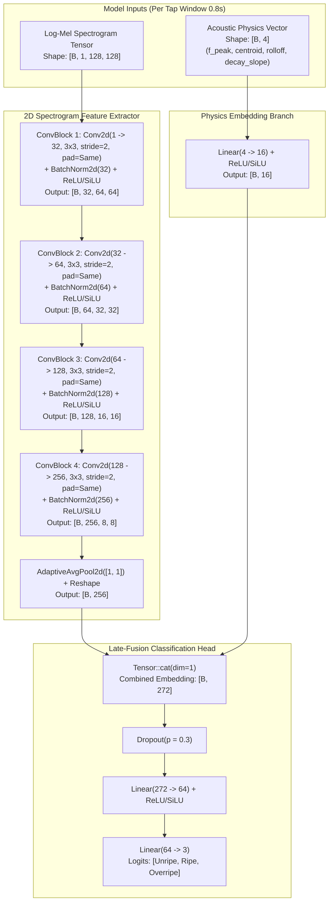

# Phase 3: Hybrid CNN Architecture & Training Pipeline in Burn

**Phase ID:** Phase 3
**Status:** Planned
**Prerequisites:** [Phase 1 (`src/dataset.rs`)](PHASE_1_DATA_AND_CONFIG.md) & [Phase 2 (`src/dsp.rs`, `src/augment.rs`)](PHASE_2_DSP_AND_AUGMENTATION.md)
**Target Files:** `src/model.rs`, `src/training.rs`, `src/main.rs`
**Parent Roadmap:** [`RoadMap.md`](../../RoadMap.md) | **Tech Spec:** [`docs/TECHNICAL_DESIGN.md`](../TECHNICAL_DESIGN.md)

---

## 1. Mục Tiêu Của Phase 3 (Objectives)

Trong Phase 3, Team sẽ xây dựng mạng nơ-ron tích chập lai **`DurianAudioCnn`** và toàn bộ quy trình huấn luyện, đánh giá, lưu trữ trọng số bằng framework học sâu **`burn` (`v0.22.1`)** trong Rust:

1. **Xây dựng kiến trúc lai `DurianAudioCnn` (`src/model.rs`):** Kết hợp nhánh tích chập 2D trên tensor `Log-Mel Spectrogram [B, 1, 128, 128]` (~420K tham số) với nhánh chiếu tuyến tính trên vector `4 đặc trưng vật lý [B, 4]` để xuất ra `3` logits (`Unripe`, `Ripe`, `Overripe`). Cùng một kiến trúc mạng `DurianAudioCnn` được dùng để huấn luyện **2 mô hình độc lập hoàn toàn**:
    - **`durian_iphone.mpk`:** Chuyên biệt cho hệ sinh thái iOS (huấn luyện từ `281` file `.m4a` trong `sound_iphone/`).
    - **`durian_android.mpk`:** Chuyên biệt cho hệ sinh thái Android (huấn luyện từ `175` file `.wav` trong `sound_android/`).
2. **Xử lý triệt để mất cân bằng lớp theo từng nền tảng (`src/training.rs`):** Vì phân bố lớp của tập iPhone (`171 : 66 : 44`) và tập Android (`95 : 38 : 42`) khác nhau, hệ thống tự động tính **Weighted Cross-Entropy Loss** với trọng số nghịch đảo tần suất lớp riêng cho từng nền tảng:
    - **iPhone Class Weights:** $w_{\text{Unripe}} \approx 0.548, \quad w_{\text{Ripe}} \approx 1.419, \quad w_{\text{Overripe}} \approx 2.129$ (lớp `Overripe` hiếm nhất).
    - **Android Class Weights:** $w_{\text{Unripe}} \approx 0.614, \quad w_{\text{Ripe}} \approx 1.535, \quad w_{\text{Overripe}} \approx 1.389$ (lớp `Ripe` hiếm nhất).
3. **Vòng lặp Huấn luyện & Early Stopping theo Macro F1-Score:** Sử dụng bộ tối ưu `AdamW` (`lr = 3e-4`, `weight_decay = 1e-4`), đánh giá trên tập Validation của từng nền tảng sau mỗi epoch ở cả cấp độ từng cú gõ (**Tap-level**) và cấp độ cả trái (**Recording-level**), lưu checkpoint tốt nhất dựa trên **Recording-level Macro F1-Score**.
4. **Phân tích Ma trận Nhầm lẫn & Kiểm soát Lỗi Nghiêm trọng:** Theo dõi sát hai lỗi tối kỵ `FP_R(1)` (`Actual = Unripe -> Predicted = Ripe`) và `FP_R(2)` (`Actual = Overripe -> Predicted = Ripe`) riêng trên tập Test iPhone (`43` files) và tập Test Android (`26` files).

---

## 2. Kiến Trúc Chi Tiết Mô Hình `DurianAudioCnn`



---

## 3. Hướng Dẫn Triển Khai Chi Tiết

### Bước 1: Hiện thực hóa `src/model.rs`

Tạo file `src/model.rs` và khai báo `pub mod model;` trong `src/lib.rs`. Sử dụng đúng định nghĩa `ConvBlock<B>` và `DurianAudioCnn<B>` trong [`docs/TECHNICAL_DESIGN.md`](../TECHNICAL_DESIGN.md#3-model-definition-in-rust-burn) (dòng `551–634`).

Ngoài ra, bổ sung hàm tiện ích `predict_proba` ngay trong `impl<B: Backend> DurianAudioCnn<B>` để dùng chung choทั้ง bước Validation và Inference ở Phase 4:

```rust
use burn::tensor::activation::softmax;

impl<B: Backend> DurianAudioCnn<B> {
    /// Trả về xác suất Softmax [B, 3] cho 3 lớp [Unripe, Ripe, Overripe]
    pub fn forward_proba(&self, mel_spec: Tensor<B, 4>, phys_feats: Tensor<B, 2>) -> Tensor<B, 2> {
        let logits = self.forward(mel_spec, phys_feats);
        softmax(logits, 1)
    }
}
```

---

### Bước 2: Xây dựng Batcher & Minority Oversampling (`src/training.rs`)

Mỗi bản thu gốc trong tập `Train`, `Val`, `Test` (đã được chia theo `fruit_id` ở Phase 1) được đưa qua bộ DSP của Phase 2 để tạo thành danh sách các mẫu xung gõ `TapSample`:

```rust
use crate::dataset::RipenessLabel;

/// Một mẫu xung gõ đơn lẻ (0.8s) đã trích xuất đặc trưng
#[derive(Debug, Clone)]
pub struct TapSample {
    pub fruit_id: u32,
    pub sample_num: u32,
    pub tap_index: usize,
    pub mel_data: Vec<f32>,      // Flattened 128 x 128 = 16,384 floats in [0.0, 1.0]
    pub physics_feats: [f32; 4], // [f_peak, centroid, rolloff, decay_slope] in [0.0, 1.0]
    pub label: RipenessLabel,
}
```

#### Chiến lược Onset-Window Minority Oversampling (Chỉ áp dụng trên tập Train)

Do tỷ lệ mất cân bằng lớp trên tập iPhone là `171 Unripe : 66 Ripe : 44 Overripe` (và trên Android là `95 : 38 : 42`), khi tạo danh sách `TapSample` cho **tập Train**:

- Với mỗi đỉnh xung gõ của lớp **`Unripe`**: Cắt `1` cửa sổ chuẩn tại `center_sample`.
- Với mỗi đỉnh xung gõ của lớp **`Ripe`**: Cắt `2` cửa sổ (1 cửa sổ chuẩn + 1 cửa sổ dịch ngẫu nhiên Onset Jitter $\pm 25\text{ ms}$ kèm nhiễu nền nhẹ).
- Với mỗi đỉnh xung gõ của lớp **`Overripe`**: Cắt `3` cửa sổ (1 cửa sổ chuẩn + 2 cửa sổ dịch Onset Jitter $[-25\text{ ms}, +25\text{ ms}]$ kèm Spectral Tilt nhẹ).
- Với tập **Validation** và **Test**: Chỉ cắt đúng `1` cửa sổ chuẩn tại từng đỉnh gõ, **tuyệt đối không oversample và không chạy augmentation**.

#### Chuyển đổi `Vec<TapSample>` sang Batch Tensor của `burn`

```rust
use burn::prelude::*;

#[derive(Clone, Debug)]
pub struct DurianBatch<B: Backend> {
    pub mel_specs: Tensor<B, 4>,  // [B, 1, 128, 128]
    pub phys_feats: Tensor<B, 2>, // [B, 4]
    pub targets: Tensor<B, 1, Int>, // [B]
}

pub fn collate_tap_batch<B: Backend>(
    samples: &[TapSample],
    device: &B::Device,
) -> DurianBatch<B> {
    let batch_size = samples.len();
    let mut mel_flat = Vec::with_capacity(batch_size * 128 * 128);
    let mut phys_flat = Vec::with_capacity(batch_size * 4);
    let mut labels = Vec::with_capacity(batch_size);

    for s in samples {
        mel_flat.extend_from_slice(&s.mel_data);
        phys_flat.extend_from_slice(&s.physics_feats);
        labels.push(s.label.as_index() as i64);
    }

    let mel_specs = Tensor::<B, 1>::from_floats(mel_flat.as_slice(), device)
        .reshape([batch_size, 1, 128, 128]);
    let phys_feats = Tensor::<B, 1>::from_floats(phys_flat.as_slice(), device)
        .reshape([batch_size, 4]);
    let targets = Tensor::<B, 1, Int>::from_ints(labels.as_slice(), device);

    DurianBatch {
        mel_specs,
        phys_feats,
        targets,
    }
}
```

---

### Bước 3: Hàm Mất Mát Weighted Cross-Entropy kèm Label Smoothing

Công thức hàm mất mát cho mẫu thứ $i$ có nhãn thực $y_i \in \{0, 1, 2\}$ với hệ số làm mượt nhãn $\epsilon = 0.05$ và trọng số lớp $w_c = \frac{N_{\text{total}}}{3 \cdot N_c}$:

$$
q_i(c) = (1 - \epsilon) \cdot \mathbb{I}(c = y_i) + \frac{\epsilon}{3}, \quad \mathcal{L}_i = - \sum_{c=0}^{2} w_c \cdot q_i(c) \cdot \ln P_i(c)
$$

```rust
use burn::prelude::*;
use burn::tensor::activation::log_softmax;

/// Tính Weighted Cross-Entropy Loss với Label Smoothing trên batch
pub fn weighted_cross_entropy_loss<B: Backend>(
    logits: Tensor<B, 2>,        // Shape: [B, 3]
    targets: &[usize],           // Độ dài B, giá trị trong {0, 1, 2}
    class_weights: &[f32; 3],    // [w_unripe, w_ripe, w_overripe]
    label_smoothing: f32,        // 0.05
    device: &B::Device,
) -> Tensor<B, 1> {
    let batch_size = targets.len();
    let num_classes = 3usize;
    let smooth_val = label_smoothing / (num_classes as f32);
    let on_val = (1.0 - label_smoothing) + smooth_val;

    // Tạo ma trận target đã nhân trọng số lớp: Shape [B, 3]
    let mut weighted_targets = vec![0.0_f32; batch_size * num_classes];
    for (row, &target_cls) in targets.iter().enumerate() {
        for c in 0..num_classes {
            let q = if c == target_cls { on_val } else { smooth_val };
            weighted_targets[row * num_classes + c] = q * class_weights[c];
        }
    }

    let target_tensor = Tensor::<B, 1>::from_floats(weighted_targets.as_slice(), device)
        .reshape([batch_size, num_classes]);

    let log_probs = log_softmax(logits, 1);
    let loss_per_sample = -(target_tensor * log_probs).sum_dim(1); // [B, 1]
    loss_per_sample.mean()
}
```

---

### Bước 4: Bộ Đánh Giá Chỉ Số (Macro F1, Balanced Accuracy & Confusion Matrix)

Trong `src/training.rs`, xây dựng cấu trúc `EvaluationMetrics` tính toán trực tiếp từ ma trận nhầm lẫn $3 \times 3$:

```rust
#[derive(Debug, Clone, Default)]
pub struct ConfusionMatrix3x3 {
    /// matrix[actual][predicted]
    pub counts: [[usize; 3]; 3],
}

#[derive(Debug, Clone)]
pub struct EvaluationReport {
    pub confusion: ConfusionMatrix3x3,
    pub per_class_precision: [f32; 3],
    pub per_class_recall: [f32; 3],
    pub per_class_f1: [f32; 3],
    pub macro_f1: f32,
    pub balanced_accuracy: f32,
    pub overall_accuracy: f32,
    pub critical_fp_ripe_rate: f32, // Tỷ lệ trái Unripe/Overripe bị đoán nhầm thành Ripe
}

impl ConfusionMatrix3x3 {
    pub fn record(&mut self, actual: usize, predicted: usize) {
        if actual < 3 && predicted < 3 {
            self.counts[actual][predicted] += 1;
        }
    }

    pub fn compute_report(&self) -> EvaluationReport {
        let mut precision = [0.0_f32; 3];
        let mut recall = [0.0_f32; 3];
        let mut f1 = [0.0_f32; 3];
        let mut total_correct = 0usize;
        let mut total_samples = 0usize;

        for c in 0..3 {
            let tp = self.counts[c][c] as f32;
            let row_sum: usize = self.counts[c].iter().sum();
            let col_sum: usize = (0..3).map(|r| self.counts[r][c]).sum();

            total_correct += self.counts[c][c];
            total_samples += row_sum;

            precision[c] = if col_sum > 0 { tp / (col_sum as f32) } else { 0.0 };
            recall[c] = if row_sum > 0 { tp / (row_sum as f32) } else { 0.0 };
            f1[c] = if precision[c] + recall[c] > 0.0 {
                2.0 * precision[c] * recall[c] / (precision[c] + recall[c])
            } else {
                0.0
            };
        }

        let macro_f1 = (f1[0] + f1[1] + f1[2]) / 3.0;
        let balanced_accuracy = (recall[0] + recall[1] + recall[2]) / 3.0;
        let overall_accuracy = if total_samples > 0 {
            (total_correct as f32) / (total_samples as f32)
        } else {
            0.0
        };

        // Lỗi nghiêm trọng: Actual là Unripe (0) hoặc Overripe (2) nhưng Predicted là Ripe (1)
        let fp_ripe = (self.counts[0][1] + self.counts[2][1]) as f32;
        let non_ripe_total = (self.counts[0].iter().sum::<usize>()
            + self.counts[2].iter().sum::<usize>()) as f32;
        let critical_fp_ripe_rate = if non_ripe_total > 0.0 {
            fp_ripe / non_ripe_total
        } else {
            0.0
        };

        EvaluationReport {
            confusion: self.clone(),
            per_class_precision: precision,
            per_class_recall: recall,
            per_class_f1: f1,
            macro_f1,
            balanced_accuracy,
            overall_accuracy,
            critical_fp_ripe_rate,
        }
    }
}
```

---

### Bước 5: Quy Trình Huấn Luyện 2 Mô Hình Độc Lập (`durian_iphone` & `durian_android`)

> [!IMPORTANT]
> **Tại sao tách riêng 2 Model và không gộp chung?**
>
> 1. **Đặc trưng phần cứng & Codec khác biệt hoàn toàn:** Tập iPhone được thu dưới định dạng nén `M4A (AAC-LC)` với đáp tuyến micro của Apple, trong khi tập Android là `WAV (Uncompressed PCM 16-bit 48kHz)` với đáp tuyến micro của thiết bị Android.
> 2. **Phân bố lớp khác nhau:** Trên tập iPhone, lớp `Overripe` ít nhất (`44/281 = 15.66%`), nhưng trên tập Android, lớp `Ripe` mới là lớp ít nhất (`38/175 = 21.71%`).
> 3. **Tối ưu tuyệt đối cho thiết bị đích:** Khi triển khai thực tế, app iOS chỉ chạy trên iPhone (nạp `durian_iphone.mpk`) và app Android chỉ chạy trên máy Android (nạp `durian_android.mpk`). Việc huấn luyện riêng 2 model trên 2 tập dữ liệu đã tách biệt giúp mỗi model hội tụ sâu nhất vào đặc tính âm học của đúng nền tảng đó mà không bị nhiễu chéo (cross-domain interference).

| Thông Số Huấn Luyện                | Model 1: iPhone (`durian_iphone.mpk`)          | Model 2: Android (`durian_android.mpk`)        |
| ---------------------------------- | ---------------------------------------------- | ---------------------------------------------- |
| **Nguồn Metadata**                 | `data/metadata_iphone.csv`                     | `data/metadata_android.csv`                    |
| **Thư mục Audio**                  | `data/sound_iphone/` (`281` files `.m4a`)      | `data/sound_android/` (`175` files `.wav`)     |
| **Phân hoạch Train / Val / Test**  | `197 / 41 / 43` files (`123 / 26 / 26` fruits) | `123 / 26 / 26` files (`123 / 26 / 26` fruits) |
| **Tổng số xung gõ ước tính**       | `~3,370` taps (`0.8s`/tap)                     | `~2,100` taps (`0.8s`/tap)                     |
| **Trọng số lớp $[w_U, w_R, w_O]$** | `[0.548, 1.419, 2.129]`                        | `[0.614, 1.535, 1.389]`                        |
| **Artifact đầu ra**                | `artifacts/durian_iphone.mpk`                  | `artifacts/durian_android.mpk`                 |

**Câu lệnh CLI để huấn luyện từng Model:**

```bash
# 1. Huấn luyện và đánh giá Model chuyên biệt cho iPhone (iOS)
cargo run --release -- train \
    --platform iphone \
    --config configs/default.toml \
    --output artifacts/durian_iphone

# 2. Huấn luyện và đánh giá Model chuyên biệt cho Android
cargo run --release -- train \
    --platform android \
    --config configs/default.toml \
    --output artifacts/durian_android
```

**Quy tắc Early Stopping & Lưu Trọng Số (`NamedMpkFileRecorder` trong `burn`) cho mỗi Model:**

- Sau mỗi epoch, tính **`val_recording_macro_f1`** (sau khi gộp xác suất các cú gõ thuộc cùng một `sample_num` trên tập Validation của nền tảng tương ứng).
- Nếu `val_recording_macro_f1 > best_macro_f1`:
    - Cập nhật `best_macro_f1 = val_recording_macro_f1`, reset `patience_counter = 0`.
    - Lưu trọng số mô hình ra `artifacts/durian_iphone.mpk` (hoặc `artifacts/durian_android.mpk`).
- Nếu không cải thiện sau `early_stopping_patience = 12` epochs liên tiếp, dừng huấn luyện và khôi phục checkpoint tốt nhất để chạy đánh giá cuối cùng trên tập **Test** của nền tảng đó.

---

## 4. Kế Hoạch Kiểm Thử (Unit & Integration Tests)

Team cần viết các bài test sau trong `src/model.rs` và `src/training.rs`:

1. `test_durian_audio_cnn_forward_shape`: Khởi tạo `DurianAudioCnn<NdArray>` với `batch_size = 4`, truyền tensor `mel_spec` kích thước `[4, 1, 128, 128]` và `phys_feats` kích thước `[4, 4]`, kiểm tra đầu ra có đúng shape `[4, 3]` và `forward_proba` có tổng mỗi hàng bằng `1.0` ($\pm 10^{-5}$).
2. `test_weighted_cross_entropy_loss_gradient_step`: Tạo một mini-batch giả lập gồm 6 mẫu (2 Unripe, 2 Ripe, 2 Overripe), chạy 5 bước cập nhật trọng số với `Autodiff<NdArray>` và `AdamW`, kiểm tra giá trị loss giảm dần qua từng bước (`loss_step_5 < loss_step_1`).
3. `test_confusion_matrix_and_macro_f1_calculation`: Kiểm tra `ConfusionMatrix3x3::compute_report()` tính chính xác `macro_f1`, `balanced_accuracy` và `critical_fp_ripe_rate` trên một ma trận $3 \times 3$ đã biết kết quả tay.

---

## 5. Definition of Done (Tiêu Chí Hoàn Thành Phase 3)

- [ ] `src/model.rs` hiện thực hóa hoàn chỉnh `DurianAudioCnn<B: Backend>` với đầy đủ nhánh tích chập 2D và nhánh đặc trưng vật lý.
- [ ] `src/training.rs` cài đặt đầy đủ Batcher, Weighted Cross-Entropy Loss, vòng lặp huấn luyện `burn`, Early Stopping và bộ xuất báo cáo `EvaluationReport`.
- [ ] Mô hình huấn luyện trên tập dữ liệu thực đạt **Recording-Level Macro F1-Score $\ge 0.85$** và **Balanced Accuracy $\ge 0.85$** trên tập Test độc lập.
- [ ] File trọng số mô hình đã lưu (`.mpk`) có kích thước `< 2.0 MB`.
