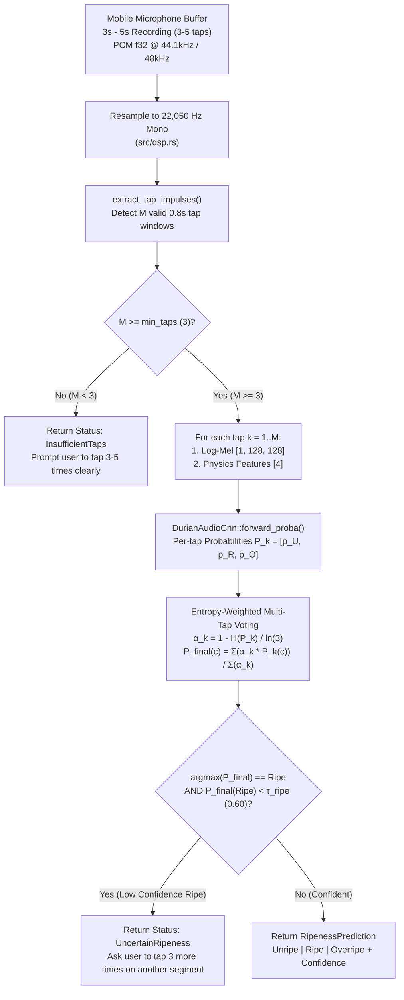

# Phase 4: Inference Engine, Multi-Tap Voting & Cross-Platform Mobile SDK

**Phase ID:** Phase 4
**Status:** Planned
**Prerequisites:** [Phase 2 (`src/dsp.rs`)](PHASE_2_DSP_AND_AUGMENTATION.md) & [Phase 3 (`src/model.rs`, `src/training.rs`)](PHASE_3_MODEL_AND_TRAINING.md)
**Target Files:** `src/inference.rs`, `src/ffi.rs`, `src/lib.rs`, `Makefile`
**Parent Roadmap:** [`RoadMap.md`](../../RoadMap.md) | **Tech Spec:** [`docs/TECHNICAL_DESIGN.md`](../TECHNICAL_DESIGN.md)

---

## 1. Mục Tiêu Của Phase 4 (Objectives)

Sau khi có bộ DSP chuẩn (Phase 2) và trọng số mô hình `DurianAudioCnn` đạt chuẩn F1 $\ge 0.85$ (Phase 3), Phase 4 tập trung vào việc đưa mô hình xuống chạy thời gian thực trên thiết bị di động (iOS & Android) với độ trễ cực thấp và độ an toàn kinh doanh tối đa:

1. **Xây dựng Engine Suy luận On-Device Theo Từng Hệ Điều Hành (`src/inference.rs`):** Nạp đúng trọng số mô hình chuyên biệt cho từng nền tảng (**`durian_iphone.mpk`** trên iOS và **`durian_android.mpk`** trên Android) và cung cấp hàm điểm vào duy nhất `classify_recorded_pcm(pcm_samples: &[f32], input_sample_rate: u32) -> Result<RipenessPrediction>`.
2. **Triển khai thuật toán Gộp Nhiều Cú Gõ theo Entropy (`Entropy-Weighted Multi-Tap Voting`):** Tổng hợp thông minh xác suất từ $M$ cú gõ liên tiếp (thường từ 3–5 cú gõ trong một lần kiểm tra), tự động hạ trọng số những cú gõ bị lẫn tạp âm hoặc trượt tay.
3. **Hiệu chỉnh Ngưỡng Quyết định An toàn (`Decision Threshold Calibration`):** Kiểm soát chặt chẽ lớp `Ripe` với ngưỡng $\tau_{\text{ripe}}$ được tinh chỉnh riêng trên tập Validation của từng model ($\tau_{\text{ripe}}^{\text{iOS}}$ và $\tau_{\text{ripe}}^{\text{Android}}$, mặc định `0.60`) nhằm đảm bảo **Precision trên lớp `Ripe` $> 90\%$** và **False Positive Rate cho lớp `Ripe` $< 5\%$** trên cả iPhone lẫn Android.
4. **Đóng gói Cross-Platform FFI SDK Riêng Biệt (`src/ffi.rs`):**
    - **Android SDK (`libdurian_sonic.so`):** Đóng gói kèm trọng số **`durian_android.mpk`** (huấn luyện thuần trên dữ liệu WAV của Android).
    - **iOS SDK (`DurianSonic.xcframework`):** Đóng gói kèm trọng số **`durian_iphone.mpk`** (huấn luyện thuần trên dữ liệu M4A của iPhone).

---

## 2. Kiến Trúc Luồng Suy Luận & Hậu Xử Lý Trên Thiết Bị



---

## 3. Hướng Dẫn Triển Khai Chi Tiết

### Bước 1: Hiện thực hóa `src/inference.rs` (Multi-Tap Voting & Threshold Calibration)

Tạo file `src/inference.rs` và khai báo `pub mod inference;` trong `src/lib.rs`.

#### 1.1. Cấu trúc Kết quả Dự đoán (`RipenessPrediction`)

```rust
use serde::{Deserialize, Serialize};

/// Trạng thái kiểm tra chất lượng lần gõ trên ứng dụng di động
#[derive(Debug, Clone, Copy, PartialEq, Eq, Serialize, Deserialize)]
pub enum PredictionStatus {
    /// Đủ số cú gõ và độ tự tin vượt ngưỡng an toàn
    Confident,
    /// Phát hiện ít hơn số cú gõ tối thiểu (ví dụ < 3 cú gõ)
    InsufficientTaps,
    /// Xác suất dự đoán lớp Ripe chưa vượt ngưỡng an toàn τ_ripe (0.60), cần gõ lại ở múi khác
    LowConfidenceRetryRequired,
}

#[derive(Debug, Clone, Serialize, Deserialize)]
pub struct RipenessPrediction {
    pub status: PredictionStatus,
    pub predicted_class: String,      // "Unripe" | "Ripe" | "Overripe" | "Uncertain"
    pub probabilities: [f32; 3],      // [P(Unripe), P(Ripe), P(Overripe)]
    pub detected_taps_count: usize,   // Số cú gõ hợp lệ phát hiện được (M)
    pub confidence_score: f32,        // Độ tự tin tổng hợp [0.0, 1.0]
    pub tap_weights: Vec<f32>,        // Trọng số tin cậy α_k của từng cú gõ
}
```

#### 1.2. Thuật toán Tổng hợp Nhiều Cú Gõ theo Trọng số Entropy (`aggregate_multi_tap_probabilities`)

Theo Mục `Deployment Strategy -> 2. Multi-Tap Aggregation Logic` trong [`docs/TECHNICAL_DESIGN.md`](../TECHNICAL_DESIGN.md#2-multi-tap-aggregation-logic):

Với mỗi cú gõ thứ $k \in \{1, \dots, M\}$ có phân phối xác suất $P_k = [P_k(0), P_k(1), P_k(2)]$:

$$
H(P_k) = - \sum_{c=0}^{2} P_k(c) \ln\big(\max(P_k(c), 10^{-12})\big), \quad \alpha_k = \max\left(1.0 - \frac{H(P_k)}{\ln 3}, 10^{-3}\right)
$$

$$
P_{\text{final}}(c) = \frac{\sum_{k=1}^{M} \alpha_k \cdot P_k(c)}{\sum_{k=1}^{M} \alpha_k}
$$

```rust
/// Gộp xác suất từ M cú gõ theo trọng số nghịch đảo Entropy
pub fn aggregate_multi_tap_probabilities(tap_probs: &[[f32; 3]]) -> ([f32; 3], Vec<f32>) {
    if tap_probs.is_empty() {
        return ([0.0, 0.0, 0.0], vec![]);
    }

    let ln3 = 3.0_f32.ln();
    let mut weights = Vec::with_capacity(tap_probs.len());
    let mut weighted_sum = [0.0_f32; 3];
    let mut total_weight = 0.0_f32;

    for probs in tap_probs {
        let entropy: f32 = probs
            .iter()
            .map(|&p| {
                let p_safe = p.clamp(1e-12, 1.0);
                -p_safe * p_safe.ln()
            })
            .sum();

        let alpha = (1.0 - (entropy / ln3)).clamp(1e-3, 1.0);
        weights.push(alpha);
        total_weight += alpha;

        for c in 0..3 {
            weighted_sum[c] += alpha * probs[c];
        }
    }

    let final_probs = [
        weighted_sum[0] / total_weight,
        weighted_sum[1] / total_weight,
        weighted_sum[2] / total_weight,
    ];

    (final_probs, weights)
}
```

#### 1.3. Hiệu chỉnh Ngưỡng Quyết định (`apply_safety_threshold_calibration`)

Để triệt tiêu hai lỗi nghiêm trọng nhất là **`FP_R(1)` (`Unripe -> Ripe`)** và **`FP_R(2)` (`Overripe -> Ripe`)**:

```rust
use crate::dataset::RipenessLabel;

#[derive(Debug, Clone)]
pub struct CalibrationConfig {
    pub min_required_taps: usize, // Mặc định: 3 cú gõ cho phiên kiểm tra thực tế
    pub ripe_threshold: f32,      // Mặc định: τ_ripe = 0.60
    pub min_confidence: f32,      // Mặc định: 0.50 cho Unripe và Overripe
}

impl Default for CalibrationConfig {
    fn default() -> Self {
        Self {
            min_required_taps: 3,
            ripe_threshold: 0.60,
            min_confidence: 0.50,
        }
    }
}

pub fn make_calibrated_decision(
    tap_probs: &[[f32; 3]],
    cal_cfg: &CalibrationConfig,
) -> RipenessPrediction {
    let detected_taps_count = tap_probs.len();
    if detected_taps_count == 0 {
        return RipenessPrediction {
            status: PredictionStatus::InsufficientTaps,
            predicted_class: "Uncertain".to_string(),
            probabilities: [0.0, 0.0, 0.0],
            detected_taps_count: 0,
            confidence_score: 0.0,
            tap_weights: vec![],
        };
    }

    let (probabilities, tap_weights) = aggregate_multi_tap_probabilities(tap_probs);

    // Tìm lớp có xác suất cao nhất
    let (best_idx, &max_prob) = probabilities
        .iter()
        .enumerate()
        .max_by(|a, b| a.1.partial_cmp(b.1).unwrap())
        .unwrap();

    let raw_label = match best_idx {
        0 => RipenessLabel::Unripe,
        1 => RipenessLabel::Ripe,
        _ => RipenessLabel::Overripe,
    };

    if detected_taps_count < cal_cfg.min_required_taps {
        return RipenessPrediction {
            status: PredictionStatus::InsufficientTaps,
            predicted_class: raw_label.as_str().to_string(),
            probabilities,
            detected_taps_count,
            confidence_score: max_prob,
            tap_weights,
        };
    }

    // Kiểm tra ngưỡng an toàn nghiêm ngặt cho lớp Ripe
    let threshold = if raw_label == RipenessLabel::Ripe {
        cal_cfg.ripe_threshold
    } else {
        cal_cfg.min_confidence
    };

    if max_prob < threshold {
        return RipenessPrediction {
            status: PredictionStatus::LowConfidenceRetryRequired,
            predicted_class: "Uncertain".to_string(),
            probabilities,
            detected_taps_count,
            confidence_score: max_prob,
            tap_weights,
        };
    }

    RipenessPrediction {
        status: PredictionStatus::Confident,
        predicted_class: raw_label.as_str().to_string(),
        probabilities,
        detected_taps_count,
        confidence_score: max_prob,
        tap_weights,
    }
}
```

---

### Bước 2: Xây dựng Giao Diện FFI cho Mobile (`src/ffi.rs`)

Để cả **Swift (iOS)** và **Kotlin (Android)** có thể gọi thư viện Rust dễ dàng, an toàn và không gặp lỗi quản lý bộ nhớ phức tạp, thiết kế một giao diện C-ABI chuẩn trả về chuỗi JSON (hoặc struct C phẳng) kèm hàm giải phóng bộ nhớ:

```rust
use std::ffi::{CStr, CString};
use std::os::raw::c_char;
use std::slice;

/// Hàm C-FFI nhận mảng PCM f32 từ iOS/Android và trả về chuỗi JSON RipenessPrediction
///
/// # Safety
/// - `pcm_ptr` phải trỏ tới vùng nhớ hợp lệ gồm ít nhất `pcm_len` phần tử `f32`.
/// - Chuỗi trả về phải được giải phóng bằng `durian_sonic_free_string`.
#[no_mangle]
pub unsafe extern "C" fn durian_sonic_classify_pcm_json(
    pcm_ptr: *const f32,
    pcm_len: usize,
    sample_rate: u32,
) -> *mut c_char {
    if pcm_ptr.is_null() || pcm_len == 0 {
        let err_json = r#"{"error":"Empty or null PCM buffer"}"#;
        return CString::new(err_json).unwrap().into_raw();
    }

    let pcm_slice = slice::from_raw_parts(pcm_ptr, pcm_len);

    let json_output = match crate::inference::classify_recorded_pcm(pcm_slice, sample_rate) {
        Ok(pred) => serde_json::to_string(&pred)
            .unwrap_or_else(|e| format!(r#"{{"error":"Serialization error: {}"}}"#, e)),
        Err(e) => format!(r#"{{"error":"Inference failed: {}"}}"#, e),
    };

    CString::new(json_output)
        .unwrap_or_else(|_| CString::new(r#"{"error":"CString conversion error"}"#).unwrap())
        .into_raw()
}

/// Giải phóng chuỗi JSON do Rust cấp phát sau khi Swift/Kotlin đã đọc xong
///
/// # Safety
/// - `ptr` phải là con trỏ được trả về từ `durian_sonic_classify_pcm_json`.
#[no_mangle]
pub unsafe extern "C" fn durian_sonic_free_string(ptr: *mut c_char) {
    if !ptr.is_null() {
        let _ = CString::from_raw(ptr);
    }
}
```

> [!TIP]
> Khi biên dịch cho Mobile, cập nhật mục `[lib]` trong `Cargo.toml` thành:
>
> ```toml
> [lib]
> name = "durian_sonic"
> path = "src/lib.rs"
> crate-type = ["rlib", "cdylib", "staticlib"]
> ```
>
> Trên thiết bị di động, sử dụng backend `burn-ndarray` (thuần CPU/SIMD, không phụ thuộc driver GPU ngoài) vì với kích thước mô hình ~420K tham số, 1 cú gõ chỉ mất `~5–8 ms` trên CPU ARM64.

---

### Bước 3: Quy Trình Cross-Compile Cho Android & iOS

Bổ sung các target sau vào `Makefile` để Team Mobile có thể build SDK chỉ bằng 1 câu lệnh:

#### 3.1. Build cho Android (`libdurian_sonic.so` + `durian_android.mpk`)

```bash
# Cài đặt target ARM64 và ARMv7 cho Android
rustup target add aarch64-linux-android armv7-linux-androideabi
cargo install cargo-ndk

# Biên dịch thư viện .so và copy model chuyên biệt của Android (durian_android.mpk) vào assets
cargo ndk -t arm64-v8a -t armeabi-v7a -o ./mobile_dist/android/jniLibs build --release
cp artifacts/durian_android.mpk ./mobile_dist/android/assets/durian_android.mpk
```

#### 3.2. Build cho iOS (`DurianSonic.xcframework` + `durian_iphone.mpk`)

```bash
# Cài đặt target iOS thiết bị thật và Simulator (Apple Silicon)
rustup target add aarch64-apple-ios aarch64-apple-ios-sim

# Biên dịch static library (.a)
cargo build --release --target aarch64-apple-ios
cargo build --release --target aarch64-apple-ios-sim

# Đóng gói XCFramework và copy model chuyên biệt của iPhone (durian_iphone.mpk) vào bundle
xcodebuild -create-xcframework \
    -library target/aarch64-apple-ios/release/libdurian_sonic.a \
    -library target/aarch64-apple-ios-sim/release/libdurian_sonic.a \
    -output ./mobile_dist/ios/DurianSonic.xcframework
cp artifacts/durian_iphone.mpk ./mobile_dist/ios/DurianSonic.xcframework/durian_iphone.mpk
```

---

## 4. Chỉ Tiêu Hiệu Năng & Ràng Buộc Kỹ Thuật (SLAs)

| Hạng Mục Kiểm Định                     | Mục Tiêu (Target)                           | Cách Đo Lường                                                         |
| -------------------------------------- | ------------------------------------------- | --------------------------------------------------------------------- |
| **Độ trễ mỗi cú gõ (`Latency / Tap`)** | `< 8.0 ms` (iPhone) / `< 12.5 ms` (Android) | Criterion benchmark trong `benches/training_benchmarks.rs`            |
| **Tổng thời gian phản hồi 5 cú gõ**    | `< 100 ms`                                  | Đo thời gian chạy `classify_recorded_pcm` với buffer `4.0s` ở `48kHz` |
| **Dung lượng SDK biên dịch**           | `< 2.5 MB` (FP32) / `< 1.2 MB` (INT8/FP16)  | Kiểm tra kích thước `libdurian_sonic.so` + file trọng số `.mpk`       |
| **Precision lớp `Ripe`**               | `> 90.0%`                                   | Đánh giá trên tập Test với $\tau_{\text{ripe}} = 0.60$                |
| **False Positive Rate lớp `Ripe`**     | `< 5.0%`                                    | Tỷ lệ trái `Unripe`/`Overripe` bị báo nhầm là `Ripe` trên tập Test    |

---

## 5. Kế Hoạch Kiểm Thử (Unit & Integration Tests)

1. `test_entropy_weighted_voting_downweights_noisy_tap`: Truyền vào 3 cú gõ rõ nét nghiêng về `Unripe` (`[0.85, 0.10, 0.05]`) và 2 cú gõ nhiễu có phân phối phẳng (`[0.33, 0.34, 0.33]`), kiểm tra trọng số $\alpha_k$ của cú gõ rõ nét lớn gấp $> 10$ lần cú gõ nhiễu và kết quả cuối cùng là `Unripe`.
2. `test_safety_threshold_blocks_borderline_ripe`: Truyền vào phân phối xác suất gộp `[0.35, 0.52, 0.13]` (lớp `Ripe` cao nhất nhưng $0.52 < \tau_{\text{ripe}} = 0.60$), kiểm tra hàm trả về `PredictionStatus::LowConfidenceRetryRequired` thay vì báo `Ripe`.
3. `test_ffi_roundtrip_memory_safety`: Gọi `durian_sonic_classify_pcm_json` với mảng PCM hợp lệ và mảng rỗng, parse kết quả JSON trả về và gọi `durian_sonic_free_string` để đảm bảo không crash và không leak bộ nhớ.

---

## 6. Definition of Done (Tiêu Chí Hoàn Thành Phase 4)

- [ ] `src/inference.rs` hoàn thiện toàn bộ pipeline từ buffer PCM thô đến `RipenessPrediction` có gộp đa cú gõ theo Entropy và hiệu chỉnh ngưỡng $\tau_{\text{ripe}} = 0.60$.
- [ ] Trên tập Test, sau khi áp dụng Multi-Tap Voting và Calibration, hệ thống đạt **Precision(`Ripe`) $> 90\%$** và **False Positive Rate(`Ripe`) $< 5\%$**.
- [ ] `src/ffi.rs` xuất thành công hàm C-FFI và build ra được `.so` / `.a` không lỗi.
- [ ] Criterion benchmark xác nhận tổng thời gian xử lý 5 cú gõ đạt `< 100 ms`.
