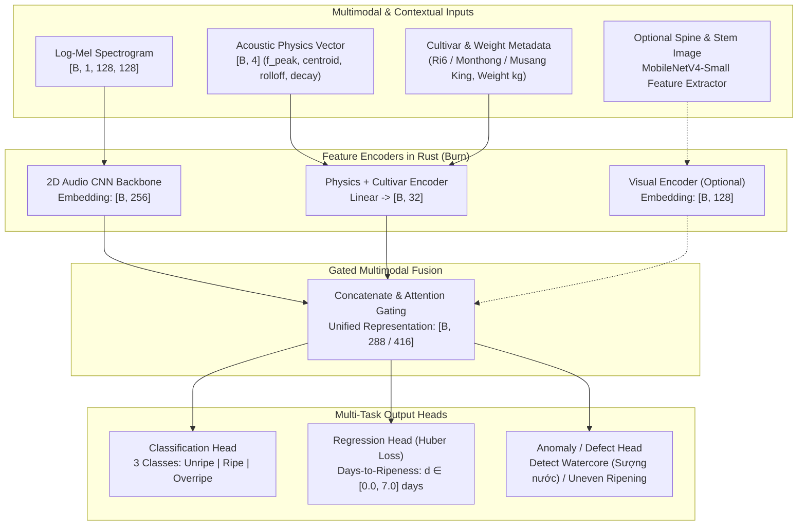

# Phase 5: Domain Expansion, Cultivar Generalization & Multimodal Fusion

**Phase ID:** Phase 5
**Status:** Future R&D (Post-MVP)
**Prerequisites:** [Phase 1–4 Completed & Production Mobile SDK Deployed](PHASE_4_INFERENCE_AND_MOBILE_SDK.md)
**Target Modules:** `src/cultivar.rs`, `src/multimodal.rs`, `data/v2/`
**Parent Roadmap:** [`RoadMap.md`](../../RoadMap.md) | **Tech Spec:** [`docs/TECHNICAL_DESIGN.md`](../TECHNICAL_DESIGN.md)

---

## 1. Mục Tiêu Của Phase 5 (Objectives)

Sau khi phiên bản MVP (Phase 1–4) hoạt động ổn định trên tập dữ liệu chuẩn gồm `175` trái sầu riêng vật lý, Phase 5 hướng tới việc mở rộng quy mô sản phẩm cho chuỗi cung ứng nông sản thương mại và xuất khẩu:

1. **Mở rộng quy mô Dataset đa giống (`> 1,000` trái sầu riêng vật lý):** Thu thập và chuẩn hóa dữ liệu âm thanh gõ cho các giống sầu riêng thương mại chủ lực (**Ri6**, **Monthong / Dona**, **Musang King**, **Chuồng Bò**) cùng thông tin trọng lượng trái (`kg`) và độ dày vỏ.
2. **Tổng quát hóa theo Giống Sầu Riêng (`Cultivar-Aware Acoustic Modeling`):** Đưa vector nhúng giống sầu riêng (`Cultivar Embedding`) vào nhánh đặc trưng vật lý của `DurianAudioCnn`, vì mỗi giống có độ dày vỏ và cấu trúc múi khác nhau dẫn đến tần số cộng hưởng chuẩn ($f_r$) lệch nhau.
3. **Dự đoán Số Ngày Chín Còn Lại (`Days-to-Ripeness Regression Head`):** Mở rộng đầu ra của mô hình từ bài toán phân loại 3 lớp rời rạc sang bài toán **Multi-Task Learning** (vừa phân lớp `Unripe / Ripe / Overripe`, vừa hồi quy số giờ/ngày còn lại cho đến khi trái đạt độ chín tối ưu $\hat{d} \in [0.0, 7.0]$ ngày).
4. **Kết hợp Đa phương thức Âm thanh + Hình ảnh (`Audio-Visual Multimodal Fusion`):** Kết hợp tín hiệu âm thanh xung gõ với ảnh chụp cuống quả, rãnh gai và màu vỏ từ camera điện thoại để nâng độ chính xác ở các ca biên (trái bị sượng nước hoặc chín ép).

---

## 2. Kiến Trúc Mở Rộng Đa Nhiệm & Đa Phương Thức (Phase 5 Architecture)

---

## 3. Hướng Dẫn Triển Khai Các Hạng Mục R&D

### Hạng mục 1: Mở rộng Schema Metadata (`Dataset v2`)

Khi thu thập dữ liệu mở rộng (> 1,000 trái), file `metadata_*.csv` cần bổ sung thêm 4 trường vật lý quan trọng nhưng vẫn giữ nguyên quy tắc đánh số tuần tự liên tục và khóa nhóm `fruit_id`:

| Column Name | Type | Description | Example |
| ----------- | ---- | ----------- | ------- |
| `sample_num` | `u32` | Mã số file tuần tự liên tục không ngắt quãng | `282` |
| `fruit_id` | `u32` | Mã định danh trái sầu riêng vật lý duy nhất | `176` |
| `cultivar` | `String` | Giống sầu riêng (`Ri6`, `Monthong`, `MusangKing`, `ChuongBo`) | `Monthong` |
| `weight_kg` | `f32` | Trọng lượng trái tính bằng kilôgam | `3.25` |
| `tapping_zone` | `String` | Vị trí gõ trên trái (`Equator`, `StemEnd`, `BottomTip`) | `Equator` |
| `days_to_ripe` | `f32` | Số ngày thực tế tính từ lúc thu âm đến khi bổ chín ngon (`0.0` nếu đã chín) | `2.5` |
| `ripeness` | `String` | Nhãn phân lớp (`Unripe`, `Ripe`, `Overripe`) | `Unripe` |

---

### Hạng mục 2: Chuẩn Hóa Tần Số Cộng Hưởng Theo Giống & Trọng Lượng (`src/cultivar.rs`)

Về mặt cơ học âm thanh, một trái sầu riêng **Monthong** nặng `4.0 kg` có vỏ dày và khoang quả lớn hơn trái **Ri6** nặng `2.0 kg`, dẫn đến tần số cộng hưởng tự nhiên $f_r$ của trái Monthong thấp hơn trái Ri6 ở cùng độ chín.

Để mô hình không nhầm trái Monthong lớn chưa chín thành trái Ri6 đã chín:

1. Mã hóa giống sầu riêng thành vector One-Hot hoặc Embedding 4 chiều $e_{\text{cultivar}} \in \mathbb{R}^4$.
2. Đưa trọng lượng ước lượng (hoặc kích thước đường kính trái) đã chuẩn hóa $\tilde{w} = \frac{w_{\text{kg}}}{5.0}$ vào nhánh vật lý:

    $$
    v_{\text{context}} = [f_{\text{peak}}, C_s, R_{85}, \beta_{\text{decay}}, \tilde{w}, e_{\text{cultivar}}] \in \mathbb{R}^9
    $$

3. Thay tầng `phys_proj: Linear(4 -> 16)` trong `DurianAudioCnn` bằng `context_proj: Linear(9 -> 32)`.

---

### Hạng mục 3: Multi-Task Learning (Phân loại Độ chín + Hồi quy Số ngày chín)

Bổ sung nhánh hồi quy `fc_days: Linear(64 -> 1)` song song với `fc_out: Linear(64 -> 3)` ở tầng cuối của `DurianAudioCnn`:

- **Hàm mất mát tổng hợp (`Multi-Task Loss`):**

    $$
    \mathcal{L}_{\text{total}} = \mathcal{L}_{\text{Weighted-CE}}(\hat{y}_{\text{cls}}, y_{\text{cls}}) + \lambda_{\text{reg}} \cdot \mathcal{L}_{\text{Huber}}(\hat{d}, d_{\text{true}})
    $$

    Trong đó $\lambda_{\text{reg}} = 0.25$ và $\mathcal{L}_{\text{Huber}}$ (Smooth L1 Loss với $\delta = 0.5$ ngày) giúp mô hình bền vững trước sai số gán nhãn thời gian chín.

---

### Hạng mục 4: Phát hiện Sầu Riêng Chín Không Đều / Sượng Nước (Multi-Zone Consistency)

Khi người dùng gõ vào 3–4 múi xung quanh xích đạo trái sầu riêng trong một phiên kiểm tra:

- Nếu các cú gõ ở múi 1 và múi 2 cho xác suất `Ripe > 0.80`, nhưng các cú gõ ở múi 3 lại cho xác suất `Unripe > 0.80` (độ lệch chuẩn xác suất giữa các múi $\sigma_{P(\text{Ripe})} > 0.35$), hệ thống sẽ cảnh báo hiện tượng **"Chín không đều / Nguy cơ sượng múi" (Uneven Ripening across Segments)** thay vì chỉ lấy trung bình cộng đơn thuần.

---

## 4. Definition of Done (Tiêu Chí Nghiệm Thu Dài Hạn Cho Phase 5)

- [ ] Tập dữ liệu mở rộng đạt `>= 1,000` trái sầu riêng vật lý với ít nhất 3 giống thương mại chính (`Ri6`, `Monthong`, `Musang King`).
- [ ] Mô hình `DurianAudioCnn-v2` (có `Cultivar Embedding`) đạt **Macro F1-Score $\ge 0.90$** trên từng giống sầu riêng.
- [ ] Sai số tuyệt đối trung bình (**MAE - Mean Absolute Error**) của nhánh dự đoán số ngày chín còn lại (`days_to_ripe`) đạt **$\le 0.75$ ngày**.
- [ ] Tính năng phát hiện lệch độ chín giữa các múi (`Multi-Zone Consistency Check`) hoạt động trực tiếp trên ứng dụng di động.
