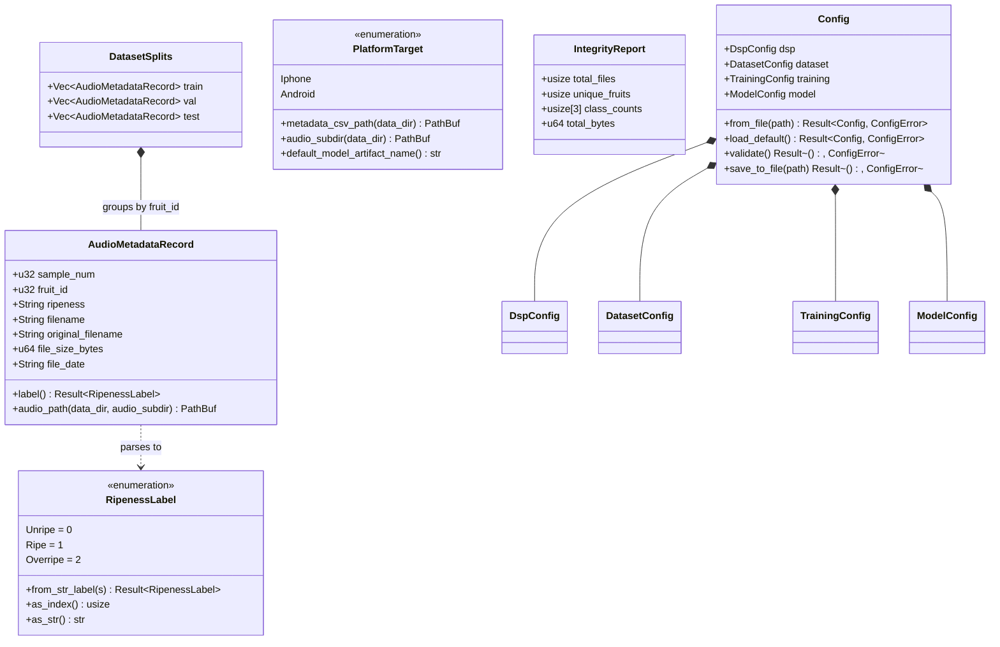

# Phase 1 Data Model: Configuration & Dataset Entities

**Feature**: `001-phase1-data-config`
**Date**: 2026-11-24

---

## 1. Entity Relationship Overview

---

## 2. Configuration Entities (`src/config.rs`)

### 2.1. `Config` (Root Aggregate)

| Field      | Type             | Serde Attribute                         | Description                                         |
| :--------- | :--------------- | :-------------------------------------- | :-------------------------------------------------- |
| `dsp`      | `DspConfig`      | `#[serde(default)]`                     | Digital Signal Processing & Onset parameters        |
| `dataset`  | `DatasetConfig`  | `#[serde(default)]`                     | Dataset paths, split ratios, and deterministic seed |
| `training` | `TrainingConfig` | Required section (fields have defaults) | Hyperparameters for optimization and regularization |
| `model`    | `ModelConfig`    | Required section (fields have defaults) | Neural network input dimensions and layer topology  |

### 2.2. `DspConfig`

| Field              | Type    | Default   | Validation Constraint (`FR-003`)                             |
| :----------------- | :------ | :-------- | :----------------------------------------------------------- |
| `sample_rate`      | `u32`   | `22_050`  | `> 0`                                                        |
| `window_sec`       | `f32`   | `0.8`     | `> 0.0`                                                      |
| `pre_onset_sec`    | `f32`   | `0.1`     | `>= 0.0` and `< window_sec`                                  |
| `min_interval_sec` | `f32`   | `0.4`     | `> 0.0`                                                      |
| `threshold_ratio`  | `f32`   | `0.25`    | `> 0.0` and `<= 1.0`                                         |
| `n_fft`            | `usize` | `1024`    | `> 0` and `n_fft.is_power_of_two()`                          |
| `hop_length`       | `usize` | `128`     | `> 0`                                                        |
| `n_mels`           | `usize` | `128`     | `> 0`                                                        |
| `fmin`             | `f32`   | `50.0`    | `>= 0.0` and `< fmax`                                        |
| `fmax`             | `f32`   | `8_000.0` | `> fmin` and `<= (sample_rate as f32) / 2.0` (Nyquist limit) |
| `top_db`           | `f32`   | `80.0`    | `> 0.0`                                                      |

### 2.3. `DatasetConfig`

| Field              | Type     | Default                       | Validation Constraint (`FR-003`)                                                 |
| :----------------- | :------- | :---------------------------- | :------------------------------------------------------------------------------- |
| `data_dir`         | `String` | `"data"`                      | Non-empty string                                                                 |
| `iphone_metadata`  | `String` | `"data/metadata_iphone.csv"`  | Non-empty string                                                                 |
| `android_metadata` | `String` | `"data/metadata_android.csv"` | Non-empty string                                                                 |
| `train_ratio`      | `f32`    | `0.70`                        | `> 0.0` and `< 1.0`                                                              |
| `val_ratio`        | `f32`    | `0.15`                        | `> 0.0` and `< 1.0`                                                              |
| `test_ratio`       | `f32`    | `0.15`                        | `> 0.0` and `< 1.0`; `(train_ratio + val_ratio + test_ratio - 1.0).abs() < 1e-4` |
| `split_seed`       | `u64`    | `42`                          | Any `u64`                                                                        |

### 2.4. `TrainingConfig`

| Field                     | Type    | Default (`configs/default.toml`)                 | Validation Constraint (`FR-003`) |
| :------------------------ | :------ | :----------------------------------------------- | :------------------------------- |
| `epochs`                  | `usize` | `80` (`100` in legacy `Config::default()`)       | `> 0`                            |
| `batch_size`              | `usize` | `32`                                             | `> 0`                            |
| `learning_rate`           | `f64`   | `0.0003` (`0.001` in legacy `Config::default()`) | `> 0.0` and `< 1.0`              |
| `weight_decay`            | `f64`   | `0.0001` (via `#[serde(default)]`)               | `>= 0.0`                         |
| `label_smoothing`         | `f32`   | `0.05` (via `#[serde(default)]`)                 | `>= 0.0` and `< 1.0`             |
| `early_stopping_patience` | `usize` | `12` (via `#[serde(default)]`)                   | `> 0`                            |

### 2.5. `ModelConfig`

| Field                  | Type         | Default (`configs/default.toml`)                     | Validation Constraint (`FR-003`)                   |
| :--------------------- | :----------- | :--------------------------------------------------- | :------------------------------------------------- |
| `architecture`         | `String`     | `"durian_audio_cnn_small"` (via `#[serde(default)]`) | Non-empty string                                   |
| `input_channels`       | `usize`      | `1` (via `#[serde(default)]`)                        | `> 0`                                              |
| `input_height`         | `usize`      | `128` (via `#[serde(default)]`)                      | `> 0`                                              |
| `input_width`          | `usize`      | `128` (via `#[serde(default)]`)                      | `> 0`                                              |
| `physics_features_dim` | `usize`      | `4` (via `#[serde(default)]`)                        | `> 0`                                              |
| `num_classes`          | `usize`      | `3` (via `#[serde(default)]`)                        | `>= 2`                                             |
| `dropout`              | `f64`        | `0.3` (via `#[serde(default)]`)                      | `>= 0.0` and `< 1.0`                               |
| `hidden_layers`        | `Vec<usize>` | `vec![128, 64]`                                      | Non-empty and every element `> 0`                  |
| `activation`           | `String`     | `"relu"`                                             | One of `["relu", "sigmoid", "tanh", "leaky_relu"]` |

---

## 3. Dataset & Verification Entities (`src/dataset.rs`)

### 3.1. `PlatformTarget`

Represents the two independent acoustic hardware/format pipelines (`FR-004`):

- `PlatformTarget::Iphone`:
    - Metadata CSV: `<data_dir>/metadata_iphone.csv` (`281` rows)
    - Audio Subdirectory: `<data_dir>/sound_iphone` (`.m4a` AAC-LC files)
    - Default Model Artifact Name: `"durian_iphone"`
- `PlatformTarget::Android`:
    - Metadata CSV: `<data_dir>/metadata_android.csv` (`175` rows)
    - Audio Subdirectory: `<data_dir>/sound_android` (`.wav` PCM 16-bit files)
    - Default Model Artifact Name: `"durian_android"`

### 3.2. `RipenessLabel`

Fixed 3-class taxonomy (`FR-005`):

- `RipenessLabel::Unripe = 0` (`"Unripe"`)
- `RipenessLabel::Ripe = 1` (`"Ripe"`)
- `RipenessLabel::Overripe = 2` (`"Overripe"`)

**Parsing Rules**: Trims leading/trailing whitespace and matches case-insensitively (`"unripe"`, `"ripe"`, `"overripe"`). Any other value returns an error.

### 3.3. `AudioMetadataRecord`

Maps 1-to-1 with a row in `metadata_iphone.csv` or `metadata_android.csv` (`FR-006`):

| Field               | Type     | Validation Rule (`FR-007`)                                   |
| :------------------ | :------- | :----------------------------------------------------------- |
| `sample_num`        | `u32`    | Must equal `row_index + 1` (`1..=N` contiguous without gaps) |
| `fruit_id`          | `u32`    | Must satisfy `(1..=175).contains(&fruit_id)`                 |
| `ripeness`          | `String` | Must parse into a valid `RipenessLabel`                      |
| `filename`          | `String` | File `<audio_dir>/<filename>` must exist on disk             |
| `original_filename` | `String` | Preserved for provenance auditing                            |
| `file_size_bytes`   | `u64`    | Must equal `fs::metadata(<audio_dir>/<filename>)?.len()`     |
| `file_date`         | `String` | ISO timestamp string preserved from metadata                 |

### 3.4. `IntegrityReport`

Summary statistics returned by `load_and_verify_metadata` (`FR-008`):

- `total_files: usize` (`281` for iPhone, `175` for Android)
- `unique_fruits: usize` (`175` for both platforms)
- `class_counts: [usize; 3]` (`[171, 66, 44]` for iPhone; `[95, 38, 42]` for Android)
- `total_bytes: u64`

### 3.5. `DatasetSplits`

Disjoint partition of `AudioMetadataRecord` items produced by `stratified_group_split_by_fruit` (`FR-009`):

- `train: Vec<AudioMetadataRecord>` (`123` unique `fruit_id`s)
- `val: Vec<AudioMetadataRecord>` (`26` unique `fruit_id`s)
- `test: Vec<AudioMetadataRecord>` (`26` unique `fruit_id`s)

**Invariants**:

1. $\text{fruits}(\text{train}) \cap \text{fruits}(\text{val}) = \emptyset$
2. $\text{fruits}(\text{train}) \cap \text{fruits}(\text{test}) = \emptyset$
3. $\text{fruits}(\text{val}) \cap \text{fruits}(\text{test}) = \emptyset$
4. $|\text{fruits}(\text{train})| + |\text{fruits}(\text{val})| + |\text{fruits}(\text{test})| = |\text{fruits}(\text{all})|$
5. `train.len() + val.len() + test.len() == records.len()`
