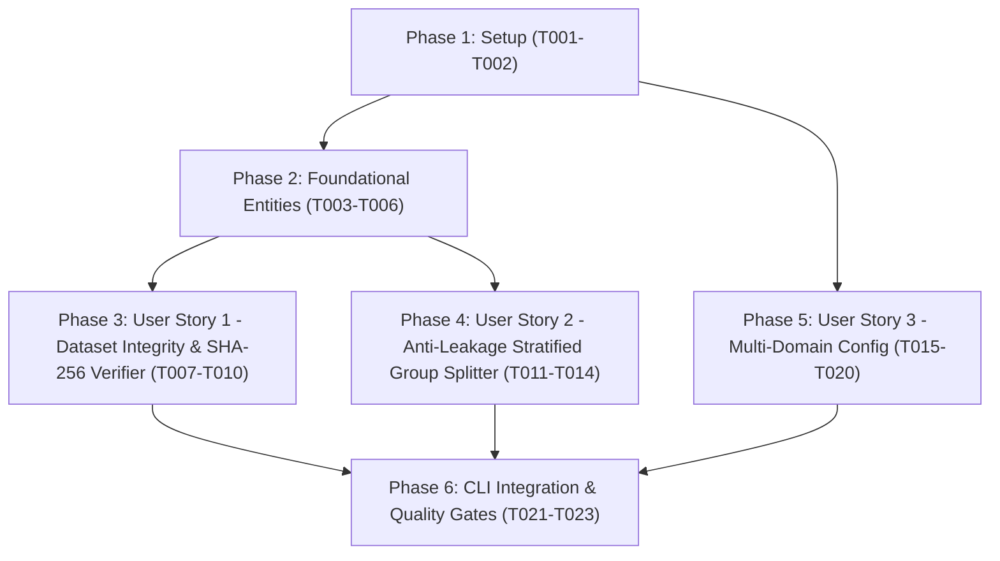

# Tasks: Phase 1 - Data Pipeline, Config Expansion & Anti-Leakage Dataset Splitter

**Input**: Design documents from `/specs/001-phase1-data-config/`

**Prerequisites**: [plan.md](./plan.md) (required), [spec.md](./spec.md) (required for user stories), [research.md](./research.md), [data-model.md](./data-model.md), [contracts/cli-and-library.md](./contracts/cli-and-library.md), [quickstart.md](./quickstart.md)

**Tests**: Required by the DurianSonic Constitution (Principle II: Test-First Development, NON-NEGOTIABLE). Within each phase, failing tests (TDD Red) MUST be written and verified to fail before writing implementation code (TDD Green & Refactor).

**Organization**: Tasks are grouped by user story (`US1`, `US2`, `US3`) to enable independent implementation and testing of each story while adhering strictly to Rust compilation boundaries and constitutional quality gates.

## Format: `[ID] [P?] [Story] Description`

- **[P]**: Can run in parallel (different files, no dependencies on incomplete tasks)
- **[Story]**: Which user story this task belongs to (`[US1]`, `[US2]`, `[US3]`)
- Exact repository file paths and verbatim `data-model.md` constraints are included in every task description

## Path Conventions

- **Crate Manifest**: `Cargo.toml`
- **Configuration File**: `configs/default.toml`
- **Library Entry & Modules**: `src/lib.rs`, `src/config.rs`, `src/dataset.rs`, `src/training.rs`
- **CLI Binary Entry**: `src/main.rs`
- **Dataset Assets**: `data/metadata_iphone.csv`, `data/metadata_android.csv`, `data/sound_iphone/`, `data/sound_android/`

---

## Phase 1: Setup (Shared Infrastructure)

**Purpose**: Verify project dependencies, dataset directory layout, and module registration in the Rust workspace.

- [x] T001 Verify crate dependencies (`serde 1.0`, `toml 1.2`, `csv 1.4`, `sha2 0.11`, `rand 0.10`, `clap 4.6`, `anyhow 1.0`, `thiserror 2.0`, `tempfile 3.27`, `approx 0.5`) and Phase 0 dataset files (`data/metadata_iphone.csv`, `data/metadata_android.csv`, `data/sound_iphone/`, `data/sound_android/`) via `Cargo.toml`
- [x] T002 [P] Export `pub mod dataset;` alongside `pub mod config;` and `pub mod training;` in `src/lib.rs` and create the initial emoji-free module file `src/dataset.rs`

---

## Phase 2: Foundational (Blocking Prerequisites)

**Purpose**: Core dataset domain types (`PlatformTarget`, `RipenessLabel`, `AudioMetadataRecord`) in `src/dataset.rs` required by both User Story 1 and User Story 2.

**CRITICAL**: Complete this phase before starting User Story 1 or User Story 2 implementation.

- [x] T003 Write failing unit tests (TDD Red) for `PlatformTarget` (`Iphone`, `Android`) path resolution (`metadata_csv_path`, `audio_subdir`, `default_model_artifact_name`), `RipenessLabel` (`Unripe = 0`, `Ripe = 1`, `Overripe = 2`) case-insensitive whitespace-trimmed parsing (`from_str_label`, `as_index`, `as_str`), and `AudioMetadataRecord` (`label`, `audio_path`) in `src/dataset.rs` (`FR-004`, `FR-005`, `FR-006`)
- [x] T004 Implement `PlatformTarget` (`Iphone`, `Android`) with `metadata_csv_path(self, data_dir: &Path) -> PathBuf` resolving `<data_dir>/metadata_iphone.csv` and `<data_dir>/metadata_android.csv`, `audio_subdir(self, data_dir: &Path) -> PathBuf` resolving `<data_dir>/sound_iphone` and `<data_dir>/sound_android`, and `default_model_artifact_name(self) -> &'static str` returning `"durian_iphone"` and `"durian_android"` with rustdoc in `src/dataset.rs` (`FR-004`)
- [x] T005 Implement `RipenessLabel` enum (`Unripe = 0`, `Ripe = 1`, `Overripe = 2`) with `from_str_label(s: &str) -> anyhow::Result<Self>` enforcing `"Trims leading/trailing whitespace and matches case-insensitively (\"unripe\", \"ripe\", \"overripe\"). Any other value returns an error"`, `as_index(self) -> usize`, and `as_str(self) -> &'static str` with rustdoc in `src/dataset.rs` (`FR-005`)
- [x] T006 Implement `AudioMetadataRecord` struct (`#[derive(Debug, Clone, Serialize, Deserialize, PartialEq, Eq)]`) for the 7 CSV columns (`sample_num: u32`, `fruit_id: u32`, `ripeness: String`, `filename: String`, `original_filename: String` `"Preserved for provenance auditing"`, `file_size_bytes: u64`, `file_date: String` `"ISO timestamp string preserved from metadata"`) with `label(&self) -> anyhow::Result<RipenessLabel>` and `audio_path(&self, data_dir: &Path, audio_subdir: &str) -> PathBuf` returning `data_dir.join(audio_subdir).join(&self.filename)` with rustdoc in `src/dataset.rs` (`FR-004`, `FR-006`)

**Checkpoint**: Foundational dataset types (`PlatformTarget`, `RipenessLabel`, `AudioMetadataRecord`) compile and pass unit tests in `src/dataset.rs`. User Stories 1, 2, and 3 can now proceed.

---

## Phase 3: User Story 1 - Dataset Integrity Verification & Deduplication Audit (Priority: P1) - MVP

**Goal**: Automatically audit both iPhone (`281` M4A records) and Android (`175` WAV records) metadata catalogs and audio files for non-empty CSV schema validity, contiguous `sample_num (1..=N)`, valid physical `fruit_id (1..=175)`, valid `RipenessLabel`, file existence, exact byte size match, and streaming `64 KB` `SHA-256` binary uniqueness (`FR-006`, `FR-007`, `FR-008`, `SC-001`, `SC-005`).

**Independent Test**: Run `cargo test dataset::tests` covering synthetic corrupted datasets (`tempfile`) and real `/data/` catalogs (`data/metadata_iphone.csv` and `data/metadata_android.csv`) with `verify_sha256 = true`, confirming 100% of injected errors are caught and 100% of the `456` real audio files pass with `0` duplicate hashes.

### Tests for User Story 1 (TDD Red Phase)

> **NOTE: Write these tests FIRST in `src/dataset.rs` and confirm they FAIL before implementing `IntegrityReport`, `compute_file_sha256`, and `load_and_verify_metadata`.**

- [x] T007 [US1] Write failing unit tests using `tempfile` in `src/dataset.rs` for `load_and_verify_metadata` fast-fail checks: empty CSV (`0` data rows), malformed CSV header or non-numeric columns (`sample_num`, `fruit_id`, `file_size_bytes`), `sample_num` gap violating `"Must equal row_index + 1 (1..=N contiguous without gaps)"`, out-of-range `fruit_id` violating `"Must satisfy (1..=175).contains(&fruit_id)"`, invalid `ripeness` violating `"Must parse into a valid RipenessLabel"`, missing audio file violating `"File <audio_dir>/<filename> must exist on disk"`, and `0`-byte or `1`-byte file size mismatch violating `"Must equal fs::metadata(<audio_dir>/<filename>)?.len()"` (`FR-006`, `FR-007`)
- [x] T008 [US1] Write failing unit and integration tests in `src/dataset.rs` for streaming `SHA-256` deduplication (`verify_sha256 = true` vs `false`) rejecting two differently named audio files with identical binary content while reporting both conflicting filenames, plus real dataset verification against `data/metadata_iphone.csv` (`total_files == 281`, `unique_fruits == 175`, `class_counts == [171, 66, 44]`) and `data/metadata_android.csv` (`total_files == 175`, `unique_fruits == 175`, `class_counts == [95, 38, 42]`) (`FR-007`, `FR-008`, `SC-001`)

### Implementation for User Story 1 (TDD Green & Refactor Phase)

- [x] T009 [US1] Implement `IntegrityReport` struct (`total_files: usize`, `unique_fruits: usize`, `class_counts: [usize; 3]`, `total_bytes: u64`) and helper `compute_file_sha256(path: &Path) -> anyhow::Result<String>` using a fixed `64 KB` stack buffer (`[0u8; 65536]`) with `sha2::Sha256` to avoid heap allocations in `src/dataset.rs` (`FR-007`, `FR-008`, `SC-005`)
- [x] T010 [US1] Implement `load_and_verify_metadata(csv_path: &Path, audio_dir: &Path, verify_sha256: bool) -> anyhow::Result<(Vec<AudioMetadataRecord>, IntegrityReport)>` enforcing non-empty CSV (`> 0` records) and sequential validation order (1. CSV parse -> 2. `sample_num` `"Must equal row_index + 1 (1..=N contiguous without gaps)"` -> 3. `fruit_id` `"Must satisfy (1..=175).contains(&fruit_id)"` -> 4. `ripeness` `"Must parse into a valid RipenessLabel"` -> 5. `filename` `"File <audio_dir>/<filename> must exist on disk"` and `file_size_bytes` `"Must equal fs::metadata(<audio_dir>/<filename>)?.len()"` -> 6. optional `SHA-256` duplicate check via `HashMap<String, String>` reporting both conflicting filenames) with descriptive `anyhow::Context` and rustdoc in `src/dataset.rs` (`FR-006`, `FR-007`, `FR-008`, `SC-001`)

**Checkpoint**: User Story 1 is complete and independently verifiable via `cargo test`. All `456` real audio files and synthetic failure scenarios pass verification.

---

## Phase 4: User Story 2 - Anti-Leakage Stratified Group Split by Physical Fruit (Priority: P1)

**Goal**: Partition each platform dataset independently into `Train (70%) / Validation (15%) / Test (15%)` grouped by physical `fruit_id (1..=175)` and stratified by rarest ripeness class (`Overripe > Ripe > Unripe`) with a deterministic seed (`split_seed = 42`), guaranteeing zero physical fruit overlap across splits and accurate inverse class frequency weights (`FR-009`, `FR-010`, `SC-002`, `SC-003`).

**Independent Test**: Run `cargo test dataset::tests` verifying that `stratified_group_split_by_fruit` produces zero `fruit_id` intersection across `Train`, `Val`, and `Test` (`123 / 26 / 26` unique fruits; `197 / 41 / 43` files on iPhone and `123 / 26 / 26` files on Android), 100% deterministic output for `seed = 42`, and exact class weights from `compute_class_weights`.

### Tests for User Story 2 (TDD Red Phase)

> **NOTE: Write these tests FIRST in `src/dataset.rs` and confirm they FAIL before implementing `DatasetSplits`, `compute_class_weights`, and `stratified_group_split_by_fruit`.**

- [x] T011 [US2] Write failing unit tests using `approx::assert_relative_eq!` in `src/dataset.rs` for `compute_class_weights`: iPhone class counts `[171, 66, 44]` yielding `[0.5477589, 1.4191919, 2.1287878]` (`~[0.5478, 1.4192, 2.1288]`), Android class counts `[95, 38, 42]` yielding `[0.6140351, 1.5350877, 1.3888888]` (`~[0.6140, 1.5351, 1.3889]`), and zero-count safety returning `0.0` when `N_c == 0` or `[0, 0, 0]` without division-by-zero panic (`FR-010`)
- [x] T012 [US2] Write failing unit and integration tests in `src/dataset.rs` for `stratified_group_split_by_fruit`: input validation rejection on empty slice (`&[]`) or invalid ratios (`train_ratio <= 0.0`, `val_ratio <= 0.0`, `train_ratio + val_ratio >= 1.0`), small synthetic strata with 1-2 fruits, `test_zero_fruit_id_leakage_across_splits` on multi-stage recordings (`Overripe > Ripe > Unripe` rarity priority, `fruits(train) ∩ fruits(val) == ∅`, `fruits(train) ∩ fruits(test) == ∅`, `fruits(val) ∩ fruits(test) == ∅`, preserving original CSV `sample_num` ascending order within each split), `test_deterministic_split_with_same_seed` (`seed = 42`), and real CSV split cardinality verification (`123` Train / `26` Val / `26` Test unique fruits; `197 / 41 / 43` files on iPhone and `123 / 26 / 26` files on Android) (`FR-009`, `SC-002`, `SC-003`)

### Implementation for User Story 2 (TDD Green & Refactor Phase)

- [x] T013 [US2] Implement `DatasetSplits` struct (`train: Vec<AudioMetadataRecord>`, `val: Vec<AudioMetadataRecord>`, `test: Vec<AudioMetadataRecord>`) and `compute_class_weights(class_counts: &[usize; 3]) -> [f32; 3]` computing normalized inverse class frequency weights `w_c = N_total / (3.0 * N_c)` with `0.0` fallback when `N_c == 0` and rustdoc in `src/dataset.rs` (`FR-009`, `FR-010`)
- [x] T014 [US2] Implement `stratified_group_split_by_fruit(records: &[AudioMetadataRecord], train_ratio: f32, val_ratio: f32, seed: u64) -> anyhow::Result<DatasetSplits>` enforcing non-empty `records` and `train_ratio > 0.0`, `val_ratio > 0.0`, `train_ratio + val_ratio < 1.0`, grouping by `fruit_id` via `BTreeMap<u32, Vec<AudioMetadataRecord>>`, assigning rarity-priority strata (`Overripe (2) > Ripe (1) > Unripe (0)`), shuffling per stratum via `rand::rngs::StdRng::seed_from_u64(seed)` and `rand::seq::SliceRandom`, applying rounding rules `n_train = (n * train_ratio).round()`, `n_val = ((n * val_ratio).round()).min(n - n_train)`, `n_test = n - n_train - n_val`, and preserving original CSV `sample_num` order within `train`, `val`, and `test` with rustdoc in `src/dataset.rs` (`FR-009`, `SC-002`, `SC-003`)

**Checkpoint**: User Stories 1 and 2 are both complete and independently verified via `cargo test`.

---

## Phase 5: User Story 3 - Centralized Multi-Domain Configuration & Validation (Priority: P2)

**Goal**: Manage all 4 configuration domains (`[dsp]`, `[dataset]`, `[training]`, `[model]`) in `src/config.rs` and `configs/default.toml` with automatic physical, mathematical, string, and finiteness validation (`Config::validate()`), backward compatibility for legacy 2-section TOML files via `#[serde(default)]`, forward tolerance of unknown TOML keys, and lossless round-trip serialization (`FR-001`, `FR-002`, `FR-003`, `SC-004`).

**Independent Test**: Run `cargo test config::tests` verifying loading of the full 4-section `configs/default.toml`, loading of legacy 2-section TOML payloads (`[training]` and `[model]` only), lossless round-trip `save_to_file` -> `from_file`, and 100% rejection of invalid physical or mathematical parameters.

### Tests for User Story 3 (TDD Red Phase)

> **NOTE: Write these tests FIRST in `src/config.rs` and confirm they FAIL before expanding `Config`, `DspConfig`, `DatasetConfig`, `TrainingConfig`, `ModelConfig`, and `configs/default.toml`.**

- [x] T015 [P] [US3] Write failing unit tests in `src/config.rs` for backward-compatible 2-section TOML loading (`[training]` and `[model]` only, auto-populating `DspConfig::default()`, `DatasetConfig::default()`, and extended `TrainingConfig`/`ModelConfig` fields via `#[serde(default)]`), forward-compatible ignoring of unknown extra TOML keys (omitting `#[serde(deny_unknown_fields)]`), automatic `validate()` invocation inside `Config::from_file`, and full 4-section round-trip `save_to_file` -> `from_file` equality (`FR-001`, `FR-002`)
- [x] T016 [US3] Write failing unit tests in `src/config.rs` for `DspConfig` validation constraints (`FR-003`, `SC-004`): float finiteness (`is_finite()`, rejecting `NaN`, `INFINITY`, `-INFINITY`), `sample_rate` (`"> 0"`), `window_sec` (`"> 0.0"`), `pre_onset_sec` (`">= 0.0 and < window_sec"`), `min_interval_sec` (`"> 0.0"`), `threshold_ratio` (`"> 0.0 and <= 1.0"`), `n_fft` (`"> 0 and n_fft.is_power_of_two()"`), `hop_length` (`"> 0"`), `n_mels` (`"> 0"`), `fmin` (`">= 0.0 and < fmax"`), `fmax` (`"> fmin and <= (sample_rate as f32) / 2.0 (Nyquist limit)"`), and `top_db` (`"> 0.0"`)
- [x] T017 [US3] Write failing unit tests in `src/config.rs` for `DatasetConfig`, `TrainingConfig`, and `ModelConfig` validation constraints (`FR-003`, `SC-004`): float finiteness (`is_finite()`), `data_dir` (`"Non-empty string"` via `!trim().is_empty()`), `iphone_metadata` (`"Non-empty string"`), `android_metadata` (`"Non-empty string"`), `train_ratio` (`"> 0.0 and < 1.0"`), `val_ratio` (`"> 0.0 and < 1.0"`), `test_ratio` (`"> 0.0 and < 1.0; (train_ratio + val_ratio + test_ratio - 1.0).abs() < 1e-4"`), `split_seed` (`"Any u64"`), `epochs` (`"> 0"`), `batch_size` (`"> 0"`), `learning_rate` (`"> 0.0 and < 1.0"`), `weight_decay` (`">= 0.0"`), `label_smoothing` (`">= 0.0 and < 1.0"`), `early_stopping_patience` (`"> 0"`), `architecture` (`"Non-empty string"` via `!trim().is_empty()`), `input_channels` (`"> 0"`), `input_height` (`"> 0"`), `input_width` (`"> 0"`), `physics_features_dim` (`"> 0"`), `num_classes` (`">= 2"`), `dropout` (`">= 0.0 and < 1.0"`), `hidden_layers` (`"Non-empty and every element > 0"`), and `activation` (`"One of [\"relu\", \"sigmoid\", \"tanh\", \"leaky_relu\"]"` exact lowercase match)

### Implementation for User Story 3 (TDD Green & Refactor Phase)

- [x] T018 [US3] Implement `DspConfig` (`sample_rate = 22_050`, `window_sec = 0.8`, `pre_onset_sec = 0.1`, `min_interval_sec = 0.4`, `threshold_ratio = 0.25`, `n_fft = 1024`, `hop_length = 128`, `n_mels = 128`, `fmin = 50.0`, `fmax = 8_000.0`, `top_db = 80.0`) and `DatasetConfig` (`data_dir = "data"`, `iphone_metadata = "data/metadata_iphone.csv"`, `android_metadata = "data/metadata_android.csv"`, `train_ratio = 0.70`, `val_ratio = 0.15`, `test_ratio = 0.15`, `split_seed = 42`) with `Default` and `#[serde(default)]` in `src/config.rs` (`FR-001`, `FR-002`)
- [x] T019 [US3] Expand root `Config` (`#[serde(default)] pub dsp: DspConfig`, `#[serde(default)] pub dataset: DatasetConfig`, `pub training: TrainingConfig`, `pub model: ModelConfig`), `TrainingConfig` (`weight_decay = 0.0001`, `label_smoothing = 0.05`, `early_stopping_patience = 12` via `#[serde(default)]`, preserving legacy `Config::default()` values `epochs = 100`, `batch_size = 32`, `learning_rate = 0.001`), and `ModelConfig` (`architecture = "durian_audio_cnn_small"`, `input_channels = 1`, `input_height = 128`, `input_width = 128`, `physics_features_dim = 4`, `num_classes = 3`, `dropout = 0.3` via `#[serde(default)]`, `hidden_layers = vec![128, 64]`, `activation = "relu"`), and implement all `FR-003` physical, mathematical, string, and finiteness validation checks in `Config::validate()` with rustdoc in `src/config.rs` (`FR-001`, `FR-002`, `FR-003`, `SC-004`)
- [x] T020 [P] [US3] Update `configs/default.toml` with the full 4-section configuration (`[dsp]`, `[dataset]`, `[training]` with `epochs = 80` and `learning_rate = 0.0003`, and `[model]`) and add unit test verifying `Config::load_default()` in `src/config.rs` (`FR-001`, `FR-002`, `FR-003`)

**Checkpoint**: User Story 3 is complete and independently verified via `cargo test`. All 4 configuration domains and physical/mathematical validation rules are active.

---

## Phase 6: Polish & Cross-Cutting Concerns (CLI Integration & Quality Gates)

**Purpose**: Integrate `Config`, dataset integrity verification (`US1`), and anti-leakage stratified group splitting (`US2`) into the `durian-sonic verify-dataset` CLI subcommand and run all constitutional quality gates.

- [x] T021 Implement `clap` derive CLI in `src/main.rs` requiring an explicit subcommand (`verify-dataset [--data-dir <PATH>] [--config <PATH>]`, printing CLI usage when invoked without a subcommand, exiting immediately with status code `1` and an error message to `stderr` when `--config` does not exist or fails validation, overriding `config.dataset.data_dir` when `--data-dir` is provided, auditing both `PlatformTarget::Iphone` and `PlatformTarget::Android` with `verify_sha256 = true`, verifying zero `fruit_id` overlap across `Train`, `Val`, and `Test`, and printing an emoji-free structured summary with class weights formatted to 3 decimal places `{:.3}`) (`FR-011`, `SC-001`, `SC-002`, `SC-005`)
- [x] T022 Audit `src/config.rs`, `src/dataset.rs`, `src/lib.rs`, `src/main.rs`, and `configs/default.toml` for DurianSonic Constitution compliance: 100% emoji-free strings and comments, zero decorative comment separators (`===` or `---`), zero `unwrap()`/`expect()` in library code, concise `//` comments explaining _why_, and complete rustdoc with examples on all public structs, enums, and functions
- [x] T023 Run end-to-end quickstart and constitutional verification gates: `cargo test`, `cargo run -- verify-dataset --data-dir data --config configs/default.toml` (confirming `< 10 seconds` execution time and exact metrics for all `456` audio files), `cargo clippy --all-targets -- -D warnings`, and `cargo fmt --check` (`SC-001`, `SC-002`, `SC-003`, `SC-004`, `SC-005`)

---

## Dependencies & Execution Order

### Phase Dependencies

- **Phase 1: Setup**: No dependencies - can start immediately.
- **Phase 2: Foundational**: Depends on Phase 1 completion - BLOCKS User Story 1 (`Phase 3`) and User Story 2 (`Phase 4`).
- **Phase 3: User Story 1 (P1 - MVP)**: Depends on Phase 2 completion. Independent of User Story 2 and User Story 3.
- **Phase 4: User Story 2 (P1)**: Depends on Phase 2 completion. Can use verified records from User Story 1 in integration tests or synthetic records independently.
- **Phase 5: User Story 3 (P2)**: Modifies `src/config.rs` and `configs/default.toml` - completely independent of `src/dataset.rs` (`Phase 2`, `Phase 3`, `Phase 4`) and can run in parallel with Phase 2-4 if staffed.
- **Phase 6: Polish & Cross-Cutting Concerns**: Depends on Phases 3, 4, and 5 completion (wires `Config` + `load_and_verify_metadata` + `stratified_group_split_by_fruit` + `compute_class_weights` into `src/main.rs`).

### User Story Dependencies



### Within Each User Story (Mandatory TDD Cycle)

1. Write failing unit and integration tests first (**TDD Red**).
2. Verify the new tests fail for the expected reason (`cargo test`).
3. Implement minimal clean library code to make all tests pass (**TDD Green**).
4. Refactor for clarity, performance, rustdoc completeness, and zero clippy warnings (**TDD Refactor**).

### Parallel Opportunities

- **Setup Phase**: `T002` (`src/lib.rs` and `src/dataset.rs` skeleton) can run in parallel after or alongside `T001` (`Cargo.toml` and `data/` check).
- **Cross-Story Parallelism**: Because **User Story 3 (`src/config.rs`, `configs/default.toml`)** touches completely different files from **Foundational + User Story 1 + User Story 2 (`src/dataset.rs`)**, one engineer or agent can execute `T015–T020` (`[US3]`) in parallel while another executes `T003–T014` (`Foundational`, `[US1]`, `[US2]`).
- **Within User Story 3**: `T020` (`configs/default.toml`) can be updated in parallel with `T018–T019` (`src/config.rs`) prior to running `Config::load_default()` test verification.

---

## Parallel Example: Cross-Story Execution

```bash
# Stream A: Dataset Domain, Integrity Verifier & Anti-Leakage Splitter (src/dataset.rs)
Task: "T003-T006 Foundational dataset entities in src/dataset.rs"
Task: "T007-T010 [US1] Dataset integrity & streaming SHA-256 verifier in src/dataset.rs"
Task: "T011-T014 [US2] Anti-leakage stratified group splitter & class weights in src/dataset.rs"

# Stream B (Parallel with Stream A): Multi-Domain Configuration (src/config.rs & configs/default.toml)
Task: "T015-T017 [US3] TDD Red validation unit tests in src/config.rs"
Task: "T018-T019 [US3] DspConfig, DatasetConfig, TrainingConfig, ModelConfig & validate() in src/config.rs"
Task: "T020 [P] [US3] Expand 4-section configuration in configs/default.toml"
```

---

## Implementation Strategy

### MVP First (User Story 1 Only)

1. Complete **Phase 1: Setup** (`T001–T002`).
2. Complete **Phase 2: Foundational** (`T003–T006`).
3. Complete **Phase 3: User Story 1** (`T007–T010`).
4. **STOP and VALIDATE**: Run `cargo test` to verify 100% of the `456` real audio recordings (`281` iPhone + `175` Android) pass metadata schema, contiguous `sample_num`, `fruit_id (1..=175)`, exact byte size, and streaming `SHA-256` deduplication checks.

### Incremental Delivery

1. **Foundation (`Phase 1 + Phase 2`)**: `PlatformTarget`, `RipenessLabel`, and `AudioMetadataRecord` ready.
2. **Increment 1 (`Phase 3 - US1`)**: Automated dataset integrity and `64 KB` streaming `SHA-256` deduplication verifier tested on real `/data/`.
3. **Increment 2 (`Phase 4 - US2`)**: Zero-leakage stratified group splitter (`123 / 26 / 26` physical fruits) and inverse class frequency weight calculator ready for Phase 2 DSP and Phase 3 Training.
4. **Increment 3 (`Phase 5 - US3`)**: Multi-domain configuration (`[dsp]`, `[dataset]`, `[training]`, `[model]`) with Nyquist, power-of-two `n_fft`, and split ratio validation.
5. **Increment 4 (`Phase 6 - CLI & Quality Gates`)**: `cargo run -- verify-dataset --data-dir data --config configs/default.toml` end-to-end audit tool and full constitutional compliance (`cargo clippy --all-targets -- -D warnings && cargo fmt --check`).

---

## Notes

- All tasks strictly follow `- [ ] [TaskID] [P?] [Story?] Description with file path`.
- All tasks and generated code must adhere to the DurianSonic Constitution (`100%` emoji-free, strict TDD Red-Green-Refactor, zero `unwrap()`/`expect()` in library code, zero clippy warnings).
- Stop at each phase checkpoint to verify `cargo test` passes before proceeding to the next phase.

---

## Phase 7: Convergence

- [x] T024 CRITICAL: Add module-level `//!` documentation and complete rustdoc with `# Examples` on all public types and methods (`ConfigError`, `Config`, `DspConfig`, `DatasetConfig`, `TrainingConfig`, `ModelConfig`, `Config::from_file`, `Config::load_default`, `Config::save_to_file`, `Config::validate`) in `src/config.rs` and public types (`PlatformTarget`, `RipenessLabel`, `AudioMetadataRecord`, `IntegrityReport`, `DatasetSplits`) in `src/dataset.rs` per Constitution V (partial)
- [x] T025 Add struct-level `#[serde(default)]` to `DspConfig` and `DatasetConfig` and derive `PartialEq` across `Config`, `DspConfig`, `DatasetConfig`, `TrainingConfig`, and `ModelConfig` in `src/config.rs` so partial `[dsp]`/`[dataset]` TOML tables deserialize cleanly and full 4-section configs support equality comparison per FR-002 (partial)
- [x] T026 Add unit tests in `src/config.rs` for `Config::load_default()` verifying `configs/default.toml` (`epochs = 80`, `learning_rate = 0.0003`), forward-compatible ignoring of unknown extra TOML keys, automatic `validate()` rejection inside `Config::from_file`, extended default field assertions in `test_load_from_file_legacy_2section`, and full 4-section `save_to_file` -> `from_file` struct equality per FR-001 (partial)
- [x] T027 Add unit tests in `src/config.rs` covering all remaining `FR-003` validation rules: float finiteness (`NaN`, `INFINITY`, `-INFINITY`) across all 4 sections, `DspConfig` bounds (`sample_rate == 0`, `window_sec <= 0.0`, `pre_onset_sec` bounds, `min_interval_sec <= 0.0`, `threshold_ratio` bounds, `hop_length == 0`, `n_mels == 0`, `fmin` bounds, `top_db <= 0.0`), `DatasetConfig` trimmed non-empty string paths and individual split ratio bounds, `TrainingConfig` bounds (`batch_size == 0`, `weight_decay < 0.0`, `label_smoothing` bounds, `early_stopping_patience == 0`), and `ModelConfig` bounds (whitespace-only `architecture`, zero dimensions, `num_classes < 2`, `dropout` bounds, zero element in `hidden_layers`, uppercase `activation`) per FR-003 (partial)
- [x] T028 Add unit and integration tests in `src/dataset.rs` for malformed CSV headers/non-numeric columns (`sample_num`, `fruit_id`, `file_size_bytes`), upper-bound `fruit_id > 175`, verification that duplicate `SHA-256` errors include both conflicting filenames, and real dataset verification against `data/metadata_iphone.csv` (`total_files == 281`, `unique_fruits == 175`, `class_counts == [171, 66, 44]`) and `data/metadata_android.csv` (`total_files == 175`, `unique_fruits == 175`, `class_counts == [95, 38, 42]`) with `verify_sha256 = true` per FR-007 (partial)
- [x] T029 Expand `stratified_group_split_by_fruit` unit and integration tests in `src/dataset.rs` with multi-fruit strata (`>= 4` fruits per stratum) so `train`, `val`, and `test` are all non-empty and RNG shuffling is exercised, assert original CSV `sample_num` ascending order is preserved within each split, and verify real dataset split cardinalities (`123` Train / `26` Val / `26` Test unique fruits with zero `fruit_id` overlap on `data/metadata_iphone.csv` and `data/metadata_android.csv`) per FR-009 (partial)
- [x] T030 Update `src/main.rs` CLI to display `clap` help/usage when invoked without a subcommand (`#[command(arg_required_else_help = true)]`) and exit immediately with status code `1` and an error message to `stderr` when `--config` fails parsing or validation per FR-011 (partial)
