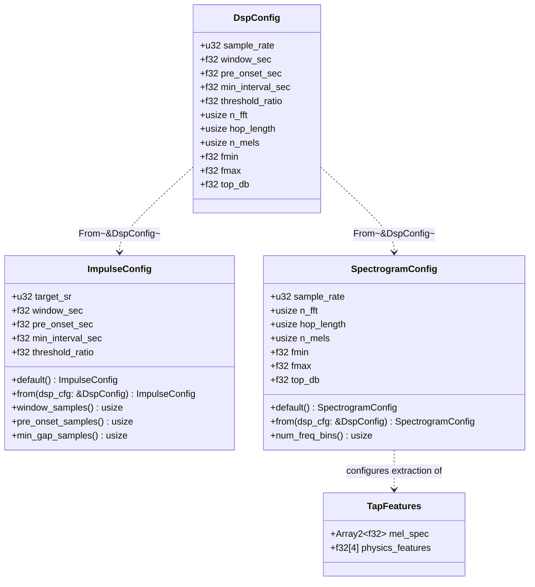

# Phase 1 Data Model: Acoustic DSP, Feature Extraction & Augmentation Entities

**Feature**: `002-phase2-dsp-augmentation`
**Date**: 2026-11-24

---

## 1. Entity Relationship & Pipeline Overview

---

## 2. DSP Configuration Entities (`src/dsp.rs`)

### 2.1. `ImpulseConfig`

Encapsulates physical time-domain parameters for transient tap onset detection and `0.8s` window extraction (`FR-003`, `FR-004`). Implements `Debug`, `Clone`, `PartialEq`, `Default`, and `From<&DspConfig>`.

| Field              | Type  | Default (`ImpulseConfig::default()`) | Derived Value at `22,050 Hz` | Validation / Physical Meaning                                                 |
| :----------------- | :---- | :----------------------------------- | :--------------------------- | :---------------------------------------------------------------------------- |
| `target_sr`        | `u32` | `22_050`                             | `22,050` samples/sec         | Unified target mono sampling rate (`> 0`)                                     |
| `window_sec`       | `f32` | `0.8`                                | `win_len = 17,640` samples   | Total duration of an extracted tap impulse window (`> 0.0`)                   |
| `pre_onset_sec`    | `f32` | `0.1`                                | `pre_len = 2,205` samples    | Attack lead-in before RMS peak (`100 ms`, `>= 0.0` and `< window_sec`)        |
| `min_interval_sec` | `f32` | `0.4`                                | `min_gap = 8,820` samples    | Minimum refractory interval between consecutive tap peaks (`400 ms`, `> 0.0`) |
| `threshold_ratio`  | `f32` | `0.25`                               | `25%` of global peak RMS     | Adaptive RMS threshold ratio (`> 0.0` and `<= 1.0`, floored at `1e-4`)        |

**Mapping from `DspConfig` (`From<&DspConfig>`)**:

- `target_sr = dsp.sample_rate`
- `window_sec = dsp.window_sec`
- `pre_onset_sec = dsp.pre_onset_sec`
- `min_interval_sec = dsp.min_interval_sec`
- `threshold_ratio = dsp.threshold_ratio`

---

### 2.2. `SpectrogramConfig`

Encapsulates time-frequency STFT and Log-Mel filterbank parameters (`FR-003`, `FR-006`, `FR-007`). Implements `Debug`, `Clone`, `PartialEq`, `Default`, and `From<&DspConfig>`.

| Field         | Type    | Default (`SpectrogramConfig::default()`) | Derived Dimension / Value      | Validation / Physical Meaning                                                        |
| :------------ | :------ | :--------------------------------------- | :----------------------------- | :----------------------------------------------------------------------------------- |
| `sample_rate` | `u32`   | `22_050`                                 | Nyquist = `11,025.0 Hz`        | Input waveform sampling rate (`> 0`)                                                 |
| `n_fft`       | `usize` | `1024`                                   | `n_freqs = 513` (`~46.44 ms`)  | Hann window & RealFFT size (`> 0`, power of two; frequency bin width `~21.533 Hz`)   |
| `hop_length`  | `usize` | `128`                                    | `128` frames (`~5.805 ms`/hop) | STFT frame step size (`> 0`; frame `127` ends at sample `127 * 128 + 1024 = 17,280`) |
| `n_mels`      | `usize` | `128`                                    | `128` Mel frequency rows       | Number of triangular Mel filterbank channels (`> 0`)                                 |
| `fmin`        | `f32`   | `50.0`                                   | `77.75` Mel                    | Lower frequency cutoff (`>= 0.0` and `< fmax`)                                       |
| `fmax`        | `f32`   | `8_000.0`                                | `2,840.02` Mel                 | Upper frequency cutoff (`> fmin` and `<= sample_rate / 2.0`)                         |
| `top_db`      | `f32`   | `80.0`                                   | `[-80.0 dB, 0.0 dB]`           | Dynamic range below window maximum power before clamping (`> 0.0`)                   |

**Mapping from `DspConfig` (`From<&DspConfig>`)**:

- Directly copies `sample_rate`, `n_fft`, `hop_length`, `n_mels`, `fmin`, `fmax`, and `top_db`.

---

## 3. Signal & Feature Representation Entities (`src/dsp.rs`)

### 3.1. `TapWindow` (`Vec<f32>`, length `17,640`) & `OnsetCenter` (`usize`)

- **`OnsetCenter` (`usize`)**: Zero-based sample index `center_sample = i * 256` in the `22,050 Hz` Mono waveform corresponding to a local maximum in the `256`-sample short-time RMS envelope.
- **`TapWindow` (`Vec<f32>`)**: Extracted `0.8s` slice starting at `start = center_sample.saturating_sub(2_205)` with exact length `win_len = 17,640` samples, normalized by `normalize_peak` such that:
    - Every sample $x[n] \in [-1.0, 1.0]$ is finite.
    - $\max_n |x[n]| = 1.0$ (within `< 1e-6`) for any non-silent input, or `0.0` for all-zero silent input (protected by denominator floor `1e-8`).

### 3.2. `PowerSpectrogram` (`Array2<f32>`, shape `(513, 128)`)

- Intermediate STFT power matrix $P(k, t) = |X(k, t)|^2$ returned by `compute_power_spectrogram`:
    - Axis 0 (`513` rows): RealFFT non-negative frequency bins $k \in [0, 512]$ corresponding to $f_k = k \times \frac{22050}{1024} \approx k \times 21.5332\text{ Hz}$.
    - Axis 1 (`128` columns): Time frames $t \in [0, 127]$ with step `hop_length = 128` samples (`~5.805 ms`).

### 3.3. `MelFilterbank` (`Array2<f32>`, shape `(128, 513)`)

- Reusable projection matrix $W_{\text{mel}}$ built once via `build_mel_filterbank(sample_rate, n_fft, n_mels, fmin, fmax)`:
    - Axis 0 (`128` rows): Triangular Mel bands spaced uniformly in Mel scale between `hz_to_mel(50.0)` and `hz_to_mel(8000.0)`.
    - Axis 1 (`513` columns): Weights for each RealFFT bin, scaled by Slaney area normalization $\text{enorm} = \frac{2.0}{\max(f_{\text{right}} - f_{\text{left}}, 10^{-8})}$.

### 3.4. `TapFeatures`

Combined feature representation returned by `extract_tap_features(audio, cfg, mel_basis)` (`FR-010`) for consumption by Phase 3 (`DurianAudioCnn` training) and Phase 4 (Mobile inference):

| Field              | Type          | Shape / Dimension | Value Range    | Description                                                             |
| :----------------- | :------------ | :---------------- | :------------- | :---------------------------------------------------------------------- |
| `mel_spec`         | `Array2<f32>` | `(128, 128)`      | `[0.0, 1.0]`   | Log-Mel spectrogram (`0.0` = `-80 dB` noise floor, `1.0` = `0 dB` peak) |
| `physics_features` | `[f32; 4]`    | `[4]`             | `[0.0, 1.0]^4` | `[\tilde{f}_peak, \tilde{C}_s, \tilde{R}_85, \tilde{\beta}_decay]`      |

---

## 4. Acoustic Physics Feature Definitions & Invariants (`FR-008`)

All 4 features are computed from `power_spec` `(513, 128)` and clamped to `[0.0, 1.0]`. If total power across the spectrogram is `<= 1e-10`, the extractor returns `[0.0, 0.0, 0.0, 0.0]` immediately.

| Index | Feature Symbol                 | Physical Quantity        | STFT Frame Range               | Raw Formula & Unit                                                                                                           | Normalization to `[0.0, 1.0]`                                                     |
| :---: | :----------------------------- | :----------------------- | :----------------------------- | :--------------------------------------------------------------------------------------------------------------------------- | :-------------------------------------------------------------------------------- | -------- | ------------------- | --------------------- | ------------------------------------------------------- |
|  `0`  | $\tilde{f}_{\text{peak}}$      | Peak Resonance Frequency | `t in 0..64` (first 64 frames) | $f_{\text{peak}} = k^* \cdot \frac{f_s}{N_{\text{fft}}}\text{ Hz}$, $k^* = \arg\max_{f_k \in [80, 1200]} P_{\text{mean}}(k)$ | $\text{clamp}\left(\frac{f_{\text{peak}} - 80.0}{1200.0 - 80.0}, 0.0, 1.0\right)$ |
|  `1`  | $\tilde{C}_s$                  | Spectral Centroid        | `t in 0..64` (first 64 frames) | $C_s = \frac{\sum_k f_k                                                                                                      | X\_{\text{mean}}(k)                                                               | }{\sum_k | X\_{\text{mean}}(k) | + 10^{-8}}\text{ Hz}$ | $\text{clamp}\left(\frac{C_s}{4000.0}, 0.0, 1.0\right)$ |
|  `2`  | $\tilde{R}_{85}$               | Spectral Roll-off (85%)  | `t in 0..64` (first 64 frames) | Smallest $f_K$ where $\sum_{k=0}^{K} P_{\text{mean}}(k) \ge 0.85 \sum_{\text{all } k} P_{\text{mean}}(k)$                    | $\text{clamp}\left(\frac{R_{85}}{6000.0}, 0.0, 1.0\right)$                        |
|  `3`  | $\tilde{\beta}_{\text{decay}}$ | Temporal Decay Slope     | `t in 26..=86` (`61` frames)   | OLS slope $\beta_{\text{decay}}$ (dB/frame) of $E_{\text{dB}}(t) = 10\log_{10}(\sum_k P(k, t) + 10^{-10})$                   | $\text{clamp}\left(\frac{-\beta_{\text{decay}}}{2.0}, 0.0, 1.0\right)$            |
