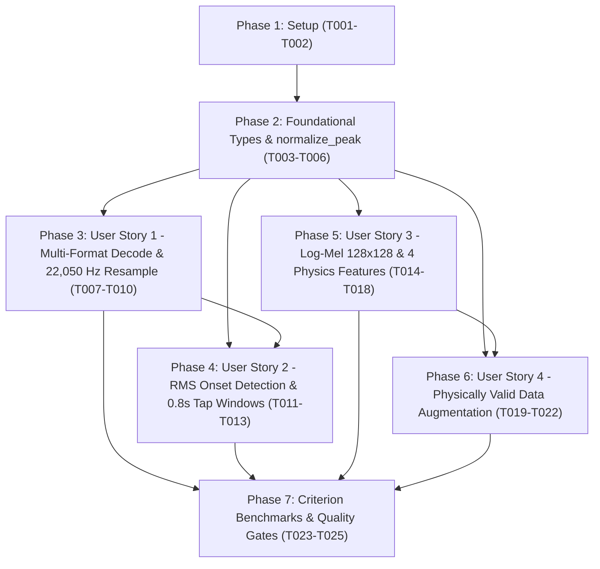

# Tasks: Phase 2 - Acoustic DSP, Impulse Onset Detection & Feature Extraction

**Input**: Design documents from `/specs/002-phase2-dsp-augmentation/`

**Prerequisites**: [plan.md](./plan.md) (required), [spec.md](./spec.md) (required for user stories), [research.md](./research.md), [data-model.md](./data-model.md), [contracts/dsp-and-augment.md](./contracts/dsp-and-augment.md), [quickstart.md](./quickstart.md)

**Tests**: Required by the DurianSonic Constitution (Principle II: Test-First Development, NON-NEGOTIABLE). Within each phase, failing tests (TDD Red) MUST be written and verified to fail before writing implementation code (TDD Green & Refactor).

**Organization**: Tasks are grouped by user story (`US1`, `US2`, `US3`, `US4`) to enable independent implementation and testing of each story while adhering strictly to Rust compilation boundaries and constitutional quality gates.

## Format: `[ID] [P?] [Story] Description`

- **[P]**: Can run in parallel (different files, no dependencies on incomplete tasks)
- **[Story]**: Which user story this task belongs to (`[US1]`, `[US2]`, `[US3]`, `[US4]`)
- Exact repository file paths and verbatim `data-model.md` constraints are included in every task description

## Path Conventions

- **Crate Manifest**: `Cargo.toml`
- **Configuration File**: `configs/default.toml`
- **Library Entry & Modules**: `src/lib.rs`, `src/config.rs`, `src/dataset.rs`, `src/dsp.rs`, `src/augment.rs`, `src/training.rs`
- **Criterion Benchmarks**: `benches/training_benchmarks.rs`
- **Dataset Audio Fixtures**: `data/sound_iphone/durian_001_unripe_iphone.m4a`, `data/sound_android/durian_001_unripe_android.wav`

---

## Phase 1: Setup (Shared Infrastructure)

**Purpose**: Verify locked crate dependencies, real audio test fixtures, and public module registration in the Rust workspace.

- [X] T001 Verify Phase 2 DSP and augmentation crate dependencies (`symphonia 0.6.1` with features `["aac", "alac", "isomp4", "pcm", "wav"]`, `rubato 5.1.0`, `realfft 3.5.1`, `ndarray 0.17.2`, `rand 0.10.4`, `anyhow 1.0.105`, `approx 0.5.1`, `tempfile 3.27.0`, `criterion 0.8.2`) in `Cargo.toml` and verify presence of real audio test fixtures (`data/sound_iphone/durian_001_unripe_iphone.m4a` and `data/sound_android/durian_001_unripe_android.wav`)
- [X] T002 [P] Export `pub mod dsp;` and `pub mod augment;` alongside `pub mod config;`, `pub mod dataset;`, and `pub mod training;` in `src/lib.rs` and create initial emoji-free module skeletons in `src/dsp.rs` and `src/augment.rs` (`FR-010`)

---

## Phase 2: Foundational (Blocking Prerequisites)

**Purpose**: Core DSP configuration bridges (`ImpulseConfig`, `SpectrogramConfig`), unified feature container (`TapFeatures`), and peak amplitude normalizer (`normalize_peak`) in `src/dsp.rs` required across User Stories 1-4.

**CRITICAL**: Complete this phase before starting User Story 1, User Story 2, User Story 3, or User Story 4 implementation.

- [X] T003 Write failing unit tests (TDD Red) in `src/dsp.rs` for `ImpulseConfig::default()`, `SpectrogramConfig::default()`, `ImpulseConfig::from(&DspConfig)`, `SpectrogramConfig::from(&DspConfig)`, derived sample helpers (`window_samples() == 17_640`, `pre_onset_samples() == 2_205`, `min_gap_samples() == 8_820`, `num_freq_bins() == 513`), `TapFeatures` construction, and `normalize_peak` (normalizing arbitrary waveforms to peak `1.0` within `< 1e-6` and handling all-zero silent arrays `vec![0.0; 17_640]` without `NaN` via `"protected by denominator floor 1e-8"`) (`FR-003`, `FR-005`, `FR-010`)
- [X] T004 Implement `ImpulseConfig` (`#[derive(Debug, Clone, PartialEq)]`) with fields `target_sr: u32` (default `22_050`, `"Unified target mono sampling rate (> 0)"`), `window_sec: f32` (default `0.8`, `"Total duration of an extracted tap impulse window (> 0.0)"`), `pre_onset_sec: f32` (default `0.1`, `"Attack lead-in before RMS peak (100 ms, >= 0.0 and < window_sec)"`), `min_interval_sec: f32` (default `0.4`, `"Minimum refractory interval between consecutive tap peaks (400 ms, > 0.0)"`), and `threshold_ratio: f32` (default `0.25`, `"Adaptive RMS threshold ratio (> 0.0 and <= 1.0, floored at 1e-4)"`), plus `Default`, `From<&DspConfig>`, `window_samples(&self) -> usize`, `pre_onset_samples(&self) -> usize`, and `min_gap_samples(&self) -> usize` with rustdoc in `src/dsp.rs` (`FR-003`)
- [X] T005 Implement `SpectrogramConfig` (`#[derive(Debug, Clone, PartialEq)]`) with fields `sample_rate: u32` (default `22_050`, `"Input waveform sampling rate (> 0)"`), `n_fft: usize` (default `1024`, `"Hann window & RealFFT size (> 0, power of two; frequency bin width ~21.533 Hz)"`), `hop_length: usize` (default `128`, `"STFT frame step size (> 0; frame 127 ends at sample 127 * 128 + 1024 = 17,280)"`), `n_mels: usize` (default `128`, `"Number of triangular Mel filterbank channels (> 0)"`), `fmin: f32` (default `50.0`, `"Lower frequency cutoff (>= 0.0 and < fmax)"`), `fmax: f32` (default `8_000.0`, `"Upper frequency cutoff (> fmin and <= sample_rate / 2.0)"`), and `top_db: f32` (default `80.0`, `"Dynamic range below window maximum power before clamping (> 0.0)"`), plus `Default`, `From<&DspConfig>`, `num_freq_bins(&self) -> usize`, and `TapFeatures` (`#[derive(Debug, Clone, PartialEq)]` with `pub mel_spec: Array2<f32>` of shape `(128, 128)` in value range `"[0.0, 1.0]"` `"Log-Mel spectrogram (0.0 = -80 dB noise floor, 1.0 = 0 dB peak)"` and `pub physics_features: [f32; 4]` in value range `"[0.0, 1.0]^4"` `"[\tilde{f}_peak, \tilde{C}_s, \tilde{R}_85, \tilde{\beta}_decay]"`) with rustdoc in `src/dsp.rs` (`FR-003`, `FR-010`)
- [X] T006 Implement `normalize_peak(window: &[f32]) -> Vec<f32>` dividing every sample by `peak = max(max_n |x[n]|, 1e-8)` (`"protected by denominator floor 1e-8"`) so every sample `x[n] in [-1.0, 1.0]` is finite and `max_n |x[n]| = 1.0` (within `< 1e-6`) for any non-silent input or `0.0` for all-zero silent input with rustdoc in `src/dsp.rs` (`FR-005`, `SC-002`)

**Checkpoint**: Foundational DSP types (`ImpulseConfig`, `SpectrogramConfig`, `TapFeatures`) and `normalize_peak` compile and pass unit tests in `src/dsp.rs`. User Stories 1, 2, 3, and 4 can now proceed.

---

## Phase 3: User Story 1 - Multi-Format Audio Decoding, Mono Downmixing & 22,050 Hz Resampling (Priority: P1) - MVP

**Goal**: Decode both iPhone `.m4a` (`AAC-LC` in ISO/MP4 container, `44.1 kHz` / `48 kHz`) and Android `.wav` (`16-bit PCM` Stereo, `48 kHz`) recordings, downmix multi-channel frames to Mono via arithmetic mean ($x_{\text{mono}}[n] = \frac{1}{C}\sum_{c=1}^{C} x_c[n]$), and resample to `22,050 Hz` (`"Unified target mono sampling rate (> 0)"`) with anti-aliasing filter delay compensation (`FR-001`, `FR-002`, `SC-001`).

**Independent Test**: Run `cargo test dsp::tests` verifying synthetic `48,000 Hz`, `44,100 Hz`, and `22,050 Hz` resampling accuracy, error handling on missing/corrupted files or `0 Hz` rates, multi-channel arithmetic mean downmixing, and real-file decoding of `data/sound_iphone/durian_001_unripe_iphone.m4a` and `data/sound_android/durian_001_unripe_android.wav` to finite `22,050 Hz` Mono waveforms.

### Tests for User Story 1 (TDD Red Phase)

> **NOTE: Write these tests FIRST in `src/dsp.rs` and confirm they FAIL before implementing `resample_mono` and `decode_audio_to_mono`.**

- [X] T007 [US1] Write failing unit tests in `src/dsp.rs` for `resample_mono`: identity passthrough when `src_sr == target_sr` (`22,050 Hz`), synchronous FFT downsampling of synthetic `48,000 Hz` and `44,100 Hz` sine waves to `22,050 Hz` yielding exact output length `round(N_src * 22050 / f_src)` with all finite values and preserved tone frequency, and explicit error returns on empty input slice `&[]`, `src_sr == 0`, or `target_sr == 0` (`FR-002`)
- [X] T008 [US1] Write failing unit and integration tests in `src/dsp.rs` for `decode_audio_to_mono`: fast-fail error returns when `target_sr == 0` (violating `"Unified target mono sampling rate (> 0)"`), when file path does not exist, or when decoding a corrupted or `0`-sample file (`tempfile`), exact arithmetic-mean Stereo-to-Mono downmixing ($x_{\text{mono}}[n] = \frac{1}{C}\sum_{c=1}^{C} x_c[n]$) on a synthetic multi-channel PCM `.wav` file, and real-file decoding of `data/sound_iphone/durian_001_unripe_iphone.m4a` and `data/sound_android/durian_001_unripe_android.wav` to non-empty finite Mono waveforms at `22,050 Hz` (`FR-001`, `SC-001`)

### Implementation for User Story 1 (TDD Green & Refactor Phase)

- [X] T009 [US1] Implement `resample_mono(samples: &[f32], src_sr: u32, target_sr: u32) -> anyhow::Result<Vec<f32>>` in `src/dsp.rs` validating `!samples.is_empty()`, `src_sr > 0`, and `target_sr > 0`, returning `Ok(samples.to_vec())` when `src_sr == target_sr`, and otherwise resampling via `rubato::Fft::<f32>::new(src_sr as usize, target_sr as usize, 1024, 1, FixedSync::Both)` with `InterleavedSlice::new` and `Resampler::process_all` (automatically trimming filter startup delay and rounding output length to `((samples.len() as f64) * (target_sr as f64) / (src_sr as f64)).round() as usize`) with rustdoc (`FR-002`)
- [X] T010 [US1] Implement `decode_audio_to_mono(path: &Path, target_sr: u32) -> anyhow::Result<Vec<f32>>` in `src/dsp.rs` enforcing `target_sr > 0` (`"Unified target mono sampling rate (> 0)"`), probing container format with `symphonia::default::get_probe().probe`, selecting `format.default_track(TrackType::Audio)` and `CodecParameters::Audio`, decoding packets via `while let Some(packet) = format.next_packet()?` and `GenericAudioBufferRef::copy_to_vec_interleaved`, downmixing multi-channel frames by arithmetic mean across channels, rejecting empty `0`-sample streams, and delegating to `resample_mono` when `src_sr != target_sr` with descriptive `anyhow::Context` and rustdoc (`FR-001`, `SC-001`)

**Checkpoint**: User Story 1 is complete and independently verifiable via `cargo test`. Both `.m4a` (iPhone AAC-LC) and `.wav` (Android 48 kHz Stereo PCM) decode cleanly to `22,050 Hz` Mono waveforms.

---

## Phase 4: User Story 2 - Transient Impulse Onset Detection & 0.8s Tap Window Extraction (Priority: P1)

**Goal**: Scan `22,050 Hz` Mono waveforms using non-overlapping `256`-sample (`~11.61 ms`) short-time RMS energy frames, detect local transient peaks exceeding adaptive threshold $\theta = \max(0.25 \cdot \max_i E_{\text{rms}}[i], 10^{-4})$ separated by at least `0.4s` (`8,820` samples), and extract peak-normalized `0.8s` (`17,640`-sample) tap impulse windows (`-100 ms` pre-onset lead-in to `+700 ms` decay tail) (`FR-004`, `FR-005`, `SC-001`, `SC-002`).

**Independent Test**: Run `cargo test dsp::tests` on a synthetic `10s` (`220,500`-sample) signal containing `5` decaying sine impulses spaced `1.5s` apart, edge-case short/empty/silent buffers, and real iPhone `.m4a` and Android `.wav` recordings (confirming `>= 5` extracted tap windows per recording, each of exact length `17,640` samples with peak amplitude `1.0` and inter-onset distance `>= 8,820` samples).

### Tests for User Story 2 (TDD Red Phase)

> **NOTE: Write these tests FIRST in `src/dsp.rs` and confirm they FAIL before implementing `detect_onset_centers` and `extract_tap_impulses`.**

- [X] T011 [US2] Write failing unit and integration tests in `src/dsp.rs` for `detect_onset_centers` and `extract_tap_impulses`: `test_extract_tap_impulses_synthetic_train` (`10s` / `220,500`-sample signal at `22,050 Hz` containing `5` exponentially decaying sine impulses spaced `1.5s` apart, asserting `5` windows of exact length `17,640` samples with peak amplitude `1.0` within `< 1e-6` and consecutive `center_sample` spacing `>= 8,820` samples), refractory suppression of echo peaks within `< 8,820` samples (`0.4s`), boundary saturation when `center_sample < 2,205` (`saturating_sub`), exclusion of trailing peaks near EOF where `start + 17,640 > samples.len()`, empty slice `&[]` returning `Vec::new()` for both functions, short non-empty slice (`1..17,640` samples) returning `vec![0]` from `detect_onset_centers` and `1` zero-padded `17,640`-sample normalized window from `extract_tap_impulses`, all-zero silent buffer safety, and real-file extraction yielding `>= 5` valid tap windows each on `data/sound_iphone/durian_001_unripe_iphone.m4a` and `data/sound_android/durian_001_unripe_android.wav` (`FR-004`, `SC-001`, `SC-002`)

### Implementation for User Story 2 (TDD Green & Refactor Phase)

- [X] T012 [US2] Implement `detect_onset_centers(samples: &[f32], cfg: &ImpulseConfig) -> Vec<usize>` in `src/dsp.rs` returning `Vec::new()` when `samples.is_empty()` or `win_len == 0`, returning `vec![0]` when `0 < samples.len() < win_len` (`win_len = 17,640`, `"Total duration of an extracted tap impulse window (> 0.0)"`), and for `samples.len() >= win_len` partitioning into non-overlapping `256`-sample frames to compute $E_{\text{rms}}[i] = \sqrt{\frac{1}{N_i}\sum x^2}$, global adaptive threshold $\theta = \max(\max_i E_{\text{rms}}[i] \times \text{threshold\_ratio}, 10^{-4})$ (`"Adaptive RMS threshold ratio (> 0.0 and <= 1.0, floored at 1e-4)"`), interior local peak selection ($i \in [1, L_{\text{rms}} - 2]$ with $E_{\text{rms}}[i] \ge \theta \land E_{\text{rms}}[i] \ge E_{\text{rms}}[i-1] \land E_{\text{rms}}[i] > E_{\text{rms}}[i+1]$), refractory interval enforcement (`min_gap = 8,820` samples, `"Minimum refractory interval between consecutive tap peaks (400 ms, > 0.0)"`), and full-window bounds check `start + win_len <= samples.len()` where `start = center_sample.saturating_sub(pre_len)` (`pre_len = 2,205` samples, `"Attack lead-in before RMS peak (100 ms, >= 0.0 and < window_sec)"`) with rustdoc (`FR-004`, `SC-002`)
- [X] T013 [US2] Implement `extract_tap_impulses(samples: &[f32], cfg: &ImpulseConfig) -> Vec<Vec<f32>>` in `src/dsp.rs` returning `Vec::new()` when `samples.is_empty()`, zero-padding `samples` with `0.0` to `win_len = 17,640` samples and returning `vec![normalize_peak(&padded)]` when `0 < samples.len() < win_len`, and for `samples.len() >= win_len` iterating over `detect_onset_centers(samples, cfg)` to slice `&samples[start..start + win_len]` (`start = center_sample.saturating_sub(pre_len)`) and normalize each window with `normalize_peak` with rustdoc (`FR-004`, `FR-005`, `SC-001`, `SC-002`)

**Checkpoint**: User Stories 1 and 2 are both complete and independently verified via `cargo test`. Real multi-tap recordings from iPhone and Android are decoded, resampled, and segmented into normalized `17,640`-sample (`0.8s`) tap windows.

---

## Phase 5: User Story 3 - Log-Mel Spectrogram (`128 x 128`) & 4 Acoustic Physics Features Extraction (Priority: P1)

**Goal**: Transform each `0.8s` (`17,640`-sample) tap window via a single shared `128`-frame `1024`-point Hann-windowed RealFFT power spectrogram (`(513, 128)`, `hop_length = 128`) into both a normalized `[0.0, 1.0]` Log-Mel spectrogram (`(128, 128)`) projected through a Slaney area-normalized Mel filterbank (`(128, 513)`) and a `[0.0, 1.0]^4` vector of `4` acoustic physics features ($\tilde{f}_{\text{peak}}$, $\tilde{C}_s$, $\tilde{R}_{85}$, $\tilde{\beta}_{\text{decay}}$) in `< 4.0 ms` per tap (`FR-006`, `FR-007`, `FR-008`, `FR-010`, `SC-003`, `SC-004`, `SC-005`).

**Independent Test**: Run `cargo test dsp::tests` verifying `hz_to_mel`/`mel_to_hz` roundtrip accuracy, `(128, 513)` Slaney filterbank construction, `(513, 128)` power spectrogram and `(128, 128)` Log-Mel spectrogram shapes and `[0.0, 1.0]` value bounds, `[0.0, 0.0, 0.0, 0.0]` output on silent input, synthetic `Unripe` (`600 Hz`, slow decay) vs `Overripe` (`180 Hz`, fast decay) physical feature discrimination, and single-pass `extract_tap_features` equivalence.

### Tests for User Story 3 (TDD Red Phase)

> **NOTE: Write these tests FIRST in `src/dsp.rs` and confirm they FAIL before implementing the Mel filterbank, STFT power spectrogram, Log-Mel spectrogram, and physics feature extraction functions.**

- [X] T014 [US3] Write failing unit tests in `src/dsp.rs` for `hz_to_mel` and `mel_to_hz` roundtrip accuracy (`approx::assert_relative_eq!`), `build_mel_filterbank(22_050, 1024, 128, 50.0, 8_000.0)` shape `(128, 513)`, non-negativity, and Slaney area normalization (`enorm = 2.0 / max(f_right - f_left, 1e-8)`), `compute_power_spectrogram` shape `(513, 128)`, and `test_log_mel_spectrogram_shape_and_bounds` verifying `compute_log_mel_spectrogram` outputs shape `(128, 128)` with all elements finite and within value range `"[0.0, 1.0]"` (`"Log-Mel spectrogram (0.0 = -80 dB noise floor, 1.0 = 0 dB peak)"`) for both normal tap windows and all-zero silent windows (`FR-006`, `FR-007`, `SC-003`)
- [X] T015 [US3] Write failing unit tests in `src/dsp.rs` for `extract_physics_features_from_power_spec`, `extract_physics_features`, and `extract_tap_features`: `test_physics_features_sine_wave_resonance` synthesizing Signal A (`Unripe`: `600 Hz` sine wave with slow exponential decay) and Signal B (`Overripe`: `180 Hz` sine wave with fast exponential decay) to verify all 4 features lie in value range `"[0.0, 1.0]^4"` (`"[\tilde{f}_peak, \tilde{C}_s, \tilde{R}_85, \tilde{\beta}_decay]"`), $\tilde{f}_{\text{peak}}(A) > \tilde{f}_{\text{peak}}(B)$, $\tilde{C}_s(A) > \tilde{C}_s(B)$, and $\tilde{\beta}_{\text{decay}}(B) > \tilde{\beta}_{\text{decay}}(A)$, silent signal invariance returning `[0.0, 0.0, 0.0, 0.0]` when total power across the spectrogram is `"<= 1e-10"`, and single-pass equivalence of `extract_tap_features(audio, &cfg, &mel_basis)` with standalone `compute_log_mel_spectrogram` and `extract_physics_features` (`FR-008`, `FR-010`, `SC-003`, `SC-004`)

### Implementation for User Story 3 (TDD Green & Refactor Phase)

- [X] T016 [US3] Implement `hz_to_mel(hz: f32) -> f32` (`2595.0 * (1.0 + hz / 700.0).log10()`), `mel_to_hz(mel: f32) -> f32` (`700.0 * (10.0_f32.powf(mel / 2595.0) - 1.0)`), and `build_mel_filterbank(sample_rate: u32, n_fft: usize, n_mels: usize, fmin: f32, fmax: f32) -> Array2<f32>` in `src/dsp.rs` constructing a `(n_mels, n_fft / 2 + 1)` (`(128, 513)`) triangular Mel filterbank matrix uniformly spaced in Mel scale between `fmin` (`"Lower frequency cutoff (>= 0.0 and < fmax)"`) and `fmax` (`"Upper frequency cutoff (> fmin and <= sample_rate / 2.0)"`) scaled by Slaney area normalization `enorm = 2.0 / (f_right - f_left).max(1e-8)` with rustdoc (`FR-006`)
- [X] T017 [US3] Implement `compute_power_spectrogram(audio: &[f32], cfg: &SpectrogramConfig) -> Array2<f32>` in `src/dsp.rs` using `realfft::RealFftPlanner::<f32>` (`n_fft = 1024`, `"Hann window & RealFFT size (> 0, power of two; frequency bin width ~21.533 Hz)"`) with Hann window $w[n] = 0.5(1 - \cos(2\pi n / N_{\text{fft}}))$ over `target_frames = 128` (`hop_length = 128`, `"STFT frame step size (> 0; frame 127 ends at sample 127 * 128 + 1024 = 17,280)"`) and zero-padding out-of-bounds indices to return `power_spec` of shape `(513, 128)`, and implement `compute_log_mel_spectrogram(audio: &[f32], cfg: &SpectrogramConfig, mel_basis: &Array2<f32>) -> Array2<f32>` projecting `mel_basis.dot(&power_spec)`, converting to Log-dB relative to window peak power $P_{\max} = \max(\max_{m,t} S_{\text{mel}}(m, t), 10^{-10})$ clamped to `[-top_db, 0.0]` (`top_db = 80.0`, `"Dynamic range below window maximum power before clamping (> 0.0)"`), and mapping linearly via `(db_clamped + top_db) / top_db` to `"[0.0, 1.0]"` with rustdoc (`FR-007`, `SC-003`)
- [X] T018 [US3] Implement `extract_physics_features_from_power_spec(power_spec: &Array2<f32>, cfg: &SpectrogramConfig) -> [f32; 4]` in `src/dsp.rs` returning `[0.0, 0.0, 0.0, 0.0]` immediately if total power across the spectrogram is `"<= 1e-10"`, computing Index `0` Peak Resonance Frequency $\tilde{f}_{\text{peak}}$ on `"t in 0..64 (first 64 frames)"` over $f_k \in [80.0, 1200.0]\text{ Hz}$ normalized via `"clamp((f_peak - 80.0) / (1200.0 - 80.0), 0.0, 1.0)"`, Index `1` Spectral Centroid $\tilde{C}_s$ on `"t in 0..64 (first 64 frames)"` with mean magnitude $|X_{\text{mean}}(k)|$ and denominator floor `1e-8` normalized via `"clamp(C_s / 4000.0, 0.0, 1.0)"`, Index `2` Spectral Roll-off (85%) $\tilde{R}_{85}$ on `"t in 0..64 (first 64 frames)"` finding smallest $f_K$ with cumulative mean power $\ge 0.85$ of total power normalized via `"clamp(R_85 / 6000.0, 0.0, 1.0)"`, and Index `3` Temporal Decay Slope $\tilde{\beta}_{\text{decay}}$ on `"t in 26..=86 (61 frames)"` via OLS linear regression slope of $E_{\text{dB}}(t) = 10\log_{10}(\sum_k P(k, t) + 10^{-10})$ normalized via `"clamp(-beta_decay / 2.0, 0.0, 1.0)"`, plus standalone wrapper `extract_physics_features(audio: &[f32], cfg: &SpectrogramConfig) -> [f32; 4]` and single-pass `extract_tap_features(audio: &[f32], cfg: &SpectrogramConfig, mel_basis: &Array2<f32>) -> TapFeatures` with rustdoc (`FR-008`, `FR-010`, `SC-003`, `SC-004`, `SC-005`)

**Checkpoint**: User Stories 1, 2, and 3 are complete and independently verified via `cargo test`. The full inference and training DSP feature extraction pipeline (`TapFeatures`) is operational.

---

## Phase 6: User Story 4 - Physically Valid Acoustic Data Augmentation (Priority: P2)

**Goal**: Provide 4 train-only physically valid acoustic data augmentations in `src/augment.rs` (`apply_onset_jitter` $\pm 40\text{ ms}$, `add_background_noise` with Box-Muller Gaussian white noise at $\text{SNR} \in [15, 35]\text{ dB}$, `apply_spectral_tilt` $\pm 3\text{ dB}$, and `apply_spec_augment` masking to `0.0`) on `rand 0.10.4` with defensive bounds guards that never panic on degenerate parameters and strictly zero Pitch Shift or Time Stretch (`FR-009`).

**Independent Test**: Run `cargo test augment::tests` verifying that all 4 augmentation functions preserve window length `17,640` or matrix shape `(128, 128)`, keep values bounded in `[-1.0, 1.0]` or `[0.0, 1.0]`, preserve peak resonance frequency $\tilde{f}_{\text{peak}}$ of a `600 Hz` tone, set masked spectrogram regions to `0.0`, and never panic on zero/inverted/small boundary arguments.

### Tests for User Story 4 (TDD Red Phase)

> **NOTE: Write these tests FIRST in `src/augment.rs` and confirm they FAIL before implementing `apply_onset_jitter`, `add_background_noise`, `apply_spectral_tilt`, and `apply_spec_augment`.**

- [X] T019 [P] [US4] Write failing unit tests in `src/augment.rs` for waveform augmentations `apply_onset_jitter` (verifying output length `win_len = 17,640` samples and `[-1.0, 1.0]` peak normalization when `center_sample` is near index `0`, near `full_samples.len()`, when `full_samples.len() < 17,640` requiring zero-padding, or when `max_jitter_samples == 0`) and `add_background_noise` (verifying Box-Muller Gaussian white noise within `[15.0, 35.0] dB` SNR maintains length `17,640` and `[-1.0, 1.0]` bounds, preserves peak resonance frequency $\tilde{f}_{\text{peak}}$ of a `600 Hz` sine wave, and never panics when `min_snr_db >= max_snr_db`, when input is all-zero silent, or when input is empty `&[]`) (`FR-009`)
- [X] T020 [P] [US4] Write failing unit tests in `src/augment.rs` for spectrogram augmentations `apply_spectral_tilt` (verifying linear dB slope across `(128, 128)` Log-Mel rows, clamping to value range `"[0.0, 1.0]"`, and panic-free handling when `max_tilt_db <= 0.0`, `top_db <= 0.0`, or `mel_spec.nrows() <= 1`) and `apply_spec_augment` (verifying contiguous Mel frequency band masking up to `min(max_freq_mask, n_mels / 4)` and time frame masking up to `min(max_time_mask, n_frames / 4)` to `noise_floor_val = 0.0`, preservation of `"[0.0, 1.0]"` bounds, and panic-free execution when `max_freq_mask == 0`, `max_time_mask == 0`, or matrix dimensions are `< 4`) (`FR-009`)

### Implementation for User Story 4 (TDD Green & Refactor Phase)

- [X] T021 [P] [US4] Implement `apply_onset_jitter(full_samples: &[f32], center_sample: usize, max_jitter_samples: usize, cfg: &ImpulseConfig) -> Vec<f32>` (sampling $\delta \in [-\text{max\_jitter\_samples}, +\text{max\_jitter\_samples}]$ via `rand::rng().random_range` when `max_jitter_samples > 0` else `0`, clamping `start` within `full_samples` or zero-padding if `full_samples.len() < win_len` where `win_len = 17,640` `"Total duration of an extracted tap impulse window (> 0.0)"` and `pre_len = 2,205` `"Attack lead-in before RMS peak (100 ms, >= 0.0 and < window_sec)"`, and normalizing with `normalize_peak`) and `add_background_noise(window: &[f32], min_snr_db: f32, max_snr_db: f32) -> Vec<f32>` (ordering `(lo, hi) = (min_snr_db.min(max_snr_db), min_snr_db.max(max_snr_db))`, guarding empty or silent $P_{\text{sig}} \le 10^{-12}$ inputs, generating Gaussian white noise $\mathcal{N}(0, \sigma_{\text{noise}}^2)$ via Box-Muller transform $z = \sqrt{-2\ln u_1}\cos(u_2)$ with `u1 in [1e-7, 1.0)`, and normalizing with `normalize_peak` `"protected by denominator floor 1e-8"`) with rustdoc in `src/augment.rs` (`FR-009`)
- [X] T022 [US4] Implement `apply_spectral_tilt(mel_spec: &mut Array2<f32>, max_tilt_db: f32, top_db: f32)` (guarding `max_tilt_db == 0.0 || !max_tilt_db.is_finite() || top_db <= 0.0 || mel_spec.nrows() <= 1`, sampling `tilt_db in [-|max_tilt_db|, +|max_tilt_db|]`, adding $\Delta_m = \frac{\text{tilt\_db}}{\text{top\_db}}\left(\frac{2m}{M - 1} - 1\right)$ to each Mel row $m \in [0, M-1]$, and clamping every element to `"[0.0, 1.0]"`) and `apply_spec_augment(mel_spec: &mut Array2<f32>, max_freq_mask: usize, max_time_mask: usize, noise_floor_val: f32)` (clamping mask bounds `f_bound = max_freq_mask.min(n_mels / 4)` and `t_bound = max_time_mask.min(n_frames / 4)` and setting masked slices to `noise_floor_val = 0.0`) with rustdoc in `src/augment.rs` (`FR-009`)

**Checkpoint**: User Story 4 is complete and independently verified via `cargo test`. All 4 physically valid train-time augmentations are ready for Phase 3 training integration.

---

## Phase 7: Polish & Cross-Cutting Concerns (Criterion Benchmarks & Quality Gates)

**Purpose**: Benchmark single-threaded DSP feature extraction latency (`< 4.0 ms / tap`) with Criterion and verify all DurianSonic Constitutional quality gates.

- [X] T023 Add a `benchmark_dsp_pipeline` Criterion benchmark group (`dsp_extract_tap_features` and `dsp_extract_tap_impulses`) to `benches/training_benchmarks.rs` measuring single-threaded execution of `extract_tap_features` on a `0.8s` (`17,640`-sample) tap window with a pre-built `(128, 513)` `mel_basis` to verify `< 4.0 ms` per-tap latency (`SC-005`)
- [X] T024 [P] Audit `src/dsp.rs`, `src/augment.rs`, `src/lib.rs`, and `benches/training_benchmarks.rs` for DurianSonic Constitution compliance: 100% emoji-free code and comments, zero decorative comment separators (`===` or `---`), zero unguarded `unwrap()`/`expect()` in library code, concise `//` comments explaining _why_, and complete module-level `//!` and item-level `///` rustdoc with `# Examples` on all public structs and functions
- [X] T025 Run end-to-end Phase 2 quickstart and constitutional verification gates: `cargo test`, `cargo bench --bench training_benchmarks -- --test`, `cargo bench --bench training_benchmarks -- dsp_extract_tap_features` (confirming `< 4.0 ms` per-tap DSP extraction latency), `cargo clippy --all-targets -- -D warnings`, `cargo fmt --check`, and `cargo run -- verify-dataset --data-dir data` (`SC-001`, `SC-002`, `SC-003`, `SC-004`, `SC-005`)

---

## Dependencies & Execution Order

### Phase Dependencies

- **Phase 1: Setup (`T001-T002`)**: No dependencies - can start immediately.
- **Phase 2: Foundational (`T003-T006`)**: Depends on Phase 1 completion - BLOCKS all User Stories (`Phase 3` through `Phase 6`).
- **Phase 3: User Story 1 (`T007-T010`, P1 - MVP)**: Depends on Phase 2 completion. Implements `resample_mono` and `decode_audio_to_mono` in `src/dsp.rs`.
- **Phase 4: User Story 2 (`T011-T013`, P1)**: Depends on Phase 2 completion (uses `ImpulseConfig` and `normalize_peak`; real-file integration tests in `T011` also use `decode_audio_to_mono` from `US1`).
- **Phase 5: User Story 3 (`T014-T018`, P1)**: Depends on Phase 2 completion (uses `SpectrogramConfig` and `TapFeatures` in `src/dsp.rs`). Can be tested independently on synthetic `17,640`-sample sine windows without waiting for `US1` or `US2`.
- **Phase 6: User Story 4 (`T019-T022`, P2)**: Modifies `src/augment.rs` and depends only on Phase 2 (`ImpulseConfig` and `normalize_peak` from `src/dsp.rs`; the `600 Hz` resonance check in `T019` calls `extract_physics_features` from `US3`). Because `src/augment.rs` is a separate file, `T019-T022` can be developed in parallel with `src/dsp.rs` work.
- **Phase 7: Polish & Cross-Cutting Concerns (`T023-T025`)**: Depends on completion of Phases 3, 4, 5, and 6.

### User Story Dependencies



### Within Each User Story (Mandatory TDD Cycle)

1. Write failing unit and integration tests first (**TDD Red**).
2. Verify the new tests fail for the expected reason (`cargo test`).
3. Implement minimal clean library code to make all tests pass (**TDD Green**).
4. Refactor for clarity, performance, rustdoc completeness, and zero clippy warnings (**TDD Refactor**).

### Parallel Opportunities

- **Setup Phase**: `T002` (`src/lib.rs`, `src/dsp.rs`, and `src/augment.rs` module skeletons) can run in parallel with `T001` (`Cargo.toml` and `data/` fixture verification).
- **Cross-Story File Parallelism (`src/dsp.rs` vs `src/augment.rs`)**: Once **Phase 2: Foundational (`T003-T006`)** is complete, **User Story 4 (`src/augment.rs`, `T019-T022`)** operates in a completely separate source file from **User Stories 1-3 (`src/dsp.rs`, `T007-T018`)** and can be implemented in parallel by another engineer or agent.
- **Within User Story 4 (`src/augment.rs`)**: Waveform augmentation tests/implementations (`T019`, `T021`) and spectrogram augmentation tests/implementations (`T020`, `T022`) touch independent functions and can be authored concurrently.
- **Polish Phase**: `T023` (`benches/training_benchmarks.rs`) and `T024` (rustdoc and Constitution audit in `src/dsp.rs` and `src/augment.rs`) touch different files and can run in parallel before final gate execution in `T025`.

---

## Parallel Example: Cross-Story Execution

```bash
# Stream A: Core Acoustic DSP Pipeline (src/dsp.rs)
Task: "T003-T006 Foundational ImpulseConfig, SpectrogramConfig, TapFeatures & normalize_peak in src/dsp.rs"
Task: "T007-T010 [US1] symphonia multi-format decoding & rubato 22,050 Hz FFT resampling in src/dsp.rs"
Task: "T011-T013 [US2] Short-time RMS onset detector & 0.8s (17,640-sample) tap extractor in src/dsp.rs"
Task: "T014-T018 [US3] Slaney Mel filterbank, single-pass STFT power spectrogram, Log-Mel (128x128) & 4 physics features in src/dsp.rs"

# Stream B (Parallel with Stream A after T006): Physically Valid Augmentation (src/augment.rs)
Task: "T019-T020 [P] [US4] TDD Red unit tests for onset jitter, Box-Muller noise, spectral tilt & SpecAugment in src/augment.rs"
Task: "T021-T022 [US4] Implement apply_onset_jitter, add_background_noise, apply_spectral_tilt & apply_spec_augment in src/augment.rs"
```

---

## Implementation Strategy

### MVP First (User Story 1 Only)

1. Complete **Phase 1: Setup** (`T001-T002`).
2. Complete **Phase 2: Foundational** (`T003-T006`).
3. Complete **Phase 3: User Story 1** (`T007-T010`).
4. **STOP and VALIDATE**: Run `cargo test` to verify that both iPhone `.m4a` (`AAC-LC`) and Android `.wav` (`16-bit PCM` Stereo `48 kHz`) audio recordings decode and resample accurately to finite `22,050 Hz` Mono waveforms.

### Incremental Delivery

1. **Foundation (`Phase 1 + Phase 2`)**: `ImpulseConfig`, `SpectrogramConfig`, `TapFeatures`, and `normalize_peak` ready and unit-tested.
2. **Increment 1 (`Phase 3 - US1`)**: Multi-format audio decoding (`symphonia 0.6.1`), Stereo-to-Mono arithmetic mean downmixing, and `22,050 Hz` synchronous FFT resampling (`rubato 5.1.0`) verified on real iPhone and Android recordings.
3. **Increment 2 (`Phase 4 - US2`)**: Short-time RMS onset detection (`256`-sample frames, `0.4s` refractory gap) and `0.8s` (`17,640`-sample) tap window segmentation verified on synthetic pulse trains and real recordings (`>= 5` taps/file).
4. **Increment 3 (`Phase 5 - US3`)**: Single-pass `1024`-point Hann-windowed RealFFT power spectrogram (`(513, 128)`), Slaney Mel filterbank (`(128, 513)`), normalized `(128, 128)` Log-Mel spectrogram, and `4` normalized acoustic physics features (`TapFeatures`) verified on synthetic `Unripe` (`600 Hz`) vs `Overripe` (`180 Hz`) decaying sine waves.
5. **Increment 4 (`Phase 6 - US4`)**: Train-only physically valid augmentations (`apply_onset_jitter`, `add_background_noise`, `apply_spectral_tilt`, `apply_spec_augment`) verified with defensive bounds guards.
6. **Increment 5 (`Phase 7 - Benchmarks & Quality Gates`)**: Criterion benchmark confirming `< 4.0 ms` per-tap DSP extraction latency and full constitutional quality gates (`cargo clippy --all-targets -- -D warnings && cargo fmt --check`).

---

## Notes

- All tasks strictly follow `- [ ] [TaskID] [P?] [Story?] Description with file path`.
- All tasks and generated code must adhere to the DurianSonic Constitution (`100%` emoji-free, strict TDD Red-Green-Refactor, zero unguarded `unwrap()`/`expect()` in library code, zero decorative comment separators, zero clippy warnings).
- Stop at each phase checkpoint to verify `cargo test` passes before proceeding to the next phase.
