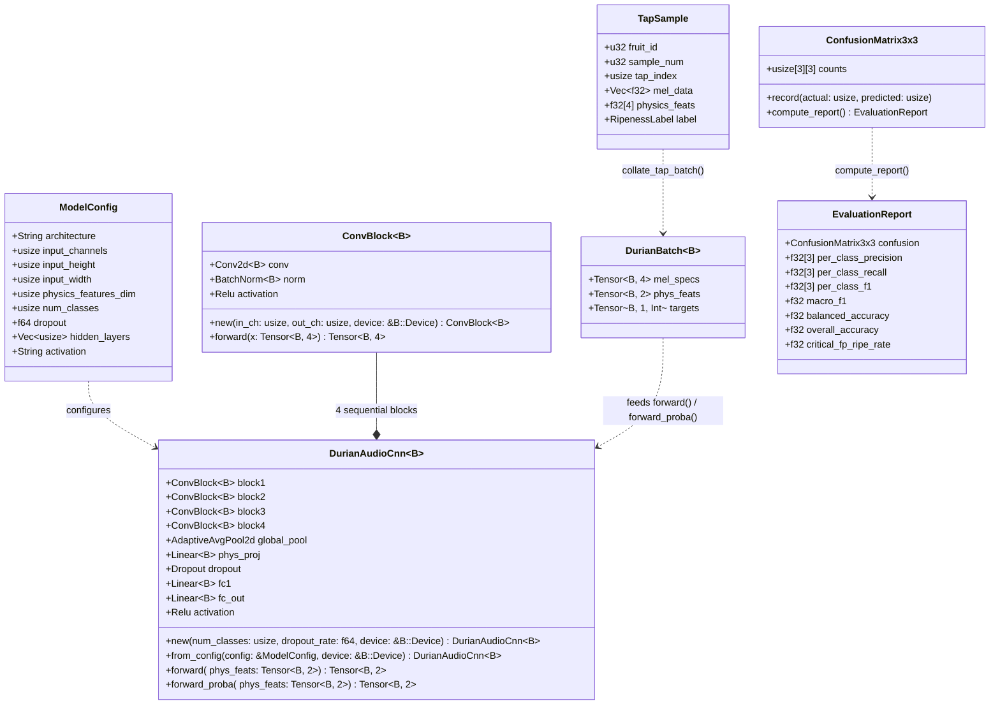

# Phase 1 Data Model: Hybrid CNN Architecture, Training Entities & Dual-Level Metrics

**Feature**: `003-phase3-model-training`
**Date**: 2026-11-26

---

## 1. Entity Relationship & Pipeline Overview

---

## 2. Neural Network Entities (`src/model.rs`)

### 2.1. `ConvBlock<B: Backend>` (`FR-001`, `CHK001`, `CHK002`, `CHK006`)

Basic 2D convolutional building block that halves spatial dimensions (`[H, W] -> [H/2, W/2]`) and expands feature channels. Derives `#[derive(Module, Debug)]`.

| Field        | Type           | Configuration (`burn 0.22.1`)                                                                                     | Tensor Shape Transformation                        |
| :----------- | :------------- | :---------------------------------------------------------------------------------------------------------------- | :------------------------------------------------- |
| `conv`       | `Conv2d<B>`    | `Conv2dConfig::new([in_ch, out_ch], [3, 3]).with_stride([2, 2]).with_padding(PaddingConfig2d::Same).init(device)` | `[B, in_ch, H, W] -> [B, out_ch, H / 2, W / 2]`    |
| `norm`       | `BatchNorm<B>` | `BatchNormConfig::new(out_ch).init(device)`                                                                       | `[B, out_ch, H / 2, W / 2]` (channel-wise 2D norm) |
| `activation` | `Relu`         | `Relu::new()`                                                                                                     | Element-wise $\max(0, x)$, preserving tensor shape |

### 2.2. `DurianAudioCnn<B: Backend>` (`FR-001`, `FR-002`, `CHK003`–`CHK010`, `CHK028`, `CHK032`)

Hybrid dual-branch convolutional and acoustic-physics neural network (~`408,019` trainable parameters, `~1.63 MB` in FP32 `.mpk` format, strictly `< 2.0 MB` per `SC-005`). Derives `#[derive(Module, Debug)]`.

| Branch / Stage               | Layer Field   | Type                | Configuration / Dimensions                                   | Input Shape          | Output Shape       | Parameter Count |
| :--------------------------- | :------------ | :------------------ | :----------------------------------------------------------- | :------------------- | :----------------- | --------------: |
| **Spectrogram Branch**       | `block1`      | `ConvBlock<B>`      | `in_ch = 1, out_ch = 32, kernel = 3x3, stride = 2, Same`     | `[B, 1, 128, 128]`   | `[B, 32, 64, 64]`  |             384 |
|                              | `block2`      | `ConvBlock<B>`      | `in_ch = 32, out_ch = 64, kernel = 3x3, stride = 2, Same`    | `[B, 32, 64, 64]`    | `[B, 64, 32, 32]`  |          18,624 |
|                              | `block3`      | `ConvBlock<B>`      | `in_ch = 64, out_ch = 128, kernel = 3x3, stride = 2, Same`   | `[B, 64, 32, 32]`    | `[B, 128, 16, 16]` |          74,112 |
|                              | `block4`      | `ConvBlock<B>`      | `in_ch = 128, out_ch = 256, kernel = 3x3, stride = 2, Same`  | `[B, 128, 16, 16]`   | `[B, 256, 8, 8]`   |         295,680 |
|                              | `global_pool` | `AdaptiveAvgPool2d` | `AdaptiveAvgPool2dConfig::new([1, 1]).init()` + `.reshape()` | `[B, 256, 8, 8]`     | `[B, 256]`         |               0 |
| **Physics Embedding Branch** | `phys_proj`   | `Linear<B>`         | `LinearConfig::new(4, 16).init(device)` + `Relu`             | `[B, 4]`             | `[B, 16]`          |              80 |
| **Late-Fusion Head**         | `cat`         | `Tensor::cat`       | `Tensor::cat(vec![spec_emb, phys_emb], 1)` (`dim = 1`)       | `[B, 256] + [B, 16]` | `[B, 272]`         |               0 |
|                              | `dropout`     | `Dropout`           | `DropoutConfig::new(dropout_rate).init()` (default `0.3`)    | `[B, 272]`           | `[B, 272]`         |               0 |
|                              | `fc1`         | `Linear<B>`         | `LinearConfig::new(272, 64).init(device)` + `Relu`           | `[B, 272]`           | `[B, 64]`          |          17,472 |
|                              | `fc_out`      | `Linear<B>`         | `LinearConfig::new(64, num_classes).init(device)` (`3`)      | `[B, 64]`            | `[B, 3]`           |             195 |
|                              | `activation`  | `Relu`              | Shared stateless `Relu::new()` for `phys_proj` and `fc1`     | —                    | —                  |               0 |

**Mathematical & Structural Invariants**:

- **Dynamic Batch Size (`CHK021`)**: `forward` extracts `let [batch_size, _, _, _] = mel_spec.dims();` dynamically before calling `.reshape([batch_size, 256])`, supporting any $B \ge 1$.
- **Class Index Ordering (`CHK013`)**: Column indices of output tensor `[B, 3]` strictly map to `0 => RipenessLabel::Unripe`, `1 => RipenessLabel::Ripe`, `2 => RipenessLabel::Overripe`.
- **Probability Simplex (`FR-002`, `SC-001`, `CHK010`, `CHK016`)**: `forward_proba` applies `softmax(logits, 1)` such that for every row $i \in [0, B)$, $P_i(c) \in [0.0, 1.0]$ and $\left|\sum_{c=0}^{2} P_i(c) - 1.0\right| < 10^{-5}$.
- **Train vs Valid Mode (`CHK018`)**: During training on `AutodiffBackend`, `Dropout(0.3)` is active and `BatchNorm` updates running statistics; during validation/testing, calling `model.valid()` disables `Dropout` and uses frozen running `BatchNorm` statistics.

---

## 3. Training Dataset, Oversampling & Batch Entities (`src/training.rs`)

### 3.1. `TapSample` (`FR-003`, `CHK001`, `CHK036`, `CHK037`)

Represents a single extracted `0.8s` (`17,640`-sample at `22,050 Hz`) tap window after Phase 2 DSP feature extraction (and optional Train-only augmentation). Implements `Debug, Clone, PartialEq`.

| Field           | Type            | Dimension / Constraint                   | Description                                                                                                               |
| :-------------- | :-------------- | :--------------------------------------- | :------------------------------------------------------------------------------------------------------------------------ |
| `fruit_id`      | `u32`           | `1..=175`                                | Physical durian fruit identifier from Phase 1 metadata (used to verify zero split leakage)                                |
| `sample_num`    | `u32`           | `1..=N` (`1..=281` iOS, `1..=175` And.)  | Sequential recording identifier used to group taps during `Recording-Level` evaluation                                    |
| `tap_index`     | `usize`         | `0..K`                                   | Zero-based sequential window index within recording `sample_num`                                                          |
| `mel_data`      | `Vec<f32>`      | Length `16,384` (`128 * 128`), `[0, 1]`  | Row-major flattened `(128, 128)` Log-Mel spectrogram (`0.0 = -80 dB` floor, `1.0 = 0 dB` peak)                            |
| `physics_feats` | `[f32; 4]`      | Length `4`, `[0.0, 1.0]^4`               | Normalized acoustic physics vector $[\tilde{f}_{\text{peak}}, \tilde{C}_s, \tilde{R}_{85}, \tilde{\beta}_{\text{decay}}]$ |
| `label`         | `RipenessLabel` | `Unripe (0)`, `Ripe (1)`, `Overripe (2)` | Ground-truth ripeness class of the fruit recording                                                                        |

### 3.2. Train-Only Onset-Window Minority Oversampling Rules (`FR-004`, `CHK007`, `CHK013`, `CHK025`, `CHK035`)

| Split Mode                    | Class Label | Windows / Peak | Window Index | Waveform-Domain Transform (Before `extract_tap_features`)                                                   | Spectrogram-Domain Transform (After `extract_tap_features`)                               |
| :---------------------------- | :---------- | :------------: | :----------: | :---------------------------------------------------------------------------------------------------------- | :---------------------------------------------------------------------------------------- |
| **`Train` (`is_train=true`)** | `Unripe`    |      `1x`      |     `0`      | Canonical `0.8s` window at `center_sample` (`normalize_peak`)                                               | None (unaugmented canonical Log-Mel)                                                      |
| **`Train` (`is_train=true`)** | `Ripe`      |      `2x`      |     `0`      | Canonical `0.8s` window at `center_sample` (`normalize_peak`)                                               | None (unaugmented canonical Log-Mel)                                                      |
|                               |             |                |     `1`      | `apply_onset_jitter(±25ms / 551 samples)` $\to$ `add_background_noise(SNR ∈ [15.0, 35.0] dB)`               | `apply_spec_augment(&mut mel_spec, 12, 16, 0.0)`                                          |
| **`Train` (`is_train=true`)** | `Overripe`  |      `3x`      |     `0`      | Canonical `0.8s` window at `center_sample` (`normalize_peak`)                                               | None (unaugmented canonical Log-Mel)                                                      |
|                               |             |                |   `1`, `2`   | `apply_onset_jitter(±25ms / 551 samples)`                                                                   | `apply_spectral_tilt(&mut mel_spec, 3.0, top_db)` $\to$ `apply_spec_augment(12, 16, 0.0)` |
| **`Val` / `Test` (`false`)**  | All Classes |      `1x`      |     `0`      | Canonical `0.8s` window at `center_sample` (`normalize_peak`) — **strictly zero oversampling/augmentation** | None                                                                                      |
| **Zero-Onset Fallback**       | Any Class   |  `1` fallback  |     `0`      | If `detect_onset_centers` returns `0` peaks, log warning and slice `1` canonical `0.8s` window at max-RMS   | Same as canonical (plus Train replicas if `is_train == true`)                             |

### 3.3. `DurianBatch<B: Backend>` (`FR-005`, `CHK002`, `CHK026`)

Collated mini-batch structure produced by `collate_tap_batch<B: Backend>(samples: &[TapSample], device: &B::Device) -> DurianBatch<B>` for dynamic batch size $B = \text{samples.len()} \ge 1$.

| Field        | Type                | Shape              | Element Domain | Construction in `burn 0.22.1`                                                        |
| :----------- | :------------------ | :----------------- | :------------- | :----------------------------------------------------------------------------------- |
| `mel_specs`  | `Tensor<B, 4>`      | `[B, 1, 128, 128]` | `[0.0, 1.0]`   | `Tensor::<B, 1>::from_floats(mel_flat.as_slice(), device).reshape([B, 1, 128, 128])` |
| `phys_feats` | `Tensor<B, 2>`      | `[B, 4]`           | `[0.0, 1.0]`   | `Tensor::<B, 1>::from_floats(phys_flat.as_slice(), device).reshape([B, 4])`          |
| `targets`    | `Tensor<B, 1, Int>` | `[B]`              | `{0, 1, 2}`    | `Tensor::<B, 1, Int>::from_ints(labels.as_slice(), device)`                          |

---

## 4. Evaluation, Early Stopping & Artifact Entities (`src/training.rs`)

### 4.1. `ConfusionMatrix3x3` & `EvaluationReport` (`FR-007`, `CHK004`, `CHK010`, `CHK027`)

- **`ConfusionMatrix3x3`**: Stores `pub counts: [[usize; 3]; 3]` where rows index ground-truth `actual` class (`0=Unripe, 1=Ripe, 2=Overripe`) and columns index `predicted` class.
- **`EvaluationReport`**:

| Field                   | Type                 | Formula / Invariant (with Zero-Denominator Guard $\to 0.0$)                                                                         |
| :---------------------- | :------------------- | :---------------------------------------------------------------------------------------------------------------------------------- |
| `confusion`             | `ConfusionMatrix3x3` | Cloned $3 \times 3$ count matrix                                                                                                    |
| `per_class_precision`   | `[f32; 3]`           | $\text{Precision}_c = \frac{\text{counts}[c][c]}{\sum_{r=0}^{2} \text{counts}[r][c]}$ (`0.0` if column sum is `0`)                  |
| `per_class_recall`      | `[f32; 3]`           | $\text{Recall}_c = \frac{\text{counts}[c][c]}{\sum_{p=0}^{2} \text{counts}[c][p]}$ (`0.0` if row sum is `0`)                        |
| `per_class_f1`          | `[f32; 3]`           | $\text{F1}_c = \frac{2 \cdot \text{Precision}_c \cdot \text{Recall}_c}{\text{Precision}_c + \text{Recall}_c}$ (`0.0` if sum is `0`) |
| `macro_f1`              | `f32`                | $\frac{1}{3}(\text{F1}_0 + \text{F1}_1 + \text{F1}_2) \in [0.0, 1.0]$                                                               |
| `balanced_accuracy`     | `f32`                | $\frac{1}{3}(\text{Recall}_0 + \text{Recall}_1 + \text{Recall}_2) \in [0.0, 1.0]$                                                   |
| `overall_accuracy`      | `f32`                | $\frac{\sum_{c=0}^{2} \text{counts}[c][c]}{\sum_{r=0}^{2}\sum_{p=0}^{2} \text{counts}[r][p]}$ (`0.0` if total is `0`)               |
| `critical_fp_ripe_rate` | `f32`                | $\frac{\text{counts}[0][1] + \text{counts}[2][1]}{\text{row\_sum}(0) + \text{row\_sum}(2)}$ (`0.0` if non-Ripe total is `0`)        |

### 4.2. `DualLevelEvaluation` (`FR-008`, `CHK011`, `CHK028`)

Pairs `pub tap_level: EvaluationReport` and `pub recording_level: EvaluationReport` for a dataset split:

- **`tap_level`**: Evaluates each individual `TapSample` via $\hat{y}_k = \arg\max_c P_k(c)$.
- **`recording_level`**: Groups all $M$ taps of each unique `sample_num`, computes Shannon entropy $H(P_k) = -\sum_{c=0}^{2} P_k(c)\ln(\max(P_k(c), 10^{-12}))$ and confidence weight $\alpha_k = \text{clamp}(1.0 - H(P_k)/\ln 3, 0.0, 1.0)$, aggregates $P_{\text{final}}(c) = \frac{\sum_{k=1}^{M}\alpha_k P_k(c)}{\sum_{k=1}^{M}\alpha_k}$ (falling back to $\frac{1}{M}\sum_{k=1}^{M} P_k(c)$ when $\sum_{k=1}^{M}\alpha_k \le 10^{-6}$), and records $\hat{y}_{\text{rec}} = \arg\max_c P_{\text{final}}(c)$.

### 4.3. `EarlyStopping` & `TrainingOutcome` (`FR-009`, `CHK005`, `CHK012`, `CHK029`)

- **`EarlyStopping`**:
    - `patience: usize` (default `12` from `TrainingConfig::early_stopping_patience`)
    - `best_macro_f1: f32` (initialized to `-1.0` so Epoch 1 always triggers checkpoint save even if `val_recording_macro_f1 == 0.0`)
    - `best_epoch: usize` (initialized to `0`)
    - `patience_counter: usize` (initialized to `0`)
    - State transition `step(&mut self, epoch: usize, val_recording_macro_f1: f32) -> EarlyStoppingAction`:
        - If `val_recording_macro_f1 > self.best_macro_f1`: sets `best_macro_f1 = val_recording_macro_f1`, `best_epoch = epoch`, `patience_counter = 0`, returns `EarlyStoppingAction::Improved` (caller saves `.mpk` checkpoint).
        - Else: increments `patience_counter += 1`; if `patience_counter >= patience`, returns `EarlyStoppingAction::Stop`, else `EarlyStoppingAction::Continue`.
- **`TrainingOutcome`**:
    - `pub platform: PlatformTarget`
    - `pub class_weights: [f32; 3]`
    - `pub best_epoch: usize`
    - `pub epochs_run: usize`
    - `pub best_val_recording_macro_f1: f32`
    - `pub artifact_path: PathBuf` (`.mpk` file on disk, verified `< 2.0 MB`)
    - `pub artifact_size_bytes: u64`
    - `pub test_evaluation: DualLevelEvaluation`
